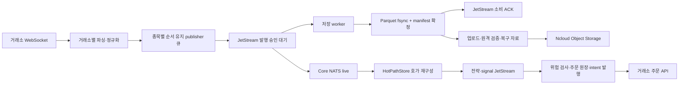
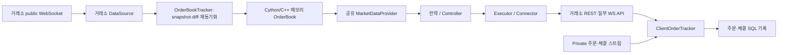
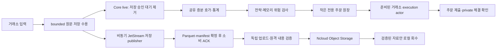

# Hummingbot 구조 비교와 VibeTrading 수정안

작성: 2026-10-14 KST. 비교 대상은 `E:/hummingbot`의 커밋 `9af100d6822da7d2d0291a906c730ef172284ee2`(2026-09-22), 현재 VibeTrading 작업 디렉터리, 실제 운영 서버다.

**판단: Hummingbot의 메모리 호가·연결 관리·주문 추적 구조를 선별 도입하고, VibeTrading의 JetStream → Parquet → 클라우드 보관은 유지하는 조합을 권한다.** 현재 가장 먼저 바꿀 부분은 데이터 저장 승인을 기다리는 실시간 전달과 전략마다 반복되는 호가 가공이다. NATS 전체 제거 또는 Hummingbot 전체 교체를 먼저 시행할 근거는 부족하다.

코드를 수정·배포하거나 주문을 제출하지 않았다. 실서버 조회, 30초의 수동 Core NATS 구독, 로컬 합성 측정만 수행했다. 본 문서의 수정안과 성능 목표는 아직 구현·검증한 결과가 아니다.

**1. 비교 범위와 실제 운영 상태**

운영 진입점은 [main.py](C:/Users/박제형/Desktop/VibeTrading/main.py:5) → `vibetrading.cli` → `vibetrading.runtime`이다. `services/`·`shared/`의 예전 구성만으로 현재 서버를 판단하지 않았다.

2026-10-14 00:06–00:14 KST에 기존 SSH 접속으로 운영 서버를 읽었다. 코드 파일 SHA256, 이미지 ID, 비밀값을 제외한 설정, NATS API, 기존 heartbeat를 확인했다.

| 항목 | 현재 확인 결과 | 판단에 주는 의미 |
|---|---|---|
| 서버 | CPU 2개, RAM 4,105,048,064 B(약 3.82GiB), swap 약 4GiB | CPU·메모리 여유를 아끼는 설계가 필요 |
| 실제 코인 범위 | Binance·Arcus·GRVT, 각 BTC/ETH/SOL | 현재는 3거래소·9시장. 중단된 Bybit·Bitget을 활성 부하에 포함하지 않음 |
| 수집 프로세스 | 거래소별 1개, 각 RSS가 아닌 Docker memory usage 약 44–70MiB | 우선 합치기보다는 공통 처리의 중복을 줄이는 편이 타당 |
| NATS | v2.10.29, 단일 replica, FILE | 같은 서버 장애를 견디는 다중 서버 구성은 아님 |
| CRYPTO_DATA | WorkQueue, DiscardNew, 512MiB, MaxAge=0 | 장기 보관이 아니라 저장 완료 전의 대기 큐 |
| MARKET_DATA / OPERATIONS | 각각 1GiB WorkQueue / 64MiB Limits | 시세 저장과 운영 이벤트를 분리함 |
| 실제 NATS 파일 한도 | `max_file_store: 2560MB`, `sync_interval: 1s` | 로컬 `deploy/nats.conf`의 2304MiB와 다름 |
| 코인 저장 | compact delivery + immutable-runs-v1, 128MiB 조회 필터, SQLite cache 64MiB | 과거 이벤트별 큰 B-tree 쓰기 문제의 대체 구조가 이미 적용됨 |
| 파일 저장 | pending 8,192건 / buffer 32MiB / storage age 60초, Arrow batch 2,048행 | Parquet 설정의 900초·16MiB만으로 실제 flush 주기를 판단하면 안 됨 |
| 클라우드 보관 | 별도 crypto-maintenance, 업로드 대기 60초, 로컬 보관 1,800초, compaction 0 | 저장·업로드·삭제가 별도 생명주기로 작동 |

00:06의 CRYPTO_DATA는 미전달 0, ACK 대기 5,758건, 재전달 0이었다. 이후 조회에서 잔량은 4,391건과 3,649건으로 감소했다. **ACK 대기를 곧바로 저장 실패나 처리 불능으로 해석하면 안 된다.** 아직 파일 확정을 기다리는 정상 배치도 포함한다.

00:12의 최근 maintenance heartbeat는 파일 8개 업로드, 로컬 12개/약 4.61MB 회수, delivery 14,269개 정리, 주기 3.252초를 기록했다. 이 조회에서 클라우드 이전이 진행 중임을 확인했다. 전체 원격 데이터의 장기 무결성을 이번에 새로 검사한 것은 아니다.

CPU pressure `some avg60`는 34.48%, I/O pressure `full avg60`는 0.69%였다. 두 번의 Docker 표본에서 crypto-storage CPU는 약 31–37%, Arcus collector는 약 14–23%, NATS는 약 10–12%, monitor-bridge는 약 17–21%였다. Docker CPU 100%는 한 코어 기준이다. crypto-storage의 Docker memory usage는 약 970MiB, 별도 heartbeat RSS는 약 660MiB였다. 측정 방식과 시점이 다르므로 같은 값으로 취급하지 않는다.

이 구간은 국내 장중 최대 부하를 포함하지 않는다. 서버 CPU 여유가 넉넉하다는 근거도, NATS가 현재 CPU 병목의 주원인이라는 근거도 아니다. monitor-timefolio의 Docker PIDs 4,610은 스레드를 포함하는 태스크 수로, 누수 판정 없이 별도 조사할 만한 관측이다.

운영 이미지가 역할별로 다르다. 코인 maintenance에는 cleanup 조회 시간 초과 후 업로드를 계속하는 수정이 이미 있고, collector에는 초 단위 발행량 집계가 이미 있다. 로컬의 업로드 후보 partial index 두 개는 maintenance 이미지 코드에 없다. 실제 DB에 이미 생성됐는지는 이번 조회에서 확인하지 않았다. 따라서 “이미 해결된 문제의 재구현”과 “아직 배포본에 없는 개선”을 구분해야 한다.

근거: [서버 표본](C:/Users/박제형/Desktop/VibeTrading/docs/evidence/hummingbot_structure_review_20261014/server_snapshot.json), [실효 설정·이미지·소스 해시](C:/Users/박제형/Desktop/VibeTrading/docs/evidence/hummingbot_structure_review_20261014/server_config.json), [heartbeat](C:/Users/박제형/Desktop/VibeTrading/docs/evidence/hummingbot_structure_review_20261014/server_health.json), [배포본과 로컬의 차이](C:/Users/박제형/Desktop/VibeTrading/docs/evidence/hummingbot_structure_review_20261014/deployed_vs_local.diff).

**2. 두 코드베이스의 실제 경로**

현재 VibeTrading의 공통 코인 경로는 다음과 같다.

마지막 전략·주문 경로는 공통 `LiveStrategyRunner`·`RealExecutionRunner`의 구현 경로다. **현재 운영에서 모든 코인 전략이 이 경로로 실제 매매 중이라는 의미는 아니다.** 코인 설정의 strategies는 비어 있고, 별도의 `fv_mm`·`liquidity_mm` 실험 runner는 직접 거래소 연결을 사용하는 경로도 있다. 국내 ETF 모의매매는 별도 runner다.

핵심 코드 근거:

- [runtime.py](C:/Users/박제형/Desktop/VibeTrading/vibetrading/runtime.py:303): bounded publisher 사용. 4 shard, 기본 queued 128개/64MiB로 같은 종목 순서를 유지한다. 각 shard worker는 JetStream 왕복을 하나씩 기다린다.
- [bus.py](C:/Users/박제형/Desktop/VibeTrading/vibetrading/bus.py:464): `await _publish()` 다음에 `live.*` 전달. Parquet 완료를 기다리지는 않지만 JetStream 승인은 기다린다.
- [strategy_runner.py](C:/Users/박제형/Desktop/VibeTrading/vibetrading/strategy_runner.py:53): JSON → 이벤트 모델 → 호가 적용 → 전략 → signal 발행을 직렬로 처리한다.
- [real_runner.py](C:/Users/박제형/Desktop/VibeTrading/vibetrading/real_runner.py:109): intent 생성·원장 저장·버스 발행 뒤 broker 연결·제출. 다른 주문이 API 응답을 기다리는 동안 같은 소비 루프도 대기한다.
- [storage_worker.py](C:/Users/박제형/Desktop/VibeTrading/vibetrading/storage_worker.py:42), [parquet_store.py](C:/Users/박제형/Desktop/VibeTrading/vibetrading/parquet_store.py:167): 별도 thread에서 파일 확정과 manifest transaction을 수행한 뒤 ACK한다. 이미 구현된 좋은 분리다.

Hummingbot은 대체로 다음 구조다.

주요 디렉터리는 `connector/`(거래소별 public/private·인증·주문), `core/data_type/` 및 `core/cpp/`(호가·이벤트·주문 상태), `core/web_assistant/`·`core/api_throttler/`(연결·호출 제한), `data_feed/`(공유 시장 데이터·봉), `strategy/`·`strategy_v2/`(전략·Controller·Executor), `model/`(SQL 기록), `client/`·`cli/`(운영 인터페이스)다.

Hummingbot의 호가는 [order_book.pyx](E:/hummingbot/hummingbot/core/data_type/order_book.pyx:59)의 정렬된 C++ set에서 변경 가격만 갱신하고 best bid/ask를 캐시한다. [OrderBookTracker](E:/hummingbot/hummingbot/core/data_type/order_book_tracker.py:634)는 snapshot과 최근 diff를 이어 적용한다. [MarketDataProvider](E:/hummingbot/hummingbot/data_feed/market_data_provider.py:384)는 여러 전략에 같은 connector의 호가를 제공한다.

다만 SQL 시세 저장은 별도 성격이다. [MarketsRecorder](E:/hummingbot/hummingbot/connector/markets_recorder.py:124)는 설정 주기마다 호가 일부를 기록한다. [기본 설정](E:/hummingbot/hummingbot/client/config/client_config_map.py:94)은 수집 비활성, 60초 주기, depth 20이다. **이것은 현재 서버가 보관하는 정규화 이벤트·호가 증분·호가 raw_payload를 대체하지 못한다.** Binance의 현재 구독은 aggTrade이므로 “현재 서버가 거래소의 개별 모든 체결을 받는다”는 주장도 하지 않는다. 모든 WebSocket wire frame의 모든 필드가 보존된다고 검증한 것도 아니다. 수정 시 현행 보존 범위를 축소하지 않는 것을 기준으로 삼는다.

**3. 두 효율 기준에 대한 판단**

| 비교 항목 | VibeTrading | Hummingbot | 판단 |
|---|---|---|---|
| 호가 갱신의 연산량 | 매 update마다 dict 전체 정렬, top 50 모델 재생성 | 정렬된 자료구조에 증분 갱신, best price 캐시 | 깊은 호가·빈번한 update에서 Hummingbot 방식이 유리할 구조적 근거 |
| 전략별 상태 공유 | 공통 runner마다 독립 HotPathStore | connector·MarketDataProvider 공유 | 다중 전략에서는 Hummingbot 방식이 유리 |
| 연결 관리 | 수집 연결은 재사용; 일부 주문 adapter는 반복 connect·REST session 생성 | 공유 session/assistant·호출 제한 | 필요한 관리 패턴을 도입할 가치가 큼 |
| 큐의 메모리 제한 | 수신·publisher·storage에 상한이 있음 | 여러 tracker/DataSource 큐가 기본 무제한 asyncio.Queue | 제한된 RAM에서는 현재 상한을 유지해야 함 |
| 원시 데이터 저장·복구 | JetStream, fsync, manifest, 재전달 중복 검사, Parquet, 원격 검증 | 기본 SQL 주문 기록과 주기식 시세 snapshot | 요구된 보관 기준에서는 현재 서버 구조가 더 적합 |
| 데이터 도착→전략 | JetStream 승인과 publisher 대기의 영향을 받음 | 메모리 호가를 읽음 | 현재 연결을 풀면 tail 지연 감소를 기대할 수 있음 |
| 전략 실행 시점 | 공통 runner는 이벤트마다 실행 | V2 Controller 기본 1초, Executor 기본 0.5초, Clock 기본 1초 | Hummingbot 전체를 옮기면 오히려 판단 주기가 느려질 수 있음 |
| 실제 주문 응답·체결 | 일부 시험 자료만 존재 | 이번에 동일 서버·입력으로 실행하지 않음 | 어느 쪽이 몇 배 빠르다는 실측 판정은 불가능 |

Hummingbot의 default interval은 [ControllerBase](E:/hummingbot/hummingbot/strategy_v2/controllers/controller_base.py:195), [ExecutorBase](E:/hummingbot/hummingbot/strategy_v2/executors/executor_base.py:36), [Clock](E:/hummingbot/hummingbot/core/clock.pyx:24)에서 확인했다. 간격은 설정·전략에 따라 바꿀 수 있으며, 모든 주문이 항상 1초 지연된다는 뜻은 아니다. 주문·체결 이벤트 콜백은 별도로 존재한다. 그러나 “Cython 호가를 쓰므로 기본 전략 실행도 초저지연”이라는 추론은 성립하지 않는다.

00:13:49–00:14:19 KST의 수동 live 관측 결과는 다음과 같다. provider가 기록한 `receive_monotonic_ns`부터 Core NATS 구독자가 메시지를 받은 시점까지다.

| 거래소 | 호가·체결 합산 표본 | p50 / p95 / p99 (ms) | 호가만 p99 (ms) |
|---|---:|---:|---:|
| Binance | 1,586 | 2.59 / 42.11 / 92.35 | 26.69 |
| Arcus | 10,575 | 5.69 / 43.44 / 59.70 | 59.90 |
| GRVT | 568 | 2.23 / 7.63 / 9.65 | 9.65 |

총 12,729개, 약 424.3개/초를 관측했다. Binance 체결만의 p99는 94.01ms였다. GRVT 체결은 이 짧은 표본에 없었다. 합산 p99는 이벤트 구성에 영향을 받으므로 거래소 자체의 속도 우열로 해석하면 안 된다.

이 수치에는 publisher queue, 직렬화, event loop scheduling, JetStream 승인, Core 전달 등이 섞인다. JetStream이 이 지연을 전부 만들었다고 분해 측정한 것은 아니다. 실제 전략·위험 검사·서명·HTTP 송신·거래소 ACK·체결 시간도 포함하지 않는다. NIC 수신 시각부터의 측정도 아니다. [측정 원본](C:/Users/박제형/Desktop/VibeTrading/docs/evidence/hummingbot_structure_review_20261014/live_latency.json).

로컬 Windows/Python 3.10·PyArrow 21의 합성 구성 요소 시험도 수행했다. 한 종목, 양쪽 각 1,000레벨, update마다 한 레벨 변경, 5,000 update다.

| 항목 | 결과 | 의미 |
|---|---:|---|
| 현행 호가 apply, snapshot 512개 유지 | p50 147.5μs / p99 309.4μs | 정렬·모델 생성 비용의 로컬 표본 |
| snapshot 1개 유지 | p50 145.4μs / p99 323.1μs | 보관 수 축소만으로 연산 속도가 개선됐다고 판정할 수 없음 |
| Python 추적 잔존 메모리, 512개 / 1개 | 28,405,100 B / 341,028 B | 약 27.09MiB / 0.33MiB. 깊은 snapshot 반복 보관 비용이 큼 |
| Arrow 호가 schema 매번 생성 | 반복당 중앙값 약 83.1μs | schema 캐시의 명확한 제거 가능 작업 |
| 작은 delta JSON / 2,000레벨 snapshot JSON | 약 12.1μs / 1,535.0μs | 같은 객체를 여러 번 직렬화할수록 불필요한 연산이 추가됨 |

이 시험은 Hummingbot과의 성능 경주가 아니며 Linux 운영 수치를 예측하지 않는다. snapshot 보관 수 축소는 구성 요소 실험일 뿐, 전략이 그 이력을 요구하면 그대로 적용할 수 없다. 현재 운영 crypto-storage의 높은 메모리를 이 HotPathStore가 만든다고 주장하지도 않는다. [재현 스크립트](C:/Users/박제형/Desktop/VibeTrading/docs/evidence/hummingbot_structure_review_20261014/benchmark_local.py), [결과](C:/Users/박제형/Desktop/VibeTrading/docs/evidence/hummingbot_structure_review_20261014/local_component_benchmark.json).

**4. NATS 저장 구조는 적절한가**

**현재의 ‘저장 완료 전 재전달 가능한 단기 큐’ 역할에는 적절하다. 주문 판단의 필수 경유 승인점으로 사용하는 부분은 수정할 가치가 있다.**

WorkQueue는 소비 ACK 후 메시지를 제거한다. 현재 worker는 Parquet 파일·디렉터리 fsync와 manifest/delivery transaction 뒤 ACK한다. 장기 데이터는 Parquet와 클라우드에 남는다. 전략이 같은 WorkQueue에 붙으면 메시지 삭제와 소비 권한이 섞이므로, 현재 별도의 Core live 전달은 올바른 방향이다. [NATS retention 공식 문서](https://docs.nats.io/learn/jetstream/retention-policies).

이 설계의 비용은 데이터가 JetStream 파일과 Parquet에 각각 쓰이고, delivery 원장·중복 검사·업로드 관리가 더해진다는 점이다. 대가로 저장 프로세스 중단과 일시적 지연을 흡수한다. 큐를 크게 만드는 것은 순간 정체를 흡수할 뿐 지속 처리량을 늘리지 않는다.

권장 구조를 위해 다음을 구분해야 한다.

1. `raw/events` 저장 큐: FILE WorkQueue·DiscardNew·재전달 중복 검사 유지. 미확정 데이터를 용량 때문에 자동으로 버리는 정책은 사용하지 않는다.
2. 실시간 시장 상태: Core NATS 또는 같은 프로세스의 이벤트 전달. JetStream 승인 후에만 내보내는 연결을 제거한다. live 유실은 snapshot 재동기화로 처리한다.
3. 주문 명령·상태: 작은 전용 원장으로 복구하고, 비필수 모니터링 발행은 비동기로 분리한다. raw 저장 ACK를 기다리지 않더라도 주문의 중복 제출 방지는 유지한다.
4. 클라우드 장기 보관: 완성된 Parquet·manifest·복구 자료·필요한 상태 백업을 독립 업로드한다. Object Storage를 JetStream/SQLite의 직접 파일시스템으로 사용하지 않는다.

**빠른 전달과 이벤트별 영구 저장 확인은 별개 계약이다.** live를 저장 ACK보다 먼저 보내면, 직후 프로세스가 죽을 때 아직 메모리에만 있던 데이터는 유실될 수 있다. 현재도 bounded publisher에 ACK 전 메모리 대기가 존재한다. 전달 순서 변경은 “주문에 사용한 이벤트는 언제나 이미 저장됐다”는 보장을 약화시킨다. 영구 저장 확인을 주문의 선행 조건으로 반드시 요구하면, 그 확인 지연을 없앨 수 없다.

또한 실제 `sync_interval=1s`, replica=1은 JetStream publish ACK를 매번 물리 디스크 fsync 완료로 보장하지 않는다. OS/호스트 장애 때 최근 승인 메시지의 유실 가능성이 있다. 1초를 엄격한 최대 유실량 보장으로 간주해서는 안 된다. [NATS 공식 내구성 설명](https://github.com/nats-io/nats.docs/blob/master/nats-concepts/jetstream/README.md).

기본 수정안은 현재 bounded 메모리 대기 정책 안에서 **저장 큐에 원문을 수용한 다음 live로 전달하고, JetStream 발행 승인만 별도 task가 기다리게 하는 것**이다. 큐 수용 실패·publisher 오류·호가 gap·저장 또는 원격 보관 여유 부족 시 신규 주문을 중단한다. 기존 주문의 취소·위험 축소와 저장 drain은 계속할 수 있게 한다. 저장 queue가 포화될 때 무한 메모리 증설 또는 원문 폐기로 대응하지 않는다. 유한 자원에서는 거래소 연결 중단 후 관측 공백이 발생할 수 있으므로 공백을 명시하고 재동기화한다.

NATS 제거는 2차 비교 후보다. 거래소별 하나의 로컬 append-only journal에 원문을 순차 기록하고, 그 journal을 따라 Parquet·클라우드 업로드를 만들면 쓰기 경로를 줄일 가능성이 있다. 하지만 segment commit, fsync, offset, 재시작 재생, 중복 판정, 미완성 frame 복구, 원격 검증 후 회수, 주문과 journal의 연계까지 직접 구현해야 한다. Hummingbot을 가져온다고 이 저장 기능이 생기지는 않는다.

따라서 같은 원문 보존·장애 조건에서 개선된 NATS 구성과 직접 journal을 비교해, NATS가 여전히 CPU/I/O의 지배 비용일 때만 제거한다. 메모리 큐 → 주기적 Parquet만으로 대체하는 것은 같은 복구 조건의 비교가 아니다.

버퍼 용량은 `미확정 원문 유입 byte/s × 허용 저장 중단 시간 × 여유율`로 산정한다. 일부 소비가 계속되면 유입과 확정 처리의 차이를 사용한다. 512MiB를 무조건 유지·증설하지 않고 원문 byte/s와 피크 분포를 측정해 결정한다. 이번 live 관측의 19.99MB에는 durable 원문의 raw_payload 등이 빠져 있으므로 이 값으로 JetStream 장애 흡수 시간을 계산하면 안 된다.

**5. Hummingbot에서 가져올 부분과 서버 수정 지점**

| 우선순위 | 가져올 구조·근거 | VibeTrading 적용 | 효율 효과와 조건 |
|---|---|---|---|
| 1 | 공유 connector·[MarketDataProvider](E:/hummingbot/hummingbot/data_feed/market_data_provider.py:38) | `hot_path.py`, `strategy_runner.py`: 시장별 호가를 한 번 가공해 여러 전략에 동일 version으로 제공 | 전략 수에 비례하는 재구성·이력 복제 줄임 |
| 1 | 네트워크 수신과 메모리 시장 상태의 분리 | `bus.py`, `runtime.py`: 원문 저장 수용과 live 전달 분리, 별도 bounded 저장 publisher | JetStream 발행 왕복이 실시간 판단을 직접 막는 경로 제거 |
| 2 | C++ 정렬 호가·best cache, [order_book.pyx](E:/hummingbot/hummingbot/core/data_type/order_book.pyx:59) | `HotPathStore._apply_crypto_book`: 매번 전체 sort·top 50 객체 생성 대신 증분 ordered book, best/VWAP/imbalance 캐시 | 변경 레벨 수에 맞춘 처리. 실제 profile 후 native kernel 선택 |
| 2 | [ConnectionsFactory](E:/hummingbot/hummingbot/core/web_assistant/connections/connections_factory.py:14)·WebAssistantsFactory | `brokers.py`, `kis_execution.py`, `extended_brokers.py`: 지속 session, 시작 전 인증·종목 규칙 준비, 비동기 갱신 | 반복 연결·metadata 조회가 주문 직전 경로에 들어오는 일을 줄임 |
| 2 | [AsyncThrottler](E:/hummingbot/hummingbot/core/api_throttler/async_throttler.py:54)와 linked limit | 거래소·계정·공유 IP 단위 호출 예산, bounded 주문 dispatcher, 취소 여유, 대기 중 intent 만료 확인 | 과도한 병렬화·429·오래된 주문 방지. 서버 허용량 자체를 늘리지는 않음 |
| 3 | [ClientOrderTracker](E:/hummingbot/hummingbot/connector/client_order_tracker.py:143), InFlightOrder, private stream | `execution.py`, `real_runner.py`: 공통 주문 상태 머신, 체결 ID 중복 처리, REST reconciliation | HTTP ACK 대기와 체결 추적을 분리하고 타임아웃 재주문 위험 감소 |
| 3 | 전략과 주문 생명주기를 나누는 Executor 패턴 | 위험 검사 후 거래소별 execution actor가 명령 수신·제출·취소·부분 체결 관리 | 한 주문 응답 대기가 다른 거래소의 상태 갱신과 전략 판단을 막지 않음 |

구체적인 구현 방향은 다음과 같다.

- **시장 상태의 단일 소유자:** 하나의 fast runtime이 거래소별·종목별 book version을 소유하고 전략에 읽기 view를 준다. 현재 거래소별 collector 프로세스는 우선 유지한다. collector 3개를 합치는 작업은 장애 영향과 실제 메모리 절약을 먼저 비교한 뒤 결정한다. cross-exchange 전략은 공유 runtime에서 같은 상태 version을 읽는다.
- **필요한 상태만 보관:** 최신 호가와 전략에 필요한 통계 window를 분리한다. 기본 512개의 완성된 depth-50 Pydantic snapshot을 모든 전략이 보관하도록 하지 않는다. 필요한 전략은 timestamp·mid·spread·depth 지표 또는 delta window를 요청한다. 원시 보관 데이터는 줄이지 않는다.
- **호가 kernel은 독립 모듈로 차출:** Hummingbot Cython 모듈 전체는 PubSub·C++ 타입·빌드 의존성을 끌어온다. 우선 알고리즘·인터페이스를 차용하고, CPU profile에서 호가가 지배적일 때 작은 native kernel을 분리한다. Hummingbot `OrderBookEntry`는 double을 사용하므로 현재 Decimal을 무조건 바꾸지 않는다. 가격·수량의 integer tick/lot 단위를 검증하고 주문 경계에서 정확한 단위 변환을 유지한다.
- **거래소별 동기화 규칙 유지:** snapshot → 최초 연결 diff → 정상 diff chain, generation 변경, 재접속 gap, stale book 차단을 유지한다. Binance의 `pu` 규칙과 Arcus·GRVT sequence 규칙을 공통 `id+1`로 통일하지 않는다. Hummingbot의 교차 호가 overlap 제거를 그대로 복사해 동기화 오류를 숨기지 않는다.
- **주문 직전 준비 제거:** `RealExecutionRunner`의 매 intent `broker.connect()`를 readiness 확인으로 바꾸고, 시작할 때 연결·인증·규칙·private 구독을 준비한다. Arcus/GRVT의 현재 connect는 REST metadata/auth 작업이 있어 반복 호출 비용이 있다. 다만 Arcus/GRVT 주문 제출 자체는 이미 지속 WS RPC다. 기존 구현을 “모든 주문마다 REST 연결”이라고 해석하지 않는다.
- **내부 명령은 빠르게, 복구 원장은 작게:** 전략 → 메모리 위험 검사 → 작은 전용 주문 원장 확정 → execution actor 제출. signal/intent의 모니터링용 JetStream 왕복은 이 경로에서 분리한다. process가 다르면 journal에 확정한 명령을 Core로 알리되, 알림 유실 때 journal에서 미제출 명령을 복구한다. 결정적 client ID와 unique intent 제약을 유지한다. 체결 여부가 불명확한 제출 타임아웃은 UNKNOWN으로 두고 조회해 해소한다.
- **HTTP/WS ACK의 의미 유지:** Hummingbot `buy/sell()`은 client ID를 반환하고 실제 제출 task를 예약한다. 함수 반환 시간을 거래소 접수 시간으로 비교하면 안 된다. 상태는 접수·부분 체결·체결·취소 요청·취소 확정·거절·UNKNOWN을 구분한다. private event와 REST 결과의 역전 도착도 처리한다.

다음은 함께 시행할 자체 최적화다. Hummingbot에 없는 저장 요구를 지키면서 공통 비용을 줄인다.

1. `bus.py`의 publisher 크기 측정, readiness 계측, durable publish에 동일 직렬화 bytes를 재사용한다. 호가 live view는 raw_payload 없이 필요할 때 한 번만 만든다. 종목의 shard 해시도 캐시한다. immutable envelope에 객체와 bytes·길이를 함께 두되 queued bytes와 in-flight bytes를 모두 예산에 포함한다.
2. `parquet_store.py::_schema`와 schema field name 목록을 event type별로 캐시한다. 데이터 형식 변경 없이 반복 Arrow schema 생성부터 제거한다.
3. pending 수·시간·메모리 등 flush 원인을 계측하고, **작은 파일을 만드는 지배 조건만** 조절한다. 현재 partition은 event type/date/provider/venue이고 종목별 9개의 파일로 나뉘는 구조가 아니다. 낮은 빈도의 funding/OI도 최대 대기 시간과 ACK floor 진행을 보장한다. 큰 파일을 위해 RAM 한도나 원격 이전 기한을 넘기지 않는다.
4. immutable event run·정확 조회·confirmed ACK floor·recovery 원격 검증은 유지한다. Bloom 성격의 음성 필터를 정확 판정의 대체로 쓰거나 delivery 원장을 단순 TTL 삭제하지 않는다. 오래된 B-tree 병목을 다시 처음부터 수정할 계획으로 만들지 않는다.
5. metadata 후보 조회의 partial index와 bounded query를 실제 배포본·DB schema에 맞춰 검증한다. 업로드·로컬 회수·백업·compaction은 각각 진행 상태와 자원 예산을 갖게 한다. 이미 maintenance에 있는 timeout 분리 수정을 중복 구현하지 않는다.
6. monitor-bridge의 상태 발행 주기·전체 조회·thread/task 개수를 측정하고 조절한다. 거래소 입력과 주문 actor에 쓸 CPU를 모니터링이 과도하게 소비하지 않게 한다. 이번 표본만으로 강제 서비스 중단 또는 CPU 제한값을 정하지 않는다.

**6. 클라우드 이전은 다음 구조로 유지한다**

원격 단위는 완료된 Parquet 객체와 manifest다. 복구용 event/delivery 정보와 필요한 원장 백업도 이전한다. 업로드 확인 후 로컬을 회수하는 순서는 현재대로 유지한다. 현재의 정규화 이벤트와 호가 raw_payload를 유지하고, 메모리 전략용 축약 view와 구분한다. 체결을 포함한 모든 wire frame의 완전한 원문 저장까지 요구한다면 별도 수집 범위 확대이며, 그 추가 byte/CPU 예산도 검증해야 한다.

[Ncloud backend](C:/Users/박제형/Desktop/VibeTrading/vibetrading/storage_backend.py:118)는 PUT 뒤 HEAD와 전체 GET을 수행해 파일 크기와 SHA256을 확인한다. 따라서 원격 검증은 메타데이터 문자열만 확인하는 방식보다 강하지만 업로드 데이터의 재다운로드·hash CPU 비용이 있다. sidecar와 recovery에도 요청 비용이 있다.

첫 개선에서는 이 내용 검증을 유지한다. 이를 줄이는 후속안은 실제 endpoint의 서버 계산 checksum 지원과 multipart·암호화 조건을 검증한 뒤 평가한다. 직접 넣은 `Metadata.sha256`의 재조회는 원격 내용 검증의 대체가 아니다. 검증하지 않은 ETag=SHA256 가정도 사용하지 않는다.

업로드 worker는 제한된 수의 파일과 bytes를 처리하고, 장애 중에도 이미 원격 검증된 로컬 파일 회수를 진행한다. 기존 `TransferConfig(use_threads=False)`는 제한된 서버의 과도한 thread 확장을 막는 선택이다. 무조건 upload concurrency를 늘리기보다 upload byte/s, 최고 미보관 파일 나이, 복구 후 backlog 감소율을 비교한다.

압축·backups·compaction·upload는 fast runtime과 다른 프로세스에서 실행하고 CPU·메모리·I/O 여유에 맞춰 조절한다. 같은 볼륨에서 directory만 나누는 것은 물리 I/O 격리가 아니다. Object Storage 장애를 흡수할 로컬 여유와 최대 미보관 시간도 독립적으로 관리한다. NATS를 없애더라도 이 보관·검증·회수 생명주기는 필수로 남는다.

**7. 변경 순서와 완료 판정**

| 순서 | 작업 | 완료 조건 |
|---|---|---|
| A | 배포 역할별 source/config 기준 고정, timestamp 계측, schema·직렬화 재사용 | 원문·event ID·Parquet 논리 내용 동일, CPU/event와 queue age 변화 측정 |
| B | 공유 시장 상태, 최신 호가 보관, 증분 kernel 후보 | 현재 book·gap·reconnect 결과와 동일, 메모리 및 update p99 비교 |
| C | 저장 ACK와 live 분리, event 기반 fast runtime | 수신→판단·수신→송신 tail 감소, 큐 포화 시 주문 중단·원문 복구 검증 |
| D | 준비된 connector·호출 예산·공통 주문 tracker | partial fill·cancel·UNKNOWN·재시작·private 재연결 시 중복 주문 없음 |
| E | 저장·업로드·원장 정리의 장기 처리량 조절 | 피크 이후 backlog 회복, 원격 검증 집합 일치, OOM·무단 폐기 없음 |
| F | 필요할 때만 JetStream 대 직접 journal 비교 | 같은 입력·동일 내구성·동일 클라우드 보관에서 CPU/I/O·복구 비교 |

시험은 같은 실제 입력 trace, 같은 종목·depth, 동일한 2CPU/약 4GiB 제한으로 기존과 후보를 비교한다. 초당 평균만 보지 않고 다음을 분리한다.

- CPU-ms/frame·CPU-ms/event, RSS/cgroup·최고 메모리, durable 쓰기 byte/event, fsync·commit p95/p99, 큐의 가장 오래된 이벤트 나이.
- `receive → parse → book apply → decision → risk/journal → sign → socket send → exchange ACK → private fill`의 단조 시계 구간. 여러 단계의 p99를 더해 전체 p99라고 하지 않는다.
- 정상 부하와 2배·짧은 burst 입력 후 회복, 국내 장중과 코인 동시 부하, 원격 업로드 중단 후 회복.
- storage kill/restart·JetStream 재전달·live 유실·sequence gap·ACK 유실·PUT 성공 후 로컬 상태 기록 전 종료를 주입한 복구. 명령 제출 응답 유실은 client ID 조회로 해소.
- 저장 파일·manifest·delivery·원격 자료의 논리 event 집합과 내용 해시. 단순 건수 일치는 데이터 무결성의 충분한 증거가 아니다.

시작점으로 목표를 잡는다면, 부하 시험에서 내부 `receive → socket send` p99 10ms 이하를 후보 목표로 두고 전략 주기에 맞춰 확정한다. 이것은 달성 실측도, 거래소 ACK·체결까지 10ms라는 의미도 아니다. archive backlog가 줄지 않거나 원시 자료가 누락되면 주문 경로만 빨라져도 성공으로 판정하지 않는다.

Hummingbot 코드를 실제 복사하는 경우 Apache-2.0 원문 license와 필요한 attribution/notice를 유지하고, 차출 commit과 수정 내용을 기록한다. 이번 제안의 1차 범위는 구조·알고리즘 도입이며, Hummingbot 전체 의존성·CLI·Controller 주기·기본 recorder를 가져오는 작업은 포함하지 않는다.

현 시점의 최우선 구현 범위는 **직렬화/schema 재사용 → 공유 호가 상태 → 저장 승인과 live 분리 → connector 준비·주문 tracker**다. 장기 보관은 기존 Parquet·클라우드 검증 경로로 이어간다. 어느 단계가 실제 자원 절감과 주문 송신 지연 개선을 만들었는지 각각 검증한 뒤 다음 단계로 진행한다.
