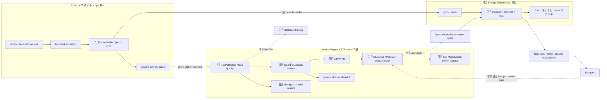

# vNext 02 — 아키텍처 검토와 추천

상태: **분석 완료 / 구현·운영 미승인 설계안**. 기준선·실측 시각은 [01](01_current_state_delta.md). 아래 평균·분위수·경제 효과는 새 측정 없이 수치화하지 않는다.

## 1. 기존 구조의 장점과 실제 실패 경계

이미 있는 JSON packet, bounded spool/UDS, shared HotPathStore, ETF journal/permit, Parquet manifest/remote proof, Telegram inbox/outbox를 재사용한다. Collector별 spool writer thread와 별도 storage 프로세스는 Arrow/압축을 engine loop 밖에 둔다. APPENDED/DURABLE/APPLIED와 consumer progress는 서로 다른 사실이므로 하나의 ACK로 합치지 않는다.

| 근거(현재 파일의 줄) | 확인된 동작 | 영향과 판단 |
|---|---|---|
| `local_pipeline.py:157,167` publish/admission, `:184` persist, `:199,205,218` writer | RAM admission 반환 → group 대기 → append/flush → try_send | durable-first이며 fsync tail이 receive→apply에 포함. 단순히 send 위치를 옮기면 복구 계약 파괴 |
| `local_pipeline.py:228–249` ACK | 순서·digest가 맞는 APPLIED까지 RAM 소유 유지. send/ACK 실패가 invalid latch | Engine/UDS 중단이 이후 Collector admission을 막음. “별도 프로세스”만으로 독립 수신은 성립하지 않음 |
| `local_engine.py:153–168,271,419–428` | producer별 mode가 있으나 `_source_error`·`_flush`·all-LIVE gate가 전역 | 한 feed 문제로 unrelated 전략 입력도 중단. `_discarded`가 있으므로 완전히 숨긴 drop은 아니지만 정상 feed 전달 보장은 아님 |
| `local_engine.py:389–402` on_frame | queue inadmissible이어도 healthy 상태 apply/APPLIED가 진행될 수 있음 | APPLIED cursor만으로 strategy-delivered를 증명하지 못함 |
| `local_runtime.py:110–135` replay_startup | C=0…H, state-only; `verified_checkpoint=True`는 0 anchor | 저장된 full-state checkpoint를 읽는 구현이 아님. producer별 재생 순서가 과거 cross-feed 결정 순서 증명은 아님 |
| `local_runtime.py:138–169` restore_etf_startup | 당일 state-only bar, cross-producer 상충 OHLCV 거절 | 기존 인과성/무주문 복원 보존. 과거 15/252일 warmup을 대체하지 않음 |
| `market_spool.py:126,154,220,255,703` | prefix 1부터 scan, GC 거절 | min ACK 이하 unlink만 추가하면 다음 부팅/reader 검증을 깨뜨림 |
| `local_storage.py:327–342,371–378,458–465` | cursor 재검증, Parquet coverage 후 facts/progress 확정; worker 오류 전역 | downstream 분리 장점 유지. 한 source 손상으로 storage 모든 lane이 멈추는 범위는 추가 축소 대상 |
| `local_snapshot.py:74–121,146` | UI용 visible depth/trade tail, all-feed health, non-durable atomic replace | 복구 checkpoint로 사용 불가; UI에서 무관 feed book까지 invalid 처리하는 부분 수정 |
| `local_runtime.py:173–176,195` | observation spool의 on_invalid도 전체 ETF quote invalid callback에 연결 | 권위 원장 오류와 비권위 알림 보관 오류를 구분해야 함. 관측 gap은 노출·재투영하고, 단순 알림 장애를 시장 데이터 손상으로 바꾸지 않음 |

현재의 소스/가상 시험에서 위 동작을 확인했으며, 현재 운영 장애의 원인이라고 소급 단정하지 않는다.

## 2. A1 / A2 / A3 비교

지연 경로를 `receive → normalize/encode → admission → batch wait → append/group fsync → UDS decode → state apply → strategy decision → intent COMMIT → adapter handoff`로 분해한다. provider의 wire decode와 engine의 normalized decode를 별도 센다. JSON 한 번 생성은 IPC/파일/Arrow가 모두 zero-copy라는 뜻이 아니다.

| 비교 | A1 Durable-first | A2 독립 Hot/Cold | A3 feed 정책 Hybrid |
|---|---|---|---|
| live 전달 | 성공한 group flush 뒤 | bounded live admission과 기록 큐를 분기; 시세 sync를 기다리지 않음 | 동일 feed의 한 고정 정책으로 A1 또는 A2 선택 |
| 평균·p95/p99/p99.9 | batch wait+fsync가 포함. 현재 값 **NOT_MEASURED** | 저장 대기 제거 가능하나 CPU 경합/큐/IPC tail은 남음. 개선율 **NOT_MEASURED** | 다른 정책 혼합 시 fairness/tail을 feed별 측정. 평균 합산 금지 |
| CPU/copy | immutable bytes 1회 생성 재사용. spool/transport/digest/engine decode/Arrow 비용 잔존 | bytes 재사용 가능하나 두 lane bookkeeping·ACK·lag/quality 관리 증가 | 코드 복제 없이 feed policy 한 곳에서 선택해야 함. 분기·시험 행렬 증가 |
| RAM/I/O | APPLIED까지 payload 소유; IPC 장애에 RAM이 묶임. fsync I/O | 두 bounded lane 및 durable lag 추적. I/O 양 자체 감소 보장 없음 | 전체 상한은 두 정책 동시 peak까지 포함 |
| crash 손실 | DURABLE 이전 RAM suffix는 손실 가능. DURABLE 이후는 spool proof 범위에서 복구 | LIVE_ONLY/APPENDED suffix가 판단에 사용될 수 있음. 마지막 검증된 durable cursor 이후가 손실 범위 | 정책/producer incarnation별 RPO를 노출. 이벤트마다 임의 전환 금지 |
| IPC 중단 | 현재 publisher invalid; 제안은 spool 수신 지속+disk catch-up | cold lane 유지, live-invalid/gate; reconnect 전 LIVE 금지 | 동일 복구 규칙 공유 |
| spool/fsync/ENOSPC | 해당 storage quality invalid, 신규 위험 차단. ingress도 실제 저장 한계에서 거절 | live state 관측은 가능하나 신규 위험은 storage integrity 계약대로 차단. 허용 기간을 임의 늘리지 않음 | data class별 필요한 내구성 정의가 먼저 |
| queue full | 유한 admission 실패와 affected range 기록 | 어느 lane 실패인지 노출. delta/trade drop/coalesce 금지 | 두 lane 최대 byte/record/frame/age/inflight를 각각 검증 |
| evidence/replay | producer durable cursor ≥ 전달 cursor. engine apply는 별도 | producer admitted/live/durable와 engine apply vector 모두 필요 | evidence에 policy version 포함; 과거 prefix를 소급 주문으로 재생하지 않음 |
| MM 경제 효과 | 낮은 복잡도. stale quote cost를 실측해야 평가 가능 | stale/adverse selection 개선 가능성은 있으나 fill/fee/queue position 자료 없음 | 실제 crypto 이득이 비용을 넘을 때만 선택할 가치 |

**추천: 첫 운영 후보는 A1을 유지하고 장애 격리·재접속·복원·상한을 먼저 보완한다.** 고정 batch sleep은 계측 후 deadline/item/byte 기반 gather로 줄인다. A1의 group sync는 시세 전달 순서이며 주문마다 모든 시세를 sync하는 Policy B가 아니다. 주문은 C01 Policy A를 그대로 유지한다.

A2/A3는 이번에 기본값으로 도입하지 않는다. 동일 trace/hardware에서 A1이 승인 latency/TTL을 충족하지 못하고, 원인이 storage wait이며, 전체 CPU/RAM/복구 gate를 유지하면서 tail과 경제적 효용이 개선될 때 **별도 결정**한다. Crypto와 KR의 최종 정책이 같아야 한다는 전제는 두지 않는다. KR은 정확한 이력·가용시각이 우선이고, Crypto는 stale·native bridge·짧은 window가 우선이다.

### A2/A3를 나중에 채택할 경우 반드시 필요한 완결 계약

1. fork 전에 한 번 `(producer,incarnation,ingress_seq,payload_digest,policy_version)`를 부여한다. RAM 수용/APPENDED/DURABLE/ENGINE_APPLIED/STRATEGY_DELIVERED를 혼동하지 않는다. v2 event payload는 유지하고 내부 frame/원장 evidence에서 표현한다.
2. 같은 bytes를 bounded live/storage lane이 소유한다. 누락/다른 digest/연속성 실패는 affected range와 quality를 latch한다. 저장 성공 이전에는 LIVE_ONLY 또는 APPENDED이며 복구 가능하다고 표시하지 않는다.
3. live delivery가 durable watermark보다 앞서면 DecisionEvidence에 입력 cursor/version, 당시 persistence 상태 및 필요한 값이 남는다. 주문의 intent/evidence/reservation/client ID/permit COMMIT는 계속 필수. 전체 lookback 복원을 약속하지 않는다.
4. fsync/EIO/ENOSPC·허용 lag 초과 시 affected 신규 위험을 닫고, healthy feed 상태 갱신 및 위험 축소/조회는 기존 검증 규칙대로 처리한다. 실패 통지 lease의 측정 상한이 없으면 신규 위험을 열지 않는다.
5. 재시작은 검증 durable prefix+checkpoint만 사용한다. 잃은 LIVE_ONLY 범위를 명시하며 새 snapshot/window로 준비한다. 과거 판단을 자동 재주문하지 않는다. 복구 전 generation의 pending intent는 재검사한다.
6. 초과 손실 범위·복구 시작점·order evidence 충돌을 시험한 후에만 정책을 바꾼다. `try_send` 한 줄 이동이나 두 개 무한 task로 구현하지 않는다.

## 3. 최종 논리/프로세스 구조

그림의 박스는 모듈이며 컨테이너 수가 아니다. Collector crypto 3개와 국내 기존 역할을 유지하는 것이 기본이다. 새 feed/종목별 프로세스, feature service, control RPC, 브로커, DB 서버는 추가하지 않는다. Engine은 상태를 한 번 적용하고 ETF/generic shadow가 이미 적용된 snapshot을 읽게 한다. generic runner의 `process_event`를 engine 뒤에서 그대로 호출해 두 번 apply하지 않는다.

Execution Owner는 논리적 계좌 권위다. ETF에서는 기존 journal+guard를 사용하고 Mock/Mock2 두 scope를 한 기존 프로세스가 소유할 수 있다. generic Owner의 offline 제한은 실제 adapter별 capability 검증 전 유지한다. 프로세스 내부 lock/DB 경로 lease를 계좌 전체 fencing으로 오해하지 않는다.

## 4. 장애별 허용 작업과 복귀 조건

아래는 **제안 목표**다. 현재 확인된 차이는 §1과 다르다. 모든 지속 수신은 남은 디스크/RAM 예산 이내다.

| 장애 | 계속할 일 | 닫을 신규 위험 | 보존·복구 및 LIVE 복귀 |
|---|---|---|---|
| UDS/Engine 중단 | Collector normalize+spool, 독립 storage | 해당 engine 의존 전략 | RAM APPLIED backlog 대신 durable reader가 bounded 전송. 검증 C/H+native snapshot/window+fresh lease 전 LIVE 금지 |
| Parquet worker 15분 중단 | A1 spool→engine, observation admission | spool 여유/품질이 검증되는 동안만 기존 정책. 무결성 불명 feed는 차단 | durable spool 보존; storage progress 이후 재소비. 900초 backlog/1800초 회복·여유 공간을 실측 |
| Cloud 24시간 중단 | 로컬 spool/Parquet/facts/engine | 데이터/원장 reserve 침범 또는 품질 불명 scope | 원격 VERIFIED를 만들지 않음; 유일본 유지, 복구 후 readback 포함 μ>λ |
| Telegram/dashboard 실패 | 수신/engine/원장/주문, 로컬 control | UI 실패 자체로 새 시장 quality invalid를 만들지 않음 | bounded outbox/스냅샷 오류 표시. full이면 집계/재투영 정책; authoritative ledger에서 회복 |
| spool EIO/fsync 불명 | 다른 producer와 관측 가능한 상태 처리 | 해당 feed 의존 위험 즉시 local gate; 전파 지연은 lease로 제한 | uncertain tail 격리. durable이라 승격하지 않음. ENOSPC 후 무한 수신·무손실은 약속 불가 |
| 시장 이벤트 queue full | 무관 feed 상태 처리와 취소/대조 | 누락된 의존 feed/strategy | discard range/digest·generation 표시; affected snapshot/window resync. silent drop 금지 |
| owner/주문 DB 실패 | Collector·시장 상태·조회 | 해당 계좌 신규 제출 | UNKNOWN/예약 보존. DB 결과 불명에 adapter 호출/재전송 없음 |

feed 식별은 `(provider,instrument,channel/role)`의 의미와 producer↔feed 목록을 명시한다. producer 전체 장애와 한 instrument native gap을 구분한다. dependencies가 불명인 전략은 보수적으로 차단한다. 전역 engine 상태 손상·순서 권위 훼손·계좌 위험 불명은 전역 차단 사유다. control 응답 오류를 queue sentinel로 보내 모든 source를 종료시키는 방식은 쓰지 않는다.

VN03은 시장 feed invalidation과 observation 전달 오류도 구분한다. 주문 증거/예약이 권위 journal에 정상 확정되어 있다면 비권위 보고 경로의 장애만으로 market quality를 invalid로 만들지 않는다. 관측 손실 범위는 기록하고 journal에서 재투영하며, 권위 원장 자체가 불명인 경우는 계좌 신규 위험을 차단한다.

## 5. Checkpoint / Replay / GC의 최소 보완

새 범용 Snapshot Framework 대신 native book+기존 event encoding을 담는 작은 checkpoint codec 하나만 허용하는 안이다. `local_snapshot` UI와 분리하며 checkpoint/reader GC가 검증되기 전에는 `gc_disabled`를 유지한다.

- 한 engine apply 경계에서 immutable copy를 만든다. full bid/ask maps, native final/previous/sync generation/bridge 상태, producer incarnation별 cursor vector+digest, engine apply_seq/버전/clock/config/schema, bounded dedup/fingerprint와 conflict latch, trade/BBO/window, PreparedHistory 및 부족/quality 정보를 포함한다. max levels 등 현 계약을 넘는 보존을 새로 약속하지 않는다.
- engine이 관측한 동일 상태의 cursor vector와 데이터가 같은 checkpoint checksum에 속해야 한다. encode/write는 bounded worker 한 개; tmp→file fsync→rename→directory fsync 후 작은 manifest를 공개한다. 과거 cursor를 최신 state와 결합하지 않는다. 부분 실패면 이전 checkpoint 유지.
- restore는 identity/config/hash/native invariants를 검사한다. 기존 시세의 timestamp를 현재 시각으로 갱신하지 않는다. stale book/만료 window는 준비 불충분. native 재동기화가 필요한 feed는 새 snapshot 후 LIVE.
- checkpoint vector C부터 durable H까지 delta replay, H 이후 bounded handoff와 digest dedup. ETF 당일 bar 복원은 기존 state-only 의미 유지. 15거래일/252일 reference는 경로/hash/as-of·readiness를 재검사한다. 재생 중 신규 주문 0.
- 오래된 spool segment 삭제 전 **base cursor/first retained segment**를 이해하는 inventory/reader migration이 필요하다. checkpoint가 유효해도 아직 Parquet/facts coverage 없는 원본, reader lease/pin, archive 검증, retention, rollback 필요 prefix가 있으면 삭제 0.
- disk/RTO 상한은 측정한 λ·delta 크기·restore 처리율로 정한다. checkpoint 파일/세대/임시본 수와 segment 보존도 유한해야 한다. 상한 초과 시 위험 차단 및 명시 backlog 상태로 남긴다.

## 6. 자체 메시징 책임 정리

| 모듈 | 판정 | 유지/수정 경계 |
|---|---|---|
| `market_spool` | MODIFY | producer 내구성·checksum·base cursor·GC proof. broker 기능을 추가하지 않음 |
| `local_pipeline` | SIMPLIFY | RAM 수용과 durable delivery 소유권 분리. 단일 sync writer와 bounded disk catch-up. APPLIED까지 모든 payload를 잡는 중복 소유 축소 |
| `local_transport` | KEEP + MODIFY | UDS frame/session/UID/ACK 검증 유지, reconnect handshake만 보완 |
| `local_engine` | MODIFY | 한 apply 권위·feed dependencies·전달 cursor. storage ACK 권위는 가져오지 않음 |
| `local_storage` | KEEP + MODIFY | manifest coverage→consumer progress, source별 오류 격리·회수 proof 연결. 두 DB transaction을 하나의 원자 transaction이라고 하지 않음 |
| `local_events` | KEEP | facts RO reader+Telegram ACK checkpoint. 주문/시장 원장으로 합치지 않음 |
| `local_observation` | KEEP | 비권위 관측 admission/spool. 실패가 Collector 종료로 번지지 않도록 caller 경계 시험 |
| `local_snapshot` | KEEP | UI projection. recovery checkpoint와 MERGE하지 않음 |
| `feed_recovery` | SIMPLIFY (후순위) | Cursor/RecoveryFrame 재사용. 미사용 coordinator와 engine의 중복 개념은 참조·시험 확인 후 하나의 권위로 축소; 지금 새로 연결하지 않음 |
| `market_fanout` / `bus.NatsJetStreamBus` | KEEP→REMOVE (P12 조건부) | 운영/rollback/backlog 의존이 있는 동안 보존. NATS-free runtime의 필수 의존으로 남기지 않음 |

모듈 통합(MERGE)을 위한 통합은 제안하지 않는다. durable cursor, engine apply, archive progress, Telegram outbox ACK는 목적이 달라 중복 DB로 오판하면 데이터 회수/보고가 깨진다.

SQLite FULL의 주문 COMMIT 의미와 장기 reader가 WAL checkpoint를 막을 수 있다는 점은 [공식 WAL 문서](https://www.sqlite.org/wal.html), [synchronous 문서](https://www.sqlite.org/pragma.html#pragma_synchronous)에 따른다. directory entry 내구성은 file fsync만으로 확보되지 않는다는 [Linux fsync 계약](https://man7.org/linux/man-pages/man2/fsync.2.html)에 따라 시험한다. 이 계약을 하드웨어 전원 장애 실증으로 대신하지 않는다.
