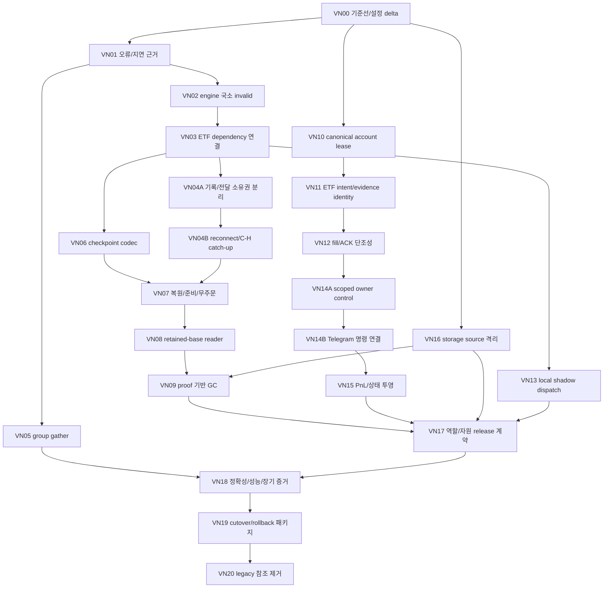

# vNext 04 — 기존 P단계의 증분 실행 계획

상태: **DRAFT / PLAN-ONLY**. 아래는 후속 코드 작업의 설계이며 이번에 실행한 작업이 아니다. 실제 배정 가능한 machine-readable 경계는 [tickets.json](tickets.json)에 있다. 원본 execution_board/tasks/gates는 수정하지 않는다.

## 1. 공통 실행 계약

- 고정 로컬 HEAD `6443eb94133bc0075b0860885829e112adc657c8`, source-set `1b0dbadc…` 및 [source_manifest](source_manifest.json)의 대상별 SHA를 사용한다. hash가 다르면 diff 재검토·재기준화 후 배정한다. 과거 test/서버 후보 before hash를 현재에 덮어씌우지 않는다.
- 모든 티켓은 `read_paths/edit_paths/forbidden_paths`, existing/add 심볼, 선행 티켓·gate, file owner, 독립 reviewer, tests/oracle, rollback을 가진다. 신규 테스트/함수/파일은 **ADD/제안**이며 현재 존재한다고 하지 않는다.
- 제품 편집자는 티켓당 1명. root가 최종 통합·gate 담당. 같은 파일을 공유하는 티켓은 DAG가 병렬이어도 직렬 편집한다. 단순 리뷰는 Luna; 고위험 복구/원장 상태기계는 별도 독립 reviewer가 검토하고 root가 통합한다.
- 기본 금지: `.env*`/secret, `runtime_data/**`, `.git/**`, 과거 evidence/receipt/oracle, 기존 `docs/refactoring/runs/20261018-stage-assignment/**`, 서버/계좌/실주문/메시지/운영 삭제. edit_paths에 없는 제품·전략 파일은 수정 금지. READ_ONLY 티켓의 명시된 과거 증거 read는 허용한다.
- 경제적 계산식, 종목, broker mode, fee, native/Decimal, WAL/FULL, UNKNOWN/예약 보존은 모든 티켓 공통 invariant다. KR 수리 hotfix는 별도 승인 없는 **범위 밖**이다.
- rollback은 티켓 diff의 역패치와 route 비활성화다. `reset/clean/stash`나 과거 live DB 덮어쓰기를 사용하지 않는다. additive DB/포맷 변경은 새 reader의 rollback 호환성을 입증하지 못하면 파일 단위 rollback을 주장하지 않는다.

## 2. 증분 DAG

장기 수동 측정은 VN00 후 병행할 수 있다. 운영 전환은 G00~G12 중 해당 선행 gate 및 G-NATS-FREE를 충족해야 하며, 이 DAG가 기존 gate를 우회하는 것은 아니다. VN20은 실제 전환·안정화·보존 완료 후에만 시작한다.

## 3. 파일·함수와 독립 검증 단위

표의 함수는 **현재 존재**한다. `(ADD)`는 구현할 새 심볼/파일이다. 상세 범위·전체 read/edit 목록은 tickets JSON이 우선한다.

| 티켓 / 기존 단계 | 목표 한 가지 | 제품 수정 또는 ADD | 주요 심볼 | 달성 조건 / 독립 후보 여부 |
|---|---|---|---|---|
| VN00 / P00·P09 | 현재 source/image/config/mount 기준선 재고정 | 제품 수정 없음; 새 run 자료만 ADD | 기존 build_release_manifest.build, metadata collector 참고 | Compose drift 의미 분류·후보 재생성 경로 고정. 문서/조사만 독립 가능 |
| VN01 / P05·P10 | 실패 단계·cursor·대기시간 관측 | MODIFY local_pipeline.py | _invalidate/_writer/_acks/stats | bounded reason/range·durable/apply lag·age. 정상 packet/ACK 순서 불변. 독립 offline/이미지 후보 가능 |
| VN02 / P03·P05 | healthy feed 큐 보존 | MODIFY local_engine.py, local_snapshot.py | _invalidate/_flush/_queue_admissible/event_source; _document | dependent input만 invalid; generation 불일치 처리. 현재 caller 결합 전에는 offline-only |
| VN03 / P03·P06 | ETF dependency gate 연결 | MODIFY local_runtime.py, etf_trading.py | run_engine.invalid, _invalidate_market_feed, event/timer | Crypto gap이 unrelated ETF를 차단하지 않음; ETF 필수 입력 오류는 차단. VN02와 함께 후보 검증 |
| VN04A / P05 | durable 수용과 live 전달 소유권 분리 | MODIFY local_pipeline.py | accept_payload/_persist/_writer/_acks | IPC 단절 중 spool writer 지속, RAM accounting 상한. resume 미완성이라 단독 배포 불가 |
| VN04B / P05·P06 | bounded reconnect+disk catch-up | MODIFY local_pipeline.py, local_transport.py, local_engine.py | connect/request_resume/initial_resume/handoff; (ADD) bounded reconnect loop | verified C/H, digest/epoch 검증, 중복 전략 실행 0. VN04A와 원자 후보 검증 |
| VN05 / P02·P05 | 불필요 fixed wait 제거 | MODIFY local_pipeline.py | _writer | batch full 또는 deadline까지 gather, 성공 flush 전 send=0. 계측 A/B 후 작은 독립 후보 |
| VN06 / P06 | market state/cursor 일관 checkpoint | ADD market_checkpoint.py; MODIFY hot_path.py | (ADD) 좁은 encode/validate/export/restore 함수 | full native book·window·quality·cursor checksum, bounded 파일/worker. codec offline-only |
| VN07 / P06 | checkpoint+delta startup | MODIFY local_runtime.py, local_engine.py | replay_startup/restore_etf_startup/begin_recovery/handoff | bad checkpoint→검증 가능한 retained prefix 또는 closed, stale timestamp 보존, replay 주문0. restore 후보; GC는 계속 금지 |
| VN08 / P06·P07 | prefix 회수 가능한 reader format | MODIFY market_spool.py, local_storage.py | _inventory/scan_spool/SpoolReader._locate_start; _FactLedger/LocalSpoolStorage 시작 검증 | base cursor·first retained segment 인식, v1 read 호환. migration/reader 원자 후보 |
| VN09 / P07 | 증거 기반 segment 회수 | MODIFY market_spool.py, local_storage.py, archive.py | gc_disabled(거절 기본 유지), coverage/progress, ArchiveMaintenance; (ADD) proof planner | checkpoint+Parquet/facts+remote/lease/retention 검증. 우선 copied fixture dry-run; 실제 삭제 별도 권한 |
| VN10 / P04·P09 | DB 경로와 독립된 계좌 독점 | MODIFY process_lease.py, etf_trading.py, execution_ledger.py | ProcessLease.acquire/close, EtfTradingLoop.initialize, ExecutionLedger.__init__ | canonical account/environment binding, 다른 DB경로 동시 owner 차단. 협조 local 범위; legacy fencing 전 운영준비 아님 |
| VN11 / P04 | ETF intent identity 보강 | MODIFY etf_journal.py, etf_trading.py | stage, dispatch_handoff, _submit_staged | guarded evidence 필수, 동일 ID 다른 payload/evidence 거절, commit fail submit0. migration copy 시험 후 독립 후보 |
| VN12 / P04 | ACK/fill/cancel 상태 단조성 | MODIFY etf_journal.py, execution_ledger.py | accepted/apply_status; ExecutionLedger.outcome/apply_fill_once | fill-first→ACK가 terminal/예약을 되돌리지 않음. generic terminal 근거는 capability 없으면 blocked. 경제적 장부 oracle 필수 |
| VN13 / P03·P05 | NATS-free generic shadow composition | MODIFY strategy_runner.py, strategy_contract.py, local_runtime.py | SharedStrategyRunner.prepare/process_event/run; (ADD) 이미 적용된 snapshot 소비 seam | apply 1회, callback I/O0, NATS 생성0, shadow 주문0. 비활성 전략 활성화 금지 |
| VN14A / P04·P08 | scoped durable owner control | MODIFY runtime_control.py, etf_journal.py, etf_trading.py | halt/resume_if_ready; (ADD) ETF command receipt/epoch 적용 | scope resume가 상위 halt를 열지 않음. known account set별 효과·UNKNOWN/취소 진행 분리. UI 없이 먼저 시험 |
| VN14B / P08 | Telegram→owner 명령 연결 | MODIFY telegram.py, local_transport.py, local_runtime.py | _handle/_handle_pending_update; (ADD) 제한된 control frame/owner handler | 기존 UDS control lane 재사용, durable command ID/TTL/allowlist, reply 유실 중복 효과0. 새 RPC service/DB 금지 |
| VN15 / P08·P09 | 읽기 전용 전략 PnL/상태 | MODIFY telegram_trade.py, telegram.py, dashboard/bridge.py | trade_report/summary/_compact_status/run; (ADD) read-only pnl view | valuation/통화/fee/funding/입출금 미확인 표시, actual/assumed/복구 구분. 주문 경로 sync 조회 추가0 |
| VN16 / P07 | storage source 장애 격리 | MODIFY local_storage.py | LocalSpoolStorage.step / 시작 coverage 검증 | 한 손상 source 격리·상한 유지, healthy source 진행; 공통 facts DB/volume 실패는 전역 closed. 독립 offline 후보 가능 |
| VN17 / P09 | 역할별 release·전체 예산 계약 | MODIFY local_config.py, build_release_manifest.py; ADD deploy/local-runtime.yml | CapacityContract.required/verify_evidence, validate 입력, build | 실제 mount/device·λ/μ·전체 peak 예산, exact digest, secret-free render. 배포 파일은 후보만 생성 |
| VN18 / P10 | 현재 후보 전체/장기 증거 | ADD scripts/refactoring/benchmark_vnext.py(작은 trace driver), 신규 run | (ADD) pinned trace A/B entrypoint; 기존 offline/Linux launcher | [05] 행렬. fixture vs production·NOT_RUN 분리. schema/strategy/GC gate 완화0 |
| VN19 / P11 | 실행 가능한 전환·복귀 패키지 | 제품 수정 없음; 새 run cutover/rollback/manifest ADD | 기존 package builder 검증 후 재사용 | 사용자 검토 가능한 command/service/account/digest·최신 원장 보존 복귀. 실행 권한 별도 |
| VN20 / P12 | 실제 무참조 NATS 의존 제거 | MODIFY bus/runtime/market_fanout/requirements/deploy 및 문서, 하위 티켓 분리 | rg caller 확인 후 정확 제거 심볼 고정 | legacy backlog 보관/reader/rollback+안정화 후. 광범위 자동 삭제 티켓으로 dispatch 금지 |

VN12의 generic 상태기계 확장은 실제 terminal/cancel evidence가 필요한 adapter가 확인된 범위만 한다. offline-only generic Owner에 선물·마진을 추가하는 작업이 아니다. VN20의 edit_paths는 최종 참조 조사 전 DRAFT이며 소규모 하위 티켓으로 재고정한다.

## 4. 명령/상태 의미를 구현 전에 고정

제안: `/pause <strategy>`는 새 진입/증액을 막고 기존 검증된 청산·대조를 유지한다. `/halt <scope>`는 owner gate close+epoch durable receipt까지 ACCEPTED, 모든 미해결 전송/주문 대조가 끝나야 COMPLETED다. 포지션 0/자동 flatten을 뜻하지 않는다. `/halt all`은 검증된 현재 account set 전부의 상태를 반환하며 unreachable scope가 있으면 전체 완료라고 하지 않는다. ETF의 기존 owned reduce-only SELL 예외를 보존하되 generic의 모든-side 차단을 임의 완화하지 않는다.

`/resume`은 지정한 scope만 열고 상위/global halt를 열지 않는다. 실제 freshness/history/계좌·UNKNOWN/owner/epoch 준비 증거를 검사하며 Telegram의 bool 주장만 믿지 않는다. 이 의미·TTL/권한 목록·Return 기준은 [06](06_agent_handoff.md)의 사용자 결정 대상이다.

명령 ID는 Telegram durable inbox와 별개로 **권위 owner journal의 효과와 receipt를 같은 transaction**에 기록한다. reply/재접속은 결과 조회를 반복한다. SQLite를 두 개 열었다고 원자 처리가 완성되는 것은 아니다. 현재 local UDS endpoint에 제한된 control frame만 추가하고 polling 서비스/범용 RPC/독립 command DB를 만들지 않는다. read-only 보고는 기존 snapshot/ledger projection을 사용한다.

## 5. 구현 규모·재사용·순서

이미 구현된 P02 packet/schema·spool codec·Parquet commit·ETF permit·Telegram inbox/outbox는 재개발하지 않는다. 예상 가장 큰 변경은 VN04A/B와 VN06~09의 **소유권/복원 포맷 변경**이다. 이는 몇 줄 최적화가 아니므로 운영 후보는 각 묶음의 회귀 후에만 만든다. 그 외 티켓은 제품 1~3파일과 의미 있는 fault/golden 시험을 기본으로 한다.

새 제품 모듈은 narrow `market_checkpoint.py` 최대 하나를 제안한다. 구현 전에 기존 helper로 같은 책임을 자연스럽게 담을 수 있으면 별도 파일도 생략할 수 있다. 신규 background process·broker·DB 서버·범용 feature/RPC/snapshot framework는 **0개**다. 신규 테스트/trace driver는 필요한 계약만 검증하며 영구 raw 로그/중복 리포트를 만들지 않는다.

후속 실행은 먼저 VN00 → VN01 → VN02를 고정한다. 그 후 VN03/04와 VN10~12를 파일 소유권별로 순차 진행한다. 이 문서 작성은 이 티켓의 구현 승인이나 테스트 PASS가 아니다.
