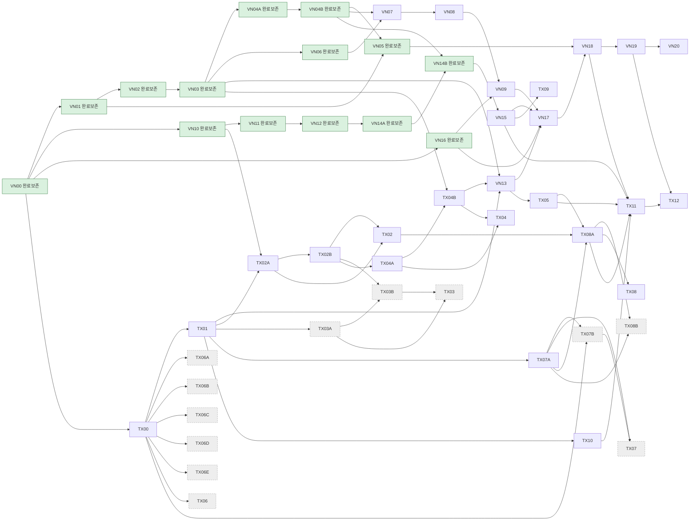

# Production 11 — VN/TX 통합 실행 계획 (2026-10-23 canonical DAG)

> **권위:** 이 표는 `docs/refactoring/vnext/reuse_audit/revised_dag.json`을 그대로 반영한다. 기존 `tickets_production.json`/`stage_status.json`의 ID·역사 상태·완료 evidence는 보존하며, 이 문서가 상태를 재설정하거나 완료를 자동 승격하지 않는다.
> **범위:** `tech_lead_scope_decisions.json`의 reuse-first 결정. 아래 완료 14개는 재개발하지 않는다. 미래 37개 중 `핵심` 18개만 필수 core이며, TX06 all-five, TX03 extra margin, TX08B cross-venue는 필수 core에서 제외한다. 어떤 제품 작업도 이 계획으로 시작되지 않는다.
> **기준 SHA:** `4977ab509490173e312183f32d47f862d94ee0bf`.

## 1. 완료·보존 (14)

| ID | 역사 상태 | 보존 evidence/의미 |
|---|---|---|
| VN00 | COMPLETE_CURRENT_READ_ONLY_BASELINE | source/image/config/mount 기준선 |
| VN01 | LOCAL_IMPLEMENTATION_COMPLETE_OPERATIONAL_GATES_OPEN | bounded fault/lag 계측 |
| VN02 | LOCAL_IMPLEMENTATION_COMPLETE_OPERATIONAL_GATES_OPEN | feed별 오류 격리 |
| VN03 | LOCAL_IMPLEMENTATION_COMPLETE_OPERATIONAL_GATES_OPEN | ETF dependency gate |
| VN04A | LOCAL_IMPLEMENTATION_COMPLETE_OPERATIONAL_GATES_OPEN | durable spool |
| VN04B | LOCAL_IMPLEMENTATION_COMPLETE_OPERATIONAL_GATES_OPEN | UDS C/H/verified replay |
| VN05 | LOCAL_IMPLEMENTATION_COMPLETE_OPERATIONAL_GATES_OPEN | bounded group sync |
| VN06 | LOCAL_IMPLEMENTATION_COMPLETE_OPERATIONAL_GATES_OPEN | native book/window/history |
| VN10 | COMPLETE_LOCAL_IMPLEMENTATION | ETF lease |
| VN11 | COMPLETE_LOCAL_IMPLEMENTATION | evidence COMMIT |
| VN12 | COMPLETE_LOCAL_IMPLEMENTATION | fill/ACK 단조성 |
| VN14A | COMPLETE_LOCAL_IMPLEMENTATION | durable halt/resume |
| VN14B | COMPLETE_LOCAL_IMPLEMENTATION | opt-in Telegram/UDS |
| VN16 | COMPLETE_LOCAL_IMPLEMENTATION | source-specific quarantine |

## 2. 미래 37 — ID·의존·상태·분류

`핵심` = mandatory core. `기반` = TX00 감사. `집계` = 기존 하위 결과의 gate. `선택`/`외부`는 필수 core가 아니다.

| ID | 선행 | 역사 상태(보존) | 분류 | 남은 범위 |
|---|---|---|---|---|
| VN07 | VN06, VN04B | PARTIAL_MARKET_ORDER_AND_JOURNAL_LIFECYCLE_COMPLETE_STRATEGY_OPEN | 핵심 | strategy/Paper checkpoint 연속성 |
| VN08 | VN07 | PLANNED_LOCAL_AUTHORIZED_SUBJECT_TO_PREREQUISITES | 핵심 | retained-prefix reader |
| VN09 | VN08, VN16 | PLANNED_LOCAL_AUTHORIZED_SUBJECT_TO_PREREQUISITES | 핵심 | safe storage/GC proof only |
| VN13 | VN03, TX01, TX04B | PAPER_FIXTURE_INTEGRATION_IMPLEMENTED_PRODUCTION_BLOCKED | 핵심 | strategy file plugin + existing Paper |
| VN15 | VN14B | PLANNED_LOCAL_AUTHORIZED_SUBJECT_TO_PREREQUISITES | 핵심 | TX09와 공동 projection |
| VN17 | VN09, VN15, VN16, VN13 | PLANNED_LOCAL_AUTHORIZED_SUBJECT_TO_PREREQUISITES | 핵심 | local runtime wiring |
| VN18 | VN17, VN05 | PLANNED_LOCAL_AUTHORIZED_SUBJECT_TO_PREREQUISITES | 핵심 | Golden + local fault gate |
| VN19 | VN18 | PLANNED_LOCAL_AUTHORIZED_SUBJECT_TO_PREREQUISITES | 핵심 | packaging/export/rollback |
| VN20 | VN19 | PLANNED_LOCAL_AUTHORIZED_SUBJECT_TO_PREREQUISITES | 외부 | proof 이후 legacy 제거; 삭제 0 |
| TX00 | VN00 | IN_PROGRESS | 기반 | static reuse audit 마감 |
| TX01 | TX00 | PAPER_SCOPED_IMPLEMENTATION | 핵심 | existing Signal/OrderIntent 최소 bridge |
| TX02A | TX01, VN10 | PAPER_SCOPED_IMPLEMENTATION_LEGACY_FENCING_OPEN | 핵심 | existing owner/lease, one writer |
| TX02B | TX02A | PAPER_SCOPED_IMPLEMENTATION | 핵심 | attribution/reservation/restart gap |
| TX02 | TX02A, TX02B | PLANNED | 집계 | existing owner/books 공동 수락 |
| TX03A | TX01 | ISOLATED_LINEAR_PAPER_ONLY | 선택 | extra product/margin DEFER |
| TX03B | TX02B, TX03A | PAPER_CASHFLOW_IMPLEMENTATION_ACTUAL_MARGIN_OPEN | 선택 | selected Paper accounting only |
| TX03 | TX03A, TX03B | PLANNED | 선택 | selected product gate |
| TX04A | TX02B | LOCAL_IMPLEMENTED_INTEGRATED_OFFLINE_TEST_PASS_PRODUCTION_OPEN | 핵심 | Paper durability gap |
| TX04B | TX04A, VN03 | MATCHER_DURABLE_CONTINUOUS_INPUT_RECOVERY_OPEN | 핵심 | NATS-free input to existing matcher |
| TX04 | TX04A, TX04B | PLANNED | 집계 | existing Paper E2E gate |
| TX05 | VN13 | PAPER_FIXTURE_INTEGRATION_IMPLEMENTED_PRODUCTION_BLOCKED | 핵심 | **VN13과 동일 workstream** |
| TX06A | TX00 | REQUEST_MAPPING_ONLY_FULL_CODE_COMPLETION_BLOCKED | 선택 | Binance: 기존 유지, 새 wrapper 0 |
| TX06B | TX00 | REQUEST_MAPPING_ONLY_FULL_CODE_COMPLETION_BLOCKED | 선택 | Arcus: 기존 WS/signer 유지 |
| TX06C | TX00 | REQUEST_MAPPING_ONLY_FULL_CODE_COMPLETION_BLOCKED | 선택 | GRVT: fv_mm/private/reconcile 유지 |
| TX06D | TX00 | REQUEST_MAPPING_ONLY_FULL_CODE_COMPLETION_BLOCKED | 선택 | Bybit: testnet 경로 유지 |
| TX06E | TX00 | REQUEST_MAPPING_ONLY_FULL_CODE_COMPLETION_BLOCKED | 선택 | Hyperliquid: SDK/broker 유지 |
| TX06 | TX00 | PLANNED | 선택 | all-five rebuild gate 제거 |
| TX07A | TX01 | PLANNED | 핵심 | existing facts 위 projection |
| TX07B | TX00, TX07A | PLANNED | 선택 | existing reconcile gap only |
| TX07 | TX07A, TX07B | PLANNED | 선택 | selected equivalence gate |
| TX08A | TX02, TX05, TX07A | PAPER_SHARED_ACCOUNT_FIXTURE_IMPLEMENTATION | 핵심 | same-account safety |
| TX08B | TX08A, TX07A | PAPER_OBSERVATIONAL_COORDINATOR_IMPLEMENTED | 선택 | cross-venue DEFER |
| TX08 | TX08A | PLANNED | 집계 | **TX08A만 의존**; cross-venue 제외 |
| TX09 | VN15 | PLANNED | 핵심 | **VN15와 동일 workstream** |
| TX10 | TX01 | PLANNED | 핵심 | cloud 보존 + manifest metadata |
| TX11 | TX05, TX08A, TX10, VN15, VN18 | PLANNED | 집계 | narrow NATS-free E2E |
| TX12 | TX11, VN19 | PLANNED | 집계 | narrow local acceptance |

## 3. 순서

1. **데이터/복구:** VN07 → VN08 → VN09 (기존 market recovery/journal/archive 재사용, GC는 proof 후 후보만).
2. **파일 plugin + 기존 Paper:** TX01 → TX02A/TX02B → TX04A/TX04B → VN13/TX05 (TX04는 집계 gate). C3/KP/KD calculator는 내부 helper이며 plugin 완료가 아니다.
3. **동일계좌 안전:** 이미 확인한 TX02A/TX02B/TX02를 재사용하여 TX08A. 기존 ETF runtime 재작성 없음.
4. **Projection/E2E:** VN15/TX09와 TX10은 독립 가지다. VN17 → VN18 이후 TX11과 VN19를 각각 완료하여 TX12로 합류한다.
5. **외부:** VN20은 cutover/안정화/rollback proof 이후에만. TX06/TX03A-B/TX08B는 선택 수요가 있을 때만.

## 4. 경계

- TX05는 VN13, TX09는 VN15, TX08 aggregate는 TX08A만 의존하고, TX11 core deps는 TX06/TX07/TX08B 및 all-five/cross-venue group을 제외한다. 위 표와 Mermaid에 역방향 의존을 만들지 않는다.
- `TX06A–E`는 **새 connector build가 아니라** 선택 기존 경로 감사다. 기존 adapter prototype evidence를 지우지 않는다.
- `TX03A/B`의 universal real margin/lifecycle engine, `TX08B`의 cross-exchange atomic execution, 새 cloud uploader, 새 Private Stream은 이 계획의 완료 조건이 아니다.
- 안전 계약은 완화하지 않는다: cancel ACK ≠ terminal fill, UNKNOWN reservation 유지, TOSS DATA_ONLY, monotonic fill identity, per-mode one writer. 문서 완료는 제품/외부 검증 완료가 아니다.
