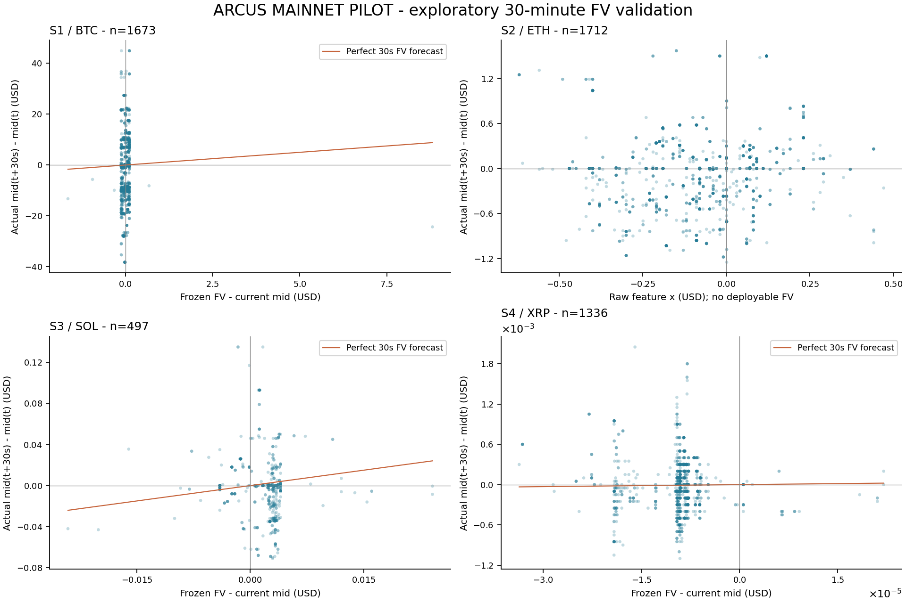
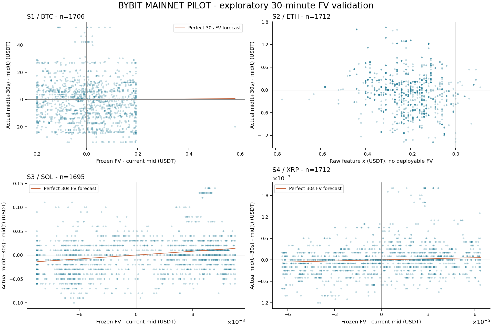
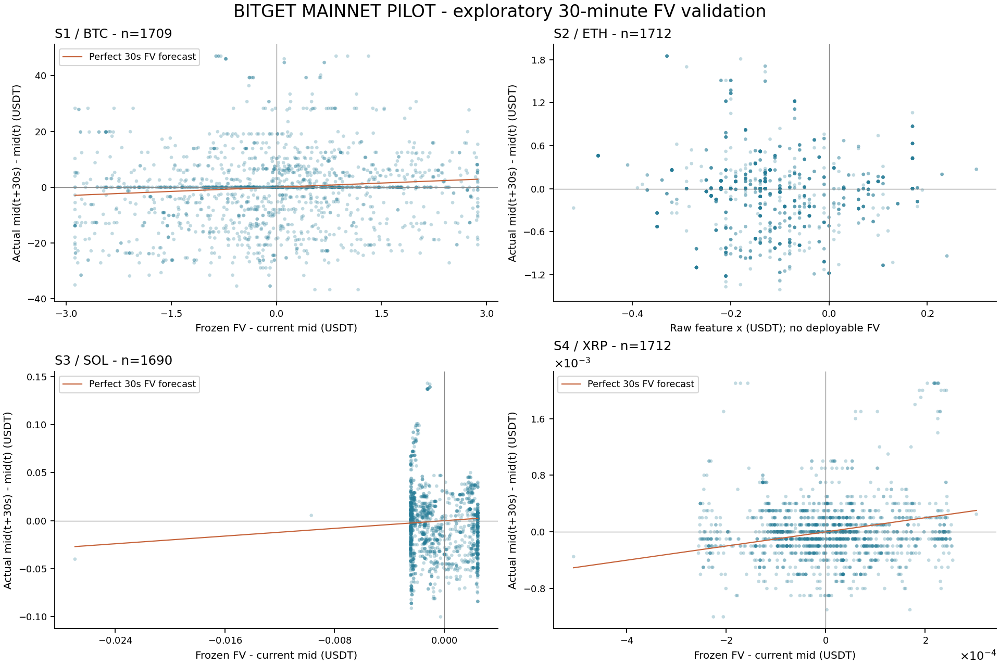
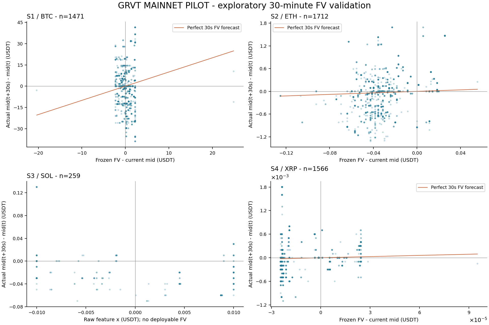

## 결과 해석

네 거래소의 16개 전략 경로를 같은 30분 동안 평가했다. 기본 지연에서 Arcus S3가 14건, Bitget S1이 1건의 주문 의도를 만들었다. Arcus S3는 2건이 지연 후 PostOnly 교차로 거절됐고 12건이 취소됐다. 이 중 5건만 maker로 활성화됐다. Bitget S1의 1건은 활성화 후 취소됐다. 표시 대기열 뒤에서 실제 공격 체결량으로 확인한 모의 체결은 없었다. 2배 지연에서도 체결은 없었다. 따라서 손익 0은 수익성 검증의 성공이나 실패가 아니라 **체결 손익을 평가할 표본이 없다는 결과**다.

후속 주문 수명 감사에서 15건 모두 가정 도착 전에 취소 요청이 생겼고 생성→취소 요청 중앙값은 3.468ms였다. 활성화된 Arcus 5건은 3.839–26.095ms, Bitget 1건은 152.487ms만 유지됐으며 그 동안 주문 가격까지 도달한 반대 체결은 없었다. 작은 수량 변화에도 즉시 취소하는 로직과 동일 처리 주기에서 취소를 먼저 처리하는 모형의 영향이 포함된다. 단순히 가격이 먼저 움직였거나 queue가 길어서만 체결이 없었다고 해석하면 안 된다. 상세 대조는 [주문 수명 감사](ORDER_LIFECYCLE_AUDIT_KO.md)에 있다.

Arcus·Bybit·Bitget의 S2는 사전 보정 lambda가 허용 범위 (0,1] 밖이었고, GRVT S3는 사전 활동량이 부족했다. 이 4개 조합도 30분 내내 입력과 원시 신호를 관찰했지만 신규 진입은 차단했다. 유효 모델을 강제로 만들거나 평가 데이터를 이용해 계수를 재보정하지 않았다.

GRVT S1에는 최소 주문 금액 제약도 있었다. BTC 수량 단위 0.001, 최소 명목 금액 100 USDT, 이번 단위 주문 상한 150 USDT에서 당시 가격으로 0.001 BTC는 최소 금액에 못 미치고 0.002 BTC는 상한을 넘었다. 해당 차단 기록을 신호 실패로 해석하면 안 된다.

1초 통계 표본의 최대 edge/C가 1보다 작아도 순간 이벤트에서 주문 의도가 생길 수 있다. 이 보고서의 표본 표는 전체 이벤트를 담지 않는다. 평가 중 실제 호가 프레임 800,516건과 후보 가격·차단 사유가 바뀐 결정 기록 29,172건을 보존했으며, 주문 의도 발생 근거는 `pilot_decisions`와 `pilot_orders`에서 확인할 수 있다. 공개 피드 재연결·검출 공백은 0건이었다.

## 가설별 판단

H=30초의 주 검정에서 **BH q<0.05를 통과한 조합은 없었다.** 16개 조합 × 3개 사전 지정 시계의 48개 진단 중 시간 블록이 충분한 45개 p값에 BH 보정을 적용했다. GRVT S3의 3개 시계는 블록 부족으로 검정을 보류했다. 아래 개선율은 동결 FV의 RMSE를 “현재 mid 유지”와 비교한 값이며 비용 차감 수익률이 아니다.

| 전략 | 관찰 결과 | 판단 |
|---|---|---|
| S1 순유동성 압력 / OFI | Bitget에서 동결 FV의 RMSE가 약 0.66% 감소했지만 q=0.0654이고 MSE 개선의 95% CI가 0을 포함했다. Bybit는 원시 OFI의 사후 기울기와 사전 고정 계수의 부호가 반대였고 FV 오차가 증가했다. | OFI 기반 FV로 가격이 이동한다는 가설을 이번 구간에서 견고하게 확인하지 못했다. |
| S2 동일자산 외부 기준가격 | 유일하게 진입 가능한 GRVT 모델의 RMSE가 약 1.60% 감소했다. MSE 개선 CI는 60초·120초 블록 모두 양수였지만 q=0.0506이며 비용 기준을 넘지 못했다. 다른 세 거래소는 lambda 범위 위반이었다. | GRVT의 예측 개선은 후속 검증 후보다. 5% 다중 비교 기준의 확인이나 거래 수익성을 의미하지 않는다. |
| S3 공격 체결 지속 | Bybit RMSE가 약 2.71% 감소했지만 q=0.0506이고 MSE 개선 CI는 0을 포함했다. Arcus·Bitget의 사전 계수는 평가 중 관측한 기울기와 부호가 반대였다. GRVT는 표본 부족이었다. | 지속성과 계수 안정성의 확인이 필요하다. Arcus의 주문 의도 14건만으로 효과를 주장할 수 없다. |
| S4 OBI | Bybit RMSE가 약 1.52% 감소했다. MSE 개선 CI는 60초·120초 블록 모두 양수였지만 q=0.0506이고 비용 기준을 넘지 못했다. | 작은 예측 개선 후보지만 이번 검정에서 확정된 알파나 체결 수익은 아니다. |

Bybit S1의 기울기 CI는 60초 블록에서 0을 포함하고 120초 블록에서는 양수였지만, 120초 블록의 동결 FV MSE 개선 CI는 음수였다. 블록 선택으로 유리한 결론만 채택하지 않는다. 30분과 서로 다른 종목으로 얻은 결과는 전략 간 우열이나 장기 수익성 순위로 사용하지 않는다.

## 재현과 검증 자료

운용 구간은 2026-10-04 **19:21:55.167–19:51:55.178 KST**, 실제 평가 1,800.011초다. 기본·2배 지연 모두 종료 재고와 열린 모의 주문이 0이다. 실행 코드는 인증 정보를 로드하지 않는 공개 데이터 모듈이며 실제 주문·취소 API가 없다. 외부 주문 제출은 0건이다.

Arcus·Bitget에는 자체 testnet 주문 지연 실측이 없어 GRVT와 Bybit 중 큰 관측값을 대용했다. GRVT 취소에도 주문 지연을 대용했다. 따라서 두 거래소의 성과를 해당 거래소의 실측 체결 결과로 표시하지 않는다. 이후 실측 지연값이 확보되면 동일 원본으로 다시 모의 분석할 수 있다.

운용 소스 SHA-256:
`ed4a84fb46d1f5dc6c24c57033d87037cc59eb322991bc74b85716d17b3d0cbb`

서버에서 회수한 사전 수집·동결 계수·평가 원본 묶음 SHA-256:
`ed348a90ab63953371483afaf6b153aeefe7c214f5ac97d4c37e55547740614e`

서버·로컬 원본 묶음 해시가 일치하고, 종료 후 로컬 운용 소스 해시도 manifest와 일치했다. 지연·대기열·취소·부분 체결·오래된 거래 제외·연속 snapshot·손익 계산에 대한 대상 테스트 47개가 통과했다. `integrity.json`에 종료 상태·소스·모델·원본 검증 결과를 남겼다.

결과 데이터: [results.json](results.json), [performance.csv](performance.csv). 운용 및 가정: [FV_PILOT_MAINNET.md](../../../FV_PILOT_MAINNET.md).

## 동결 FV와 실제 30초 후 이동

각 점은 서버 수신 기준 표본과 30초 후 mid 이동의 쌍이다. 유효 모델의 주황색 선은 완전한 FV 예측을 뜻한다. 신규 진입이 차단된 모델은 동결 FV 대신 원시 feature를 그려 별도로 표시했다. Arcus 가격 단위는 USD, 나머지는 USDT다.

