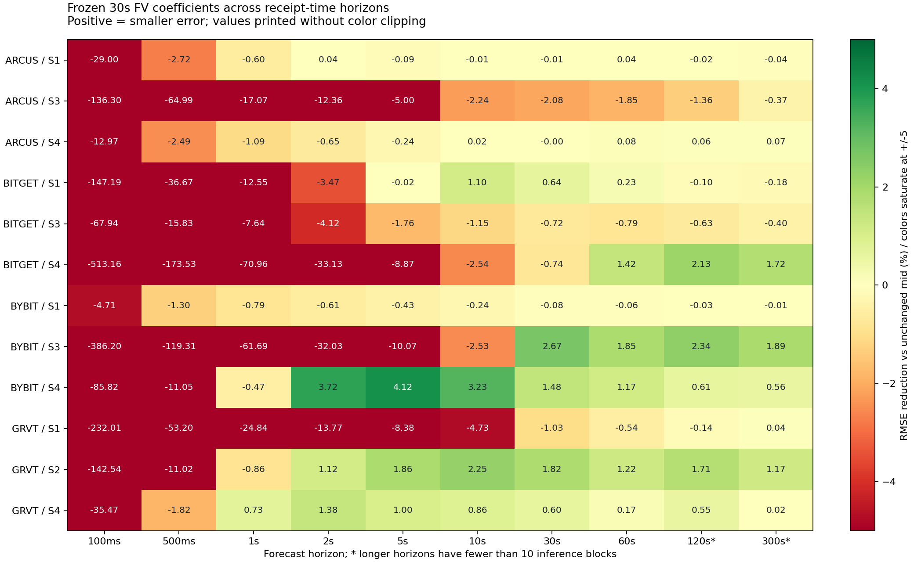
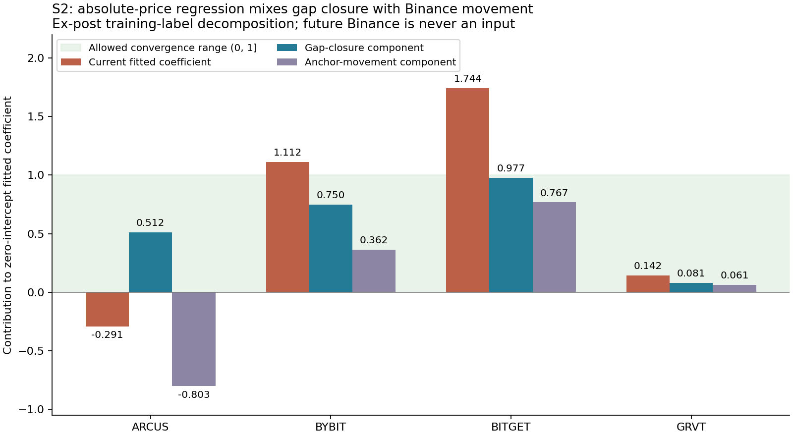

# FV 예측력·시계·복합 입력·Binance 기준가격 진단

2026-10-04의 10분 사전 수집과 30분 평가 원본을 읽기 전용으로 분석했다. 기존 전략·동결 계수·운용 원장·주문 조건은 수정하지 않았다. 새로운 실거래나 모의 운용은 수행하지 않았다.

## 예측력이 얼마나 약한가

기존 30초 결과에서 최대 RMSE 감소율 2.7055%는 “방향을 2.7%만 맞혔다”는 의미가 아니다. mid 유지보다 예측 오차 크기를 2.7% 줄였다는 뜻이며, 제곱오차 감소로 환산하면 약 5.34%다. 기준 제곱오차의 약 94.66%가 남았다. **가격 이동의 크기를 충분히 설명하는 FV 모델이라고 보기는 어렵다.** 작은 조건부 방향 정보가 있을 가능성과 수수료 후 수익성은 별도의 문제다.

## 각 모델이 약했던 이유

| 모델 | 코드·데이터에서 확인한 제약 | 해석 |
|---|---|---|
| S1 순유동성 압력 | 현재 BBO 평균 깊이만큼의 활동량을 모으는 창에서 signed/total의 절댓값이 1 이하다. 입력 x는 spread×signed/depth여서 절댓값이 spread 이하로 제한된다. 30초 이후 이동은 여러 spread에 이를 수 있다. Bybit의 사전 계수는 음수였는데 평가 중 원시 OFI 기울기는 양수였다. | 짧은 수급 상태를 고정 계수 하나로 미래 이동 전체에 대응시켰다. 동시 가격 충격의 설명력과 이후 가격 예측력을 구분해야 한다. |
| S2 외부 기준가격 | 현재의 basis 보정 Binance mid와 현지 mid의 차이만 사용한다. 30초 동안 Binance가 움직이는 성분과 가격 차이가 줄어드는 성분이 하나의 계수에 섞인다. 초기 150초 basis와 약 208개 중첩 학습 쌍을 사용했다. | 계수를 순수한 수렴율로 해석하는 것이 현재 회귀 목표와 맞지 않는다. 아래 분해가 차단 원인을 설명한다. |
| S3 공격 체결 지속 | 체결량 창도 현재 깊이 기준이고 spread 단위 입력이다. 유효 표본의 창 중앙값은 Arcus 약 55.7초, Bybit 약 8.5초, Bitget 약 20.2초로 서로 달랐다. Arcus·Bitget의 사전 계수와 평가 중 기울기 부호가 반대였다. GRVT는 사전 실시간 체결 활동이 부족했다. | 매수 체결이 강해도 매도 호가가 즉시 보충되면 가격은 올라가지 않을 수 있다. 체결량 단독 입력은 흡수·재공급을 구분하지 못한다. |
| S4 OBI | 현재 BBO 잔량 비율만 사용한다. 추가·취소·체결 속도, 잔량 유지 시간과 더 깊은 호가를 사용하지 않는다. | 즉시·다음 가격 변화의 방향에는 정보가 있어도 30초 이동 크기의 설명은 약할 수 있다. 이번 구간에서는 2~10초에서 상대적으로 나았다. |

공통적으로 학습은 약 10분, 평가는 30분이다. 시장 상태별 계수·가격 차이 기준의 안정성을 확보하기에 짧고, 하나의 선형 계수로 비선형적인 소진·보충을 표현했다. 현재 깊이 변화가 활동량 창·정규화·주문 수량을 동시에 바꾸므로 입력과 실행이 민감하게 흔들릴 수도 있다. 각각을 장기 원인으로 입증한 결과는 아니며 코드 구조와 이번 관측을 바탕으로 한 진단이다.

OFI 원 연구는 구간 안의 주문 흐름과 **같은 구간의 가격 변화**를 설명한다. 이를 그대로 미래 30초 FV 예측의 근거로 사용할 수 없다. [Cont·Kukanov·Stoikov 원 논문](https://arxiv.org/abs/1011.6402)

## 더 짧거나 긴 시계

후속 검사는 100ms·500ms·1·2·5·10·30·60·120·300초를 비교했다. 원래의 약 1초 간격 시그널 표본에 **30초로 학습한 계수를 그대로** 적용했다. 미래 값은 t+H 시각까지 수신한 마지막 BBO mid이며, 3초 넘게 바뀐 호가 기록이 없는 쌍과 증거 종료 뒤의 목표는 제외했다. 기존 보고서는 목표 이후 첫 1초 표본을 사용했기 때문에 30초 숫자도 조금 다르다.

| 조합 | 1초 | 5초 | 10초 | 30초 | 60초 | 120초 |
|---|---:|---:|---:|---:|---:|---:|
| Bybit S4 OBI | −0.48% | +4.12% | +3.23% | +1.48% | +1.17% | +0.61% |
| Bybit S3 체결 지속 | −61.69% | −10.07% | −2.54% | +2.67% | +1.85% | +2.34% |
| Bitget S1 순유동성 | −12.55% | −0.03% | +1.10% | +0.64% | +0.23% | −0.10% |
| GRVT S2 외부 기준가격 | −0.86% | +1.86% | +2.25% | +1.82% | +1.22% | +1.71% |

숫자는 mid 유지 대비 RMSE 감소율이다. 100~500ms에서는 현재 30초 계수가 미래 이동 크기를 과대예측해 대부분 더 나빴다. 이것은 해당 시계로 따로 학습한 모델이 불가능하다는 뜻이 아니다. 120·300초는 2H 시간 블록 수가 10개 미만이므로 통계적 확인을 보류했다.

Bybit S4의 5초 결과는 1,737쌍이고, 상승·하락으로 실제 이동한 1,188쌍에서 방향 balanced accuracy는 약 65.7%다. 무변화 549쌍은 이 방향 지표에서 제외했다. 이는 모든 시점의 65.7%를 맞혔거나 거래 승률이 65.7%라는 뜻이 아니다. FV 이동 크기의 중앙값은 약 0.187bp로 maker 진입+taker 감축의 기본 수수료 7.5bp보다 훨씬 작다.

이번 후속 **오차 차이 검정**에서는 Bybit S4의 2·5·10초 등이 탐색적 BH 보정을 통과했다. 5초 q는 약 0.0025다. 이는 이전 보고서의 30초 **원시 신호 기울기 검정**과 검정 대상·시계·표본 정의가 다른 결과다. 기존 주 검정 결과를 수정하거나 대체하지 않는다. 같은 평가 기간을 보고 추가한 탐색적 결과이므로 별도의 보지 않은 구간에서 확인해야 한다.

## OFI·체결·소진·보충을 함께 보면

개선 가능성은 있다. 예를 들어 강한 매수 체결과 빠른 매도 호가 보충이 동시에 보이면 흡수 상태이고, 같은 매수 체결에 매도 잔량 감소·보충 부재가 겹치면 소진 압력이다. 순간 OBI만으로는 이를 구분할 수 없다. 체결량은 OFI에 이미 반영될 수 있으므로 OFI와 체결량을 그대로 더하면 이중 계산이 된다.

다만 추가 입력을 넣었다고 자동으로 좋아지지는 않았다. 같은 BTC에서 별도 사전 원장만 사용해 5초 OFI 단독, OFI+실제 체결, 그리고 OBI·같은 가격의 표시 잔량 증가/감소·체결 강도·상호작용을 포함한 8개 입력의 ridge 회귀를 4개 거래소·1/5/30/60초로 비교했다. ridge=10과 특징 정의는 고정했고 평가 구간으로 계수를 맞추지 않았다.

| BTC 실험 / 5초 목표 | OFI 단독 | OFI+체결 | 8개 입력 |
|---|---:|---:|---:|
| Arcus | +0.17% | +0.21% | +1.83% |
| Bybit | +0.31% | −0.62% | −2,463.11% |
| Bitget | −13.72% | −35.42% | −10,191.55% |
| GRVT | −127.66% | −127.66% | −25.62% |

이 실험은 원래의 활동량 창 S1과 다른 5초 시간 창 모델이다. 같은 표본에서 입력 조합을 비교하기 위한 진단이다. Bybit·Bitget의 8개 입력은 **현재 BBO 깊이로 나눈 값과 곱셈 상호작용이 얕은 호가에서 폭증**해 매우 나빴다. 평가 특징의 최대 표준화 크기는 학습 분산 기준 약 6천·2.2만에 달했다. 극단적인 손실을 숨기거나 좋은 조합만 남기지 않았다.

Arcus의 방향 지표가 높아 보이는 경우도 있다. 1초의 실제 비영 가격 이동은 127쌍/1,790쌍뿐이고, 5초의 8개 입력 모델은 예측 이동 중앙값 약 0.005bp다. 높은 비영 방향 정확도를 수수료 차감 수익성과 동일시하지 않는다. GRVT의 사전 거래 활동이 부족해 OFI+체결의 거래 계수가 사실상 학습되지 않은 것도 고려해야 한다.

다음 모델은 시간에 안정적인 깊이 기준·signed log/asinh 또는 학습 구간에서 정한 한도·잔량 지속성·여러 호가 수준의 OFI·체결과 재공급의 상호작용을 함께 검토할 수 있다. 가격 변화 유무, 다음 변화 방향, 변화까지의 시간과 조건부 이동 크기를 나눠 학습하는 방식도 적절한 후보이다. 다층 OFI 연구의 개선 결과는 동시 가격 변화 설명이며, 이번 암호화폐의 미래 예측 개선을 보장하지 않는다. [다층 OFI 원 논문](https://arxiv.org/abs/1907.06230), [다음 가격 변화 방향과 queue imbalance 원 논문](https://arxiv.org/abs/1512.03492)

## S2가 차단된 이유

g=현재 보정 anchor−현재 local mid라 두면 다음의 사후 항등식이 성립한다.

`local 가격 변화 = anchor 가격 변화 + (현재 gap − 미래 gap)`

현재 코드는 왼쪽을 g에 회귀한 계수를 순수 수렴율 lambda로 취급한다. 사전 학습 208쌍의 동일한 계수를 사후 분해하면 다음과 같다.

| 거래소 | 현재 전체 계수 | gap 수렴 성분 | Binance anchor 이동 성분 |
|---|---:|---:|---:|
| Arcus | −0.291 | +0.512 | −0.803 |
| Bybit | +1.112 | +0.750 | +0.362 |
| Bitget | +1.744 | +0.977 | +0.767 |
| GRVT | +0.142 | +0.081 | +0.061 |

Arcus·Bybit·Bitget에서도 gap 수렴 성분은 0~1에 있었다. 전체 계수는 공통 가격 움직임까지 포함해 범위를 벗어났고, 현재 정책이 신규 진입을 차단했다. **이번 S2 실패를 수집기 중단이나 가격 차이 수렴의 전면 부재로 해석하면 안 된다.** 미래 Binance 값을 사용한 이 분해는 사후 진단일 뿐, 미래 값을 실시간 예측 입력에 넣지 않았다.

S2 개선에서는 gap 수렴과 Binance의 최근 변화·lead/lag를 구분하고, basis의 변동과 수신 지연을 별도로 다루는 모델이 필요하다. 과거 기준으로 계산한 신호가 주문 도착 시점에도 남는지도 검증해야 한다. 기존 전체 계수를 단순히 0~1로 잘라 거래를 강제로 여는 방식은 이번 진단으로 정당화되지 않는다.

경제적인 제약도 크다. 평가 중 보정 gap의 중앙값은 Arcus −0.30bp, Bybit −0.85bp, Bitget −0.48bp, GRVT −0.78bp였다. maker+taker 기본 수수료는 각각 2.25·7.5·8.0·4.5bp이고 tick·오차 여유는 추가된다. 관측된 차이 대부분은 비용보다 작았으므로 모델의 계수 해석만 고쳐도 수익성이 생긴다고 볼 수 없다.

## Binance 및 관련 수집기 확인

30분 동안 Binance ETH 변경 BBO 기록은 200,595건이며 S2 네 거래소의 각 1,742개 평가 표본에 기준가격 누락이 없었다. source timestamp와 순번 역행은 없었다. Binance source→journal 관측 지연의 중앙값과 p95는 대략 26ms·138ms였다. S2 표본 시점에서 마지막 변경 기준가격의 수신 후 나이는 중앙값 약 30ms·p95 약 182ms·최대 약 537ms였다. 이는 네트워크만의 지연이 아니라 시계·이벤트 처리·기록 지연을 포함하는 대용 관측이다.

Binance·Bybit·Bitget·GRVT·Arcus 운영 perpetual 수집기는 현재 모두 healthy/publishing이고 10초 간격으로 실제 발행 수가 증가했다. 증가 건수는 516·1,057·1,356·95·178건이다. 확인한 최근 보유 로그에서 ERROR/WARNING/traceback은 0이었다. 해당 수집기에서 재현되거나 현재 발생 중인 오류는 발견하지 못했으므로 운영 수집기를 임의로 재배포하지 않았다. 기존 Binance snapshot 경계값 수정에 대한 로컬 회귀 시험 5개와 실제 실행 이미지에서의 메모리 bus 검증 5개도 통과했다. 실제 수집 프로세스를 재시작하거나 네트워크·주문 API를 호출하지 않고 그 이미지의 코드를 별도 Python 프로세스에서 확인했다.

S2는 이 운영 수집기 DB를 읽은 것이 아니라 실험의 독립 Binance public bookTicker 소켓을 사용했다. 운영 수집기의 건강 상태와 함께 실제 실험 기준가격 원장을 따로 확인했다. 별도 TradFi Binance health 파일의 disk_reserve 정지는 이 perpetual 기준가격 소켓과 다른 경로이고, S2의 누락 원인이 아니다.

과거 Bitget의 연속 snapshot마다 전략 이력을 초기화한 결함은 기존 30분 평가 전에 수정됐다. 새 복합 입력 진단에서도 수정 전 사전 원장의 reset 표시를 그대로 쓰지 않고, 이미 감사한 gap-free 증가 sequence로 논리적 연속성을 메모리에서 재구성했다. 원본 DB는 수정하지 않았다.

## 증거 및 검증

새 진단의 as-of 목표, 미래 입력 배제, snapshot 이력, 학습 구간의 정규화 고정과 추론 블록 부족 처리에 관한 테스트 7개가 통과했다.

- [시계별 수치](horizon_metrics.csv)
- [48개 동일자산 복합 입력 비교](combination_metrics.csv)
- [전체 진단과 방법](prediction_diagnosis.json)
- [S2 학습 계수 분해](s2_lambda_decomposition.json)
- [운영 수집기 상태·발행 증가 확인](collector_health_check.json)
- [실행 이미지의 Binance 동기화 수정 검증](deployed_binance_bridge_check.json)

이 후속 결과는 원래 30분 모의 체결 성과를 바꾸지 않는다. 체결 손익은 여전히 평가할 표본이 없고, 여기서는 가격 예측과 방향 정보만 분석했다.
