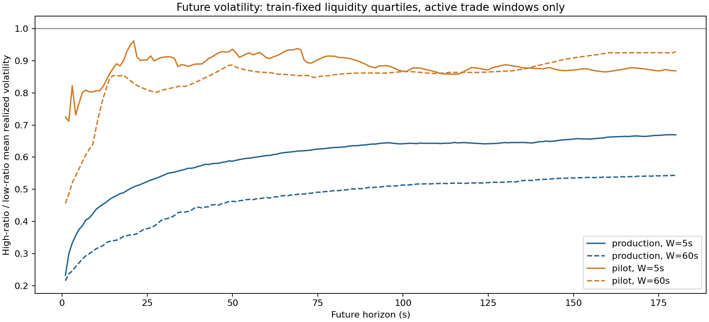
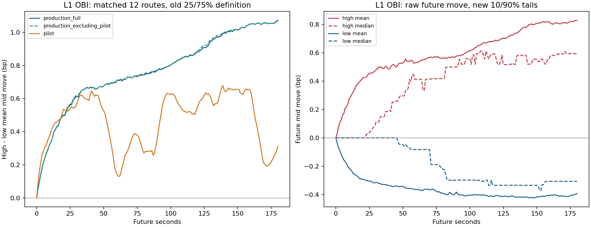
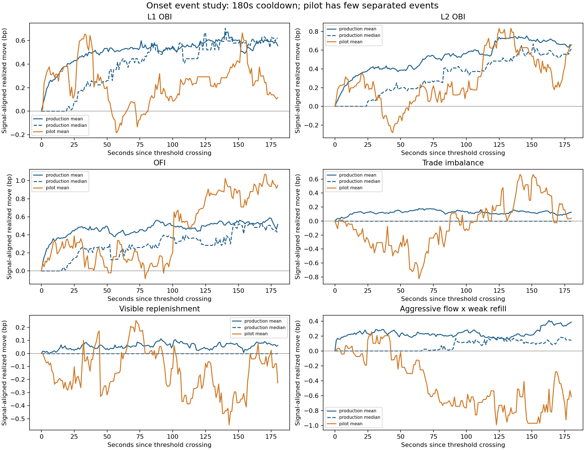
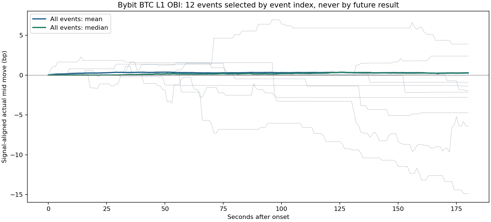

# 유동성 국면·범위 평균회귀·수급 신호 이후 실제 가격 이동

분석 기준: 2026-10-05 KST. 기존 2026-10-04 고정 자료를 사용했으며 새 주문이나 모의 체결을 만들지 않았다. 이전 [FV 보고서](../fv_research_20261004/REPORT_KO.md)의 원본과 결과는 변경하지 않았다.

## 1. 네 질문에 대한 판단

1. **횡보 범위와 중심을 이용한 평균회귀는 가능한 전략 가설이다. 하지만 범위 안에 있었다는 사실이 중심을 미래 FV로 만들지는 않는다.** 이번 자료에서 과거 밴드의 중심 복귀보다 밴드 이탈이 먼저 나타나는 경우가 많았다. 높은 유동성 비율만으로 grid 국면을 확정할 근거는 부족했다.
2. **높은 유동성 비율과 낮은 미래 변동성의 관계는 확인됐다.** 운영 W=5초에서 H=5초의 high/low 미래 실현변동성 비율 중앙값은 0.375, W=60초→H=60초는 0.474였다. 그러나 **낮은 비율에서 방향 정확도가 일관되게 더 높지는 않았다.** 변동성 상태 판별과 방향성 edge는 별개의 조건이다.
3. **L1 OBI는 이후 짧은 가격 움직임과 조건부 관계가 있다.** pilot 기간을 뺀 운영 자료에서도 25초 후 high-low 평균 이동 차이는 0.568bp였다. 다만 두 곡선의 유사성 자체는 독립 재현의 증거가 아니다. 겹치는 구간의 L1 OBI 상관 중앙값은 0.999699였다.
4. **가격 움직임 자체로 평가했고 아래에 제시한다.** 모든 초의 실제 mid 이동, 신호 강도별 평균·중앙값·25/75분위수, 상승/하락/무변화 비율, 신호 시작 후 경로와 유리/불리 이동을 CSV에 공개한다. 1bp=0.01%이며 거래 수익률·체결 승률과 다르다.

## 2. 원글과 이번 검증이 다른 점

사용자가 제시한 [퀀트대디의 개인 분석](https://blog.naver.com/quantdaddy/223200751708)을 확인했다. 원글은 S&P 500 선물의 틱 자료를 일별로 집계하고 20일 이동평균한 공급/수요 비율과 실현변동성의 관계를 설명한다. 이번 자료는 암호자산의 약 22~68시간이고, 1~60초 신호와 이후 1~180초를 본다. **원글의 일·월 단위 결과를 그대로 복제한 검증은 아니다.** 같은 기간의 상관과 미래에 남는 정보도 구분한다.

남아 있는 L1 명목 잔량 `S=b×q_bid+a×q_ask`는 공급의 **현재 stock**이고, 기간 내 체결대금 `T=sum(price×quantity)`는 소비의 **flow**다. 잔량을 호가 메시지마다 다시 더하면 같은 주문을 반복해서 세며 메시지 빈도에 의존한다. 따라서 주 비율은 다음과 같다.

`R_notional(W)=integral_(t-W)^t S(u)du / T(W) = 평균 L1 명목 잔량 / 초당 체결대금`

단위는 **초**이며, 지금 속도로 체결이 계속될 때 표시 잔량이 몇 초 분량인지 나타내는 proxy다. 실제 고갈 시간은 취소·재공급 때문에 이 값과 같지 않다. 무체결은 infinity로 만들어 high로 분류하지 않고 **inactive**로 분리했다.

pilot SQLite에는 실제 체결 가격과 변경 BBO가 있으므로 명목금액 비율을 정확한 수신 시각으로 적분했다. 운영 장기 집계는 가격×수량의 곱을 보존하지 않아 `R_quantity=integral(q_bid+q_ask)du / sum(trade_quantity)`를 사용했다. 이를 원글의 정확한 명목 비율이라고 부르지 않는다. pilot에서 두 정의의 순위 상관은 거의 1이고 상대 차이 중앙값은 W=5초 약 0.0011%, W=60초 약 0.0039%였다. 하지만 다른 시장·시간축에서도 같다는 증거는 아니다.

변경 BBO의 명목 잔량을 이벤트마다 더한 비율도 별도 계산했다. 이는 **모든 native quote tick**의 합과 같은 정의가 아니며 이벤트 수의 영향을 받는다. `volatility.csv`의 `quote_event_stock_sum`으로 시간 적분 비율과 구분한다. 공개 BBO 잔량은 모든 신규 지정가 제출량이나 숨은 유동성도 아니다.

## 3. 자료와 통계 방법

- 운영: Binance/Bybit/Bitget BTC·ETH·SOL 약 2.84일, Arcus/GRVT 약 22시간. 앞 60% 학습·뒤 40% 평가, 180초 label purge와 60초 embargo, 평가 anchor 5초 간격.
- pilot: 원래 10분 학습과 이후 30분 평가를 분리, anchor 1초 간격. XRP는 pilot에만 있다. 운영과 pilot의 일부 시간은 겹친다.
- 호가 정상 조건은 이전 보고서와 같고, **과거 60초~미래 180초 전체가 정상**인 창만 사용한다. 체결 방향이 unknown인 창은 방향 지표에서 제외한다. 총 체결량을 사용하는 비율은 unknown 방향도 포함한다.
- 각 거래소·종목·W별 학습 비율 25/75분위수로 low/high를 동결했다. 미래 변동성은 `sqrt(sum(미래 1초 mid 수익률bp²))`, 가격 반응은 `10000×(mid(t+h)/mid(t)-1)`다. 두 값은 다르다.
- 명시한 H=5/25/30/60/180의 조건부 평균 차이는 길이 max(60,2H)초의 시간 block bootstrap 1,000회로 진단했다. 10개 미만 block 또는 어느 그룹이 30개 미만이면 추론을 보류했다. 표시한 p 전체를 탐색적 BH 보정했다. 연구를 설계하기 전에 같은 자료를 이미 보았으므로 새로운 확증 실험은 아니다.
- 아래 요약은 **사용 가능한 경로 통계의 동일 가중 중앙값**이다. 서로 다른 시장을 독립 표본으로 합산하지 않는다. 커버리지·미측정 사유·그룹별 n을 모두 제공한다. 신호 관계를 인과효과로 판정하지 않는다.

비율 학습과 평가에 충분한 활성 체결 창이 남은 경로 수는 아래와 같다. 운영 W=5초는 12개, pilot W=5초는 11개다. **GRVT는 비율을 학습할 체결 자료가 부족해 비율 국면 결과에 포함되지 않는다.** pilot Arcus XRP도 W에 따라 활성 창이 부족하다. 호가만 필요한 OBI 분석의 커버리지와 구분한다.

| source | window | available_routes |
| --- | --- | --- |
| pilot | 1 | 8 |
| pilot | 5 | 11 |
| pilot | 10 | 11 |
| pilot | 30 | 12 |
| pilot | 60 | 12 |
| production | 1 | 12 |
| production | 5 | 12 |
| production | 10 | 12 |
| production | 30 | 12 |
| production | 60 | 12 |

## 4. 유동성 비율은 미래 변동성을 구분하는가

다음 값은 각 경로의 high 그룹 평균 RV / low 그룹 평균 RV를 계산한 후 중앙값을 낸 것이다. 1보다 작으면 high에서 미래 변동성이 낮았다. inactive는 들어가지 않는다.

| source | window | horizon | high_low_ratio |
| --- | --- | --- | --- |
| pilot | 5 | 5 | 0.768 |
| pilot | 5 | 25 | 0.903 |
| pilot | 5 | 60 | 0.909 |
| pilot | 5 | 180 | 0.869 |
| pilot | 60 | 5 | 0.563 |
| pilot | 60 | 25 | 0.809 |
| pilot | 60 | 60 | 0.864 |
| pilot | 60 | 180 | 0.928 |
| production | 5 | 5 | 0.375 |
| production | 5 | 25 | 0.524 |
| production | 5 | 60 | 0.605 |
| production | 5 | 180 | 0.670 |
| production | 60 | 5 | 0.271 |
| production | 60 | 25 | 0.377 |
| production | 60 | 60 | 0.474 |
| production | 60 | 180 | 0.543 |

위 관계는 단순히 동일 시점의 변동성을 비교한 결과가 아니다. 다만 이미 조용한 구간이 계속 조용해지는 효과를 포함한다. **과거 변동성의 같은 학습 분위수 안에서 비교**하면 운영 자료의 high/low 비율은 다음과 같이 가까워진다. 사용 가능한 과거 RV 분위수의 비율 중앙값을 경로별로 먼저 구한 뒤 경로 중앙값을 냈다.

| window | 5 | 25 | 60 | 180 |
| --- | --- | --- | --- | --- |
| 5 | 0.556 | 0.690 | 0.744 | 0.786 |
| 60 | 0.530 | 0.639 | 0.680 | 0.789 |

또한 과거 RV와 체결 유량으로 미래 RV를 예측하는 고정 ridge 모형에 log(R)를 추가했다. 학습에서만 표준화·clip·계수를 정했다. 아래는 미래 RV의 **MAE 감소율(%)**이다. 가격 FV의 RMSE가 아니다.

| source | window | 5 | 25 | 60 | 180 |
| --- | --- | --- | --- | --- | --- |
| pilot | 5 | -0.217 | -0.275 | 0.061 | -0.340 |
| pilot | 60 | -0.455 | 1.307 | 0.109 | -1.562 |
| production | 5 | 1.653 | 0.868 | 1.301 | 1.114 |
| production | 60 | -0.110 | 0.081 | 0.004 | -0.208 |

국면 간 변동성 차이가 커도 이미 관측한 변동성·활동량을 넘어서는 추가 예측 개선은 작거나 음수일 수 있다. 비율은 위험 상태를 요약하는 후보지만 그 숫자 하나가 충분한 국면 모델이라는 결론은 아니다. 음의 차이를 보이고 탐색적 q<0.05인 미래 RV 비교 셀은 133개이며, 인접 W/H를 독립 검증 개수로 세지 않는다.

## 5. 비율이 낮을 때 방향성 betting이 더 유리한가

W=5초의 각 원시 지표 방향에 따라 다음 가격 이동의 부호를 정렬했다. 양수는 시그널 방향으로 움직였다는 뜻이다. `mean_aligned_over_future_rv`는 **관측한 미래 RV로 나눈 사후 진단**이며 거래 시점 입력이나 거래 크기 결정에 쓰지 않았다. balanced accuracy는 실제로 가격이 움직인 표본에서 상승·하락 recall의 평균이다. 무변화는 분모에서 제외한다.

| indicator | regime | horizon | mean_aligned_bps | mean_aligned_over_future_rv | balanced_accuracy_moving |
| --- | --- | --- | --- | --- | --- |
| aggressive_weak_refill | high | 5 | 0.020 | 0.032 | 58.585 |
| aggressive_weak_refill | high | 25 | 0.044 | 0.063 | 54.432 |
| aggressive_weak_refill | high | 60 | 0.055 | 0.064 | 52.077 |
| aggressive_weak_refill | low | 5 | 0.049 | 0.043 | 54.340 |
| aggressive_weak_refill | low | 25 | 0.025 | 0.030 | 50.997 |
| aggressive_weak_refill | low | 60 | -0.179 | -0.006 | 49.674 |
| l1_obi | high | 5 | 0.076 | 0.108 | 74.416 |
| l1_obi | high | 25 | 0.187 | 0.208 | 65.089 |
| l1_obi | high | 60 | 0.221 | 0.209 | 60.237 |
| l1_obi | low | 5 | 0.069 | 0.101 | 60.029 |
| l1_obi | low | 25 | 0.134 | 0.126 | 55.288 |
| l1_obi | low | 60 | 0.081 | 0.106 | 53.420 |
| l2_obi | high | 5 | 0.055 | 0.092 | 73.454 |
| l2_obi | high | 25 | 0.142 | 0.180 | 64.640 |
| l2_obi | high | 60 | 0.185 | 0.197 | 60.040 |
| l2_obi | low | 5 | 0.061 | 0.077 | 57.488 |
| l2_obi | low | 25 | 0.138 | 0.102 | 54.325 |
| l2_obi | low | 60 | 0.155 | 0.071 | 53.418 |
| ofi | high | 5 | 0.067 | 0.074 | 66.240 |
| ofi | high | 25 | 0.133 | 0.112 | 56.829 |
| ofi | high | 60 | 0.159 | 0.090 | 53.814 |
| ofi | low | 5 | 0.093 | 0.098 | 59.938 |
| ofi | low | 25 | 0.154 | 0.111 | 54.793 |
| ofi | low | 60 | -0.001 | 0.058 | 51.240 |
| replenishment | high | 5 | 0.020 | 0.030 | 57.131 |
| replenishment | high | 25 | 0.058 | 0.038 | 52.975 |
| replenishment | high | 60 | 0.070 | 0.047 | 51.774 |
| replenishment | low | 5 | 0.036 | 0.057 | 55.337 |
| replenishment | low | 25 | 0.066 | 0.073 | 52.913 |
| replenishment | low | 60 | 0.100 | 0.039 | 51.904 |
| signed_trade_flow | high | 5 | 0.020 | 0.032 | 58.622 |
| signed_trade_flow | high | 25 | 0.044 | 0.063 | 54.432 |
| signed_trade_flow | high | 60 | 0.055 | 0.064 | 52.097 |
| signed_trade_flow | low | 5 | 0.049 | 0.043 | 54.340 |
| signed_trade_flow | low | 25 | 0.025 | 0.030 | 50.997 |
| signed_trade_flow | low | 60 | -0.179 | -0.006 | 49.674 |
| trade_imbalance | high | 5 | 0.020 | 0.032 | 58.622 |
| trade_imbalance | high | 25 | 0.044 | 0.063 | 54.432 |
| trade_imbalance | high | 60 | 0.055 | 0.064 | 52.097 |
| trade_imbalance | low | 5 | 0.049 | 0.043 | 54.340 |
| trade_imbalance | low | 25 | 0.025 | 0.030 | 50.997 |
| trade_imbalance | low | 60 | -0.179 | -0.006 | 49.674 |

낮은 비율에서 OFI의 짧은 평균 이동은 커지는 경우가 있지만, 방향 정확도가 함께 개선되는 것은 아니다. L1/L2 OBI의 비영 방향 정확도는 오히려 high에서 더 높은 경우가 많았다. **낮은 R → 큰 변동성 → 방향을 알 수 있음**은 성립하지 않는다. 부호 없는 비율은 규모 정보를 담을 수 있지만 매수·매도 방향을 직접 주지 않는다.

전체 표에는 신호 절댓값의 학습 강도 분위수를 맞춘 비교도 포함한다(`regime_direction.csv`). 서로 다른 강도의 시그널을 비교한 것과 같은 강도에서의 국면 효과를 구분해야 한다. 평균 bp가 커졌다는 사실만으로 고변동성 구간의 risk-adjusted edge가 커졌다고 말하지 않는다.

공격 체결×약한 refill은 `signed_flow×(1-소진 측 관측 보충률)`로 정의했다. buy일 때 ask, sell일 때 bid를 보며 해당 가격 측 활동이 없으면 약화를 추측하지 않고 제외했다. 0이 아닌 값의 방향은 체결 방향을 유지하므로, 단순히 sign을 사용할 때 체결 불균형과 같은 방향을 갖는다. 활동이 없거나 보충률이 1인 표본의 제외 때문에 평가 집단은 달라질 수 있다. 추가 정보는 **강도 분류와 onset 선택**에서 평가한다. 공개 top10 공통 가격의 순잔량 변화만 사용해 완전한 소진·gross refill을 포착한 것은 아니다.

## 6. 과거 횡보 밴드의 중심을 FV로 볼 수 있는가

센터를 FV로 사용할 조건은 과거 범위 안의 가격 분포가 보였다는 것보다 강하다. 미래에도 중심과 범위가 안정적이어야 하고, 중심에서 벗어난 가격이 되돌아오는 경향이 있어야 하며, 왕복 이동폭이 거래 비용보다 커야 한다. 비대칭·추세·재고 위험이 있으면 범위의 중간은 기대가격이나 경제적 FV와 같지 않다. 평균회귀 거래 연구에서도 되돌림 과정과 비용·손절 제약을 따로 설정한다. [평균회귀와 거래 비용 연구](https://arxiv.org/abs/1411.5062).

**이번 가격 경로 검사:** t 직전 15분 또는 60분의 min/max로 하단·상단을 정하고, 그 중간을 center로 **고정**했다. 이후 가격을 보며 밴드를 다시 맞추지 않았다. 내부에 있고 중심에서 밴드 반폭의 50% 이상 벗어난 `outer_half_entry`에서 중심 복귀와 바깥 밴드 이탈의 순서를 측정했다. R은 60초 창의 학습 threshold다. 이 장기 검사에는 과거 15/60분~미래 30분 전체 정상 경로와 test 경계 이후 lookback 확보를 요구했다.

| lookback | regime | horizon | n | median_halfwidth_bps | toward_center_mean_bps | p_center_before_exit | p_exit_before_center | p_neither | median_future_center_shift_halfwidth |
| --- | --- | --- | --- | --- | --- | --- | --- | --- | --- |
| 900 | all | 180 | 538.500 | 5.287 | 0.171 | 0.134 | 0.481 | 0.366 | 0.162 |
| 900 | all | 1800 | 538.500 | 5.287 | 1.276 | 0.325 | 0.672 | 0.001 | 1.037 |
| 900 | high | 180 | 249.000 | 4.683 | -0.044 | 0.139 | 0.479 | 0.369 | 0.174 |
| 900 | high | 1800 | 249.000 | 4.683 | 0.325 | 0.318 | 0.676 | 0.000 | 1.147 |
| 900 | low | 180 | 44.500 | 8.280 | 0.680 | 0.135 | 0.474 | 0.373 | 0.107 |
| 900 | low | 1800 | 44.500 | 8.280 | 2.753 | 0.394 | 0.606 | 0.000 | 0.787 |
| 3600 | all | 180 | 423.500 | 10.227 | 0.645 | 0.036 | 0.274 | 0.691 | 0.000 |
| 3600 | all | 1800 | 423.500 | 10.227 | 3.555 | 0.352 | 0.596 | 0.045 | 0.386 |
| 3600 | high | 180 | 224.500 | 9.409 | 0.094 | 0.027 | 0.240 | 0.729 | 0.000 |
| 3600 | high | 1800 | 224.500 | 9.409 | 2.492 | 0.323 | 0.590 | 0.069 | 0.400 |
| 3600 | low | 180 | 32.500 | 13.393 | 1.709 | 0.039 | 0.357 | 0.596 | 0.002 |
| 3600 | low | 1800 | 32.500 | 13.393 | 4.796 | 0.360 | 0.610 | 0.025 | 0.354 |

표의 `p_center_before_exit`는 중심을 먼저 친 비율, `p_exit_before_center`는 밴드를 먼저 이탈한 비율이다. 같은 1초 관측에서 둘 다 도달하면 순서를 지어내지 않고 `p_same_second_ambiguous`로 따로 기록한다. 미래 30분 후 center 이동/기존 반폭이 1 이상이면 과거의 FV center도 한 반폭 넘게 이동한 셈이다.

매분 anchor는 30분 경로가 겹치므로 독립 거래 표본이 아니다. **30분 이상 떨어진 anchor**의 결과도 확인했다.

| regime | n | toward_center_mean_bps | p_center_before_exit | p_exit_before_center |
| --- | --- | --- | --- | --- |
| all | 16.500 | 0.782 | 0.374 | 0.604 |
| high | 8.000 | 0.680 | 0.240 | 0.710 |
| inactive | 2.000 | -5.649 | 0.000 | 1.000 |
| low | 1.500 | 2.544 | 0.500 | 0.500 |

high/low의 독립 episode 수가 작으므로 grid 국면 효과를 확정할 수 없다. 밴드 폭·진입 z도 국면별로 달라 비교는 인과효과가 아니다. 다만 높은 R이 ‘중심 회귀를 보장한다’는 단순 가정은 이 자료로 지지되지 않는다.

**±1% 밴드:** 같은 과거 center에 반폭 100bp를 둔 검사에서는 `|z|>=0.5`인 진입 표본이 없었다. 넓은 밴드 안에 30분 동안 머물렀다는 관측은 많지만, 50bp 이상 중심에서 벗어나 돌아오는 기회를 검증하지 못한 것이다. 이 상태에서 고정 ±1%가 유효한 FV 구간이라고 선언하거나 grid 이익을 주장하지 않는다.

Grid는 작은 왕복을 여러 번 잡을 수도 있으므로 중심 완전 복귀가 필수 체결 조건은 아니다. 이 검사는 **밴드 중심을 FV로 놓는 가설의 진단**이며 실제 grid backtest가 아니다. 호가 터치를 체결로 가정하지 않았다. 실제 평가에는 grid 간격·재고 상한·범위 이탈시 MTM·수수료·취소 지연·대기열 체결이 필요하다. 낮은 변동성은 손실 위험뿐 아니라 거래 기회도 줄인다.

## 7. L1 OBI 두 곡선이 25초까지 닮은 이유

원래 그림은 모든 anchor를 학습 분위수로 나눈 **조건부 평균 차이**였다. 독립 신호가 새로 시작한 시점만 고른 그림도 아니고, 한 거래의 수익 경로도 아니었다. 동일 종목이지만 서로 다른 종목 구성·threshold·일부 겹치는 데이터가 사용됐다.

이번에는 Binance와 XRP를 빼고 **동일한 12개 거래소·종목**을 비교했다. 공유 정상 초에서 mid 차이 중앙값은 0bp이고, L1 OBI 상관 중앙값은 0.999699였다. 운영 평가 anchor 중 pilot 시간과 겹친 비율은 경로별 중앙값 약 3.88%다. 따라서 원래 두 선이 비슷하다는 사실만으로 독립 재현이라고 부를 수 없다.

| source | 5 | 25 | 60 | 180 |
| --- | --- | --- | --- | --- |
| pilot | 0.278 | 0.539 | 0.141 | 0.312 |
| production_excluding_pilot | 0.211 | 0.568 | 0.715 | 1.069 |
| production_full | 0.213 | 0.562 | 0.711 | 1.073 |
| production_same_pilot_period | 0.282 | 0.503 | 0.303 | 0.754 |

pilot과 겹친 시간 및 이후 label까지 제외한 운영 자료에서도 25초 high-low 차이는 0.568bp였고, pilot은 0.539bp였다. **짧은 이후 움직임과 OBI의 관계가 있다는 증거**로는 읽을 수 있다. 그러나 이 차이는 두 집단 평균의 차이이며 high 신호 매수 한 번에 그만큼 번다는 뜻이 아니다. 개별 경로 CI·q와 무변화 비율을 확인해야 한다.

25초의 경로별 평균 차이와 시간 block 95% 구간은 다음과 같다. 12개 경로 모두 구간의 하단이 양수다. q는 전체 탐색 비교군에서 보정한 값이며, 같은 자료를 이미 관찰한 뒤 만든 분석이므로 새로운 기간의 확증이나 인과검정으로 해석하지 않는다.

| venue | asset | mean_high_minus_low | ci_low | ci_high | q_bh_exploratory |
| --- | --- | --- | --- | --- | --- |
| bybit | BTC | 0.370 | 0.298 | 0.435 | 0.003 |
| bybit | ETH | 0.415 | 0.341 | 0.498 | 0.003 |
| bybit | SOL | 0.708 | 0.570 | 0.849 | 0.003 |
| bitget | BTC | 0.461 | 0.390 | 0.538 | 0.003 |
| bitget | ETH | 0.493 | 0.410 | 0.582 | 0.003 |
| bitget | SOL | 0.347 | 0.217 | 0.478 | 0.003 |
| arcus | BTC | 0.701 | 0.586 | 0.816 | 0.003 |
| arcus | ETH | 0.674 | 0.522 | 0.846 | 0.003 |
| arcus | SOL | 0.787 | 0.499 | 1.108 | 0.003 |
| grvt | BTC | 0.642 | 0.418 | 0.891 | 0.003 |
| grvt | ETH | 0.336 | 0.209 | 0.480 | 0.003 |
| grvt | SOL | 1.218 | 0.944 | 1.520 | 0.003 |

## 8. 신호 이후 실제 가격과 신호 강도

각 지표 W=5초의 학습 10/90분위수를 동결하고, 가격 이동을 **매 초 1~180초** 직접 측정했다. 다음 그림은 학습 signed decile별 실제 평균 가격 이동이다. 양·음 부호 모두 원시 가격 변화로 보여주며, discrete 신호는 같은 값이 몰려 일부 decile이 비어 있다. 경로 평균의 중앙값이므로 한 종목의 실제 전형적인 가격 경로와 구분한다.

절댓값이 큰 신호가 더 큰 방향 이동을 보였는지 보려면 방향을 정렬한 뒤 비교해야 한다. 다음은 H=25초에서 학습 절댓값 강도 하위·상위 20%의 평균 이동이다. 두 강도 bin이 모두 있는 경로만 비교한 값이다. 값이 같은 체결 불균형처럼 강도 수준이 적은 지표는 비어 있는 bin이 있을 수 있다.

| indicator | 1 | 5 | strong_minus_weak |
| --- | --- | --- | --- |
| aggressive_weak_refill | 0.023 | 0.090 | 0.061 |
| l1_obi | 0.027 | 0.351 | 0.324 |
| l2_obi | 0.035 | 0.296 | 0.288 |
| ofi | 0.048 | 0.317 | 0.253 |
| replenishment | 0.005 | 0.039 | 0.044 |
| signed_trade_flow | 0.034 | 0.038 | 0.003 |
| trade_imbalance | 0.026 | 0.093 | 0.115 |

**새 신호 발생(onset):** 시그널이 학습 10/90분위수 밖으로 처음 넘어갈 때만 사건으로 잡고, 매수·매도 양방향 합쳐 180초 cooldown을 적용했다. 지속되는 같은 상태를 수천 개 독립 사건으로 세지 않았다. 아래 mean은 시그널 방향으로 정렬한 평균 이동이며 median과 p_flat도 함께 본다.

| indicator | horizon | n | mean_bps | median_bps | p_flat |
| --- | --- | --- | --- | --- | --- |
| aggressive_weak_refill | 5 | 351.000 | 0.185 | 0.000 | 0.583 |
| aggressive_weak_refill | 25 | 351.000 | 0.234 | 0.000 | 0.268 |
| aggressive_weak_refill | 60 | 351.000 | 0.207 | 0.000 | 0.125 |
| aggressive_weak_refill | 180 | 351.000 | 0.389 | 0.142 | 0.023 |
| l1_obi | 5 | 365.000 | 0.210 | 0.000 | 0.625 |
| l1_obi | 25 | 365.000 | 0.430 | 0.083 | 0.318 |
| l1_obi | 60 | 365.000 | 0.511 | 0.414 | 0.127 |
| l1_obi | 180 | 365.000 | 0.556 | 0.620 | 0.031 |
| l2_obi | 5 | 255.000 | 0.150 | 0.000 | 0.676 |
| l2_obi | 25 | 255.000 | 0.385 | 0.053 | 0.278 |
| l2_obi | 60 | 255.000 | 0.394 | 0.189 | 0.139 |
| l2_obi | 180 | 255.000 | 0.655 | 0.613 | 0.037 |
| ofi | 5 | 256.000 | 0.253 | 0.000 | 0.539 |
| ofi | 25 | 256.000 | 0.445 | 0.142 | 0.234 |
| ofi | 60 | 256.000 | 0.427 | 0.207 | 0.137 |
| ofi | 180 | 256.000 | 0.516 | 0.413 | 0.037 |
| replenishment | 5 | 467.000 | 0.008 | 0.000 | 0.782 |
| replenishment | 25 | 467.000 | 0.025 | 0.000 | 0.383 |
| replenishment | 60 | 467.000 | 0.046 | 0.000 | 0.198 |
| replenishment | 180 | 467.000 | 0.061 | 0.000 | 0.065 |
| signed_trade_flow | 5 | 345.000 | 0.187 | 0.000 | 0.584 |
| signed_trade_flow | 25 | 345.000 | 0.252 | 0.000 | 0.260 |
| signed_trade_flow | 60 | 345.000 | 0.257 | 0.000 | 0.116 |
| signed_trade_flow | 180 | 345.000 | 0.317 | 0.112 | 0.019 |
| trade_imbalance | 5 | 468.000 | 0.055 | 0.000 | 0.753 |
| trade_imbalance | 25 | 468.000 | 0.127 | 0.000 | 0.370 |
| trade_imbalance | 60 | 468.000 | 0.154 | 0.000 | 0.183 |
| trade_imbalance | 180 | 468.000 | 0.126 | 0.000 | 0.064 |

pilot의 비중첩 onset은 경로별 대체로 7~9건에 불과하다. 이후 180초 결과가 크게 달라질 수 있으며 별도 확증으로 쓰기 부족하다. 운영 onset은 종목·신호별 수백 건이지만 시간 의존성은 남는다. 0초 원점은 가격 변화 0이고 예측 성능 점수로 계산하지 않는다.

예를 들어 운영 L1 OBI onset의 25초 방향 정렬 평균 이동은 경로 중앙값 약 +0.430bp(0.0043%)지만, 가격 이동 중앙값의 경로 중앙값은 +0.083bp다. 5초에는 평균이 +0.210bp이고 중앙값은 0이다. 평균 반응이 있다는 사실과 개별 가격을 정밀하게 맞춘다는 것은 다르다.

회색은 Bybit BTC L1의 사건 순서에 따라 고른 12개 경로다. 좋은 결과를 골라낸 것이 아니다. 두꺼운 선은 그 종목의 전체 사건 평균·중앙값이다. **평균은 양수인데 많은 사건은 움직이지 않거나 반대로 움직일 수 있다.** 이것이 RMSE, 평균 반응, 방향 적중과 실제 수익을 구분해야 하는 이유다.

## 9. 다음 전략 설계에 대한 시사점

이번 결과는 ‘R high면 grid, R low면 방향성’이라는 두 갈래 자동 전환을 확정하지 않는다. R은 변동성 위험 필터 후보이고, 평균회귀 여부와 방향성 edge는 따로 검증해야 한다. 구체적인 후보는 **① 거래 활동이 충분한지, ② center·band가 안정적인지, ③ 되돌림/지속성 중 어느 쪽이 보이는지, ④ 도착 뒤 이동폭이 비용을 넘는지**의 조합이다. 새 시기에 소수의 규칙을 동결해 검증해야 한다.

OFI와 시장 깊이의 동시 가격 영향은 기존 연구와 양립하지만, 이후 예측·체결 수익은 추가 조건이다. [OFI·시장 깊이의 가격 영향 연구](https://arxiv.org/abs/1011.6402). 공개 net refill은 전체 취소·추가를 완전하게 분해하지 못한다. 이번 분석에서는 실제 grid 주문·손익·수익성 검증을 실행하지 않았다.

## 10. 전체 실측과 재현 자료

- [유동성 국면별 매 초 미래 RV·절대 이동](volatility.csv), [비율 threshold](ratio_thresholds.csv), [정확 명목/수량 비율 비교](ratio_quality.csv)
- [과거 변동성을 맞춘 비교](past_vol_matched.csv), [기존 RV·활동량 대비 추가 예측](volatility_incremental.csv)
- [low/high의 방향·강도 통제 비교](regime_direction.csv)
- [동결 밴드 가격 경로 검사](ranges.csv), [비중첩 검사](range_nonoverlap.csv)
- [신호 양끝 집단의 실제 가격](price_curves.csv), [모든 signed decile](signal_deciles.csv), [절댓값 강도](signal_strength.csv)
- [발생 후 경로](onset_curves.csv), [개별 원시 경로 예시](event_examples.csv)
- [L1 동일 경로·중복 제외 비교](l1_matched_curves.csv), [중복 데이터 감사](l1_overlap_audit.csv)
- [block CI·탐색 BH](all_inference.csv), [coverage](coverage.csv), [미측정 사유](unavailable.csv), [명세](methods.json), [집계](summary.json), [원본·코드 검증](integrity.json)

표의 원시 수치 단위는 bp 또는 확률(0~1)이며 방향 BA만 %로 변환했다. 결측 없는 기간만 선택한 조건부 결과라 장애·변동성 큰 시기의 선택 편향이 남을 수 있다. 결과를 전체 시장·다른 자산·일별 시간축으로 일반화하지 않는다.
