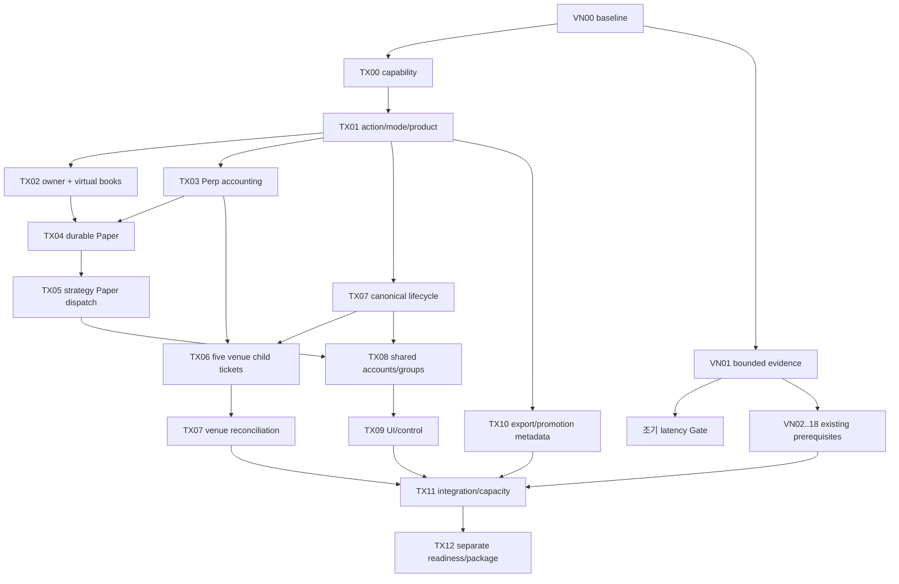

# Production 11 — VN/TX 통합 실행 계획

기존 `tickets.json`은 불변이다. 새 [tickets_production.json](tickets_production.json)이 기존 VN23개와 TX 상위/하위 티켓의 명시 DAG·hash·파일 소유권·gate를 제공한다. 기본 source는 기존531개 manifest이며 변경 후 새 production manifest에서 정확 candidate를 검증한다.

## 순서와 중복 제거

1. VN00/TX00 현재 code/capability를 고정하고 TOSS DATA_ONLY, Perp product/mode, lifecycle 계약을 확인한다.
2. VN01 오류·지연 근거를 먼저 구현/시험한다. 조기 latency Gate에서 freshness/TTL 위반 원인이 fsync/group wait이면 A2 실험 티켓을 별도로 배정한다. A1 기본 유지.
3. TX01 공통 action/mode/product/canonical event → TX02 계좌권위·귀속 → TX03 Perp 회계 → TX04 durable Paper → TX05 공통 runtime 연결.
4. VN02~09 feed/transport/recovery/GC는 기존 티켓으로 수행한다. TX에서 같은 spool/book/원장을 다시 만들지 않는다.
5. TX06은 Binance/Arcus/GRVT/Bybit/Hyperliquid별 분리. TX07 canonical lifecycle/reconciliation과 결합하되 실제 계좌 mutation gate를 열지 않는다.
6. TX08 shared account/cross-venue → TX09 UI/control → TX10 export → TX11 동시 부하/지속 Paper → TX12 acceptance/package.
7. VN19+TX12 패키지 검토 후에만 사용자 승인 cutover. VN20은 실제 P11 안정화·backlog/rollback 종료 후에만 가능.

VN13 확장은 shared state를 한 번 apply한 뒤 snapshot을 소비하게 한다. 기존 legacy Signal 전략은 호환 adapter로 받고, 새로운 Paper 액션은 같은 account owner를 거친다. VN10~12와 TX02는 ETF journal/permit seam을 공통 scope·위험 계약에 연결하되, 운영 ETF를 새 Paper 원장으로 이관하지 않는다. VN15/TX09는 한 보고 projection을 공유한다.

한 파일 한 편집자, root 최종 통합, 단순 diff 리뷰 Luna, 고위험 회계/복구 독립 reviewer를 유지한다. 현재 구현 상태는 [14](14_agent_execution_handoff.md)에 기록하며, 계획 DAG를 PASS 보고서로 쓰지 않는다.
