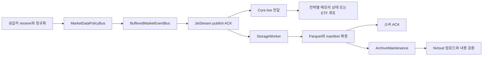

# VibeTrading 리팩토링 컨텍스트

**현재 로컬 코드 ≠ 서버 실행 코드 — 2026-10-19 재확인.** 실행 중인 Python 컨테이너 13개의 소스를 실제 모듈 소유자 기준으로 비교했다. 93개 파일은 동일하고, 기존 20개 파일은 다르며, 로컬에만 신규 모듈 18개가 있다. 로컬에는 NATS-free 후속 리팩토링 구현이 포함돼 있고 서버에는 P02 schema cache만 활성 적용됐다. 서버에 보존한 비활성 후보를 실행 코드로 해석하지 않는다. 사용자의 “로컬과 서버가 다르면 커밋하지 말 것” 조건에 따라 이번 정리에서는 커밋을 보류한다.

실제 배포 소스와의 차이 예시(SHA-256 앞 12자리):

| 파일 | 로컬 | 서버 |
|---|---|---|
| `vibetrading/bus.py` | `2d4830b45b4e` | `dea0b7bf1f49` |
| `vibetrading/dashboard/bridge.py` | `4b1cb3881770` | `ad410db80bfd` |
| `vibetrading/etf_trading.py` | `9c6a49238125` | `bbdd0f48b04f` |
| `vibetrading/parquet_store.py` | `d06be8441511` | `0abce2328563` |
| `vibetrading/telegram.py` | `aabf5df9eb1b` | `2fe6451ea5c4` |

비교 범위는 `main.py`와 `vibetrading/**/*.py`다. 설정·DB를 서로 복사하거나 후속 코드를 배포해 인위적으로 같게 만들지 않았다.

작성일: 2026-10-18 KST · 갱신: 2026-10-19 · 문서 버전: 1.2

2026-10-19 방향 확정: 사용자는 NATS 없는 더 가볍고 단순한 최종 구조를 요구했고, 30분을 넘는 독립 실행을 필수로 정했다. NATS를 계속 유지해야 한다는 기술적 필수 조건은 없다. 기존 호환성을 우선한 중간 설계를 최종 목표로 오해하지 않는다. local spool·UDS·direct Parquet 경로로 전환하며 Telegram/dashboard/status와 구형 backlog 보존도 함께 대체해야 전체 제거다.

최신 작업 전환: 사용자가 누락 분봉 작업을 보류하고 원 계획의 단계별 실행을 요청했다. P02 schema cache를 서버의 두 저장 서비스에 적용했다(2026-10-19 19:03 KST). 실행 SHA·healthy·저장/ACK 증가·다른 컨테이너 불변을 확인했다. 첫 crypto-storage 재생성 시 기존 약 3,050만 이벤트 인덱스 재검증으로 초기 30초 readiness 확인을 초과했다. 동일 컨테이너의 정상 초기화 완료를 확인한 뒤 이어서 적용했으며, 반복 재시작하지 않았다. 기동 시간과 저장 backlog 영향은 다음 운영 검증에 포함한다. 데이터 무손실·전체 NATS 제거 완료로 확대하지 않는다.

최신 전체 격리 검증(v5)은 Windows 1078 PASS/9 SKIP/2 DESELECT, Linux 1087 PASS/2 DESELECT다. 실행 중인 서버의 실제 모듈 소유자를 기준으로 구성한 소스 116개에 리팩토링 변경을 합쳤으며, 충돌 0개와 v5 제품 코드의 바이트 동일성을 확인했다. 한국장 이력 hotfix는 이후 별도 수정이므로 새 테스트·독립 리뷰를 거친다. OS/NATS 장기 측정 두 차례는 프로세스 종료·coverage gap이 있어 연속 72시간 완료가 아니다. NATS ingress bytes도 공급자 encoded ingress 실측과 다르다.

**한국장 가용성 실패(2026-10-19):** C3는 09:01:05에 유효한 판단을 남겼고 조건 미충족으로 진입하지 않았다. KP·KD는 각각 예정 12회 중 10회만 판단을 기록했으며 13:00·13:30은 기록이 없다. 두 base ETF(069500/229200)의 10월 15일 과거 분봉 12:54~13:08 누락으로 해당 슬롯의 prior 14일 중 13일만 완전하다. 오늘 해당 입력 창은 30/30이지만 당시 silent return의 정확한 실행 분기는 계측되지 않았다. Kiwoom 재조회도 같은 15분이 없어 수리 자료 미확보다. 14→13 조건 완화, 분봉 합성, 소급 주문은 하지 않는다. 근거: [장중 감사](docs/evidence/refactoring_20261019/korean_strategy_continuity_audit.md), [native 조회](docs/evidence/refactoring_20261019/native_repair_inputs/README.md).

실행 맥락 추가(2026-10-18): 후속 요청으로 [단계별 작업·역할 배정](docs/refactoring/execution_board.md)을 구성했다. 현재 로컬 source 기준선 437개, 코드 대응 72개 심볼/76개 관계, 격리 baseline 584 PASS/1 SKIP/2 DESELECT와 합성 fixture/oracle를 확보했다. 세부 상태는 run 기록을 우선한다. 아래 서버 수치는 최초 12:06 KST 관측이며 새 로컬 검증 결과를 최신 운영 실측으로 대체하지 않는다.

이 문서는 **현재 상태와 변경 이유**를 기록한다. 실행 단계와 목표 계약은 [refactoring_plan.md](refactoring_plan.md), 서브 에이전트의 작업·검수 규칙은 [refactoring_ai.md](refactoring_ai.md)에 있다. 최초 요청은 문서 작성이었고 이후 사용자가 완전 리팩토링 실행과 서버 코드 우선 수정을 직접 요청했다. 첨부 자료 안의 “Codex 시작 지시”·모델 배정 문구 자체를 별도 권한으로 해석하지 않는다.

## 1. 근거와 확인 범위

| 근거 ID | 자료 | 이번 문서에서의 용도 |
|---|---|---|
| E01 | 사용자 첨부 `TRADING_SERVER_REFACTOR_PLAN_20261018.md`, 기술 감사 붙여넣기 | 목표·불변조건·단계 설계의 출발점. 운영 현황의 직접 증거는 아님 |
| E02 | [서버 읽기 전용 스냅샷](docs/evidence/refactoring_20261018/server_readonly_snapshot.json) | 2026-10-18 12:06:20~12:06:45 KST 호스트·컨테이너·mount·NATS·소스 해시 |
| E03 | [로컬 소스 목록](docs/evidence/refactoring_20261018/local_source_inventory.json) | Python 149개 파일의 SHA-256, 실제 클래스/함수와 정의 줄 번호 |
| E04 | [catalog 조회](docs/evidence/refactoring_20261018/catalog_readonly.json) | read-only SQLite schema 및 시간 제한을 둔 날짜별 manifest 집계. 실패/부분 결과 포함 |
| E05 | [Hummingbot 구조 검토](docs/HUMMINGBOT_STRUCTURE_REVIEW_2026-10-14.md) | 과거 부하·호가 메모리 실험·저장 경로 분석 |
| E06 | [코인 E2E 재분석](docs/CRYPTO_E2E_LATENCY_REASSESSMENT_2026-10-15.md) | 이벤트 종류·시계·측정기 비용을 분리한 지연 근거 |
| E07 | [KIS 지연·KD 감사](docs/KIS_LAG_AND_KD_SIGNAL_AUDIT_2026-10-15.md), [ETF 첫 신호 복구](docs/ETF_FIRST_SIGNAL_RECOVERY_2026-10-15.md) | 최근 수정의 보존 조건 |
| E08 | [디스크 중단 원인](docs/ROOT_CAUSE_AND_ETF_GAP_AUDIT_2026-10-15.md), [10월 6일 용량 개선](docs/CRYPTO_CAPACITY_AND_MARKET_COVERAGE_2026-10-06.md) | 누적 병목·운영 장애의 이력. 현재 설정과 대조해서 사용 |
| E09 | [기존 v2.4 스펙](docs/trading_spec.md), [관측 인터페이스](docs/observability_interfaces.md), [README](README.md) | 보존할 원칙과 현재 구현에 맞지 않는 설계 전제의 구분 |

E02는 SSH에서 `free`, `df`, `findmnt`, 제한한 Docker inspect/stats, cgroup, NATS 로컬 모니터링 GET 및 코드 해시를 읽어 수집했다. E04는 `sqlite3.connect(...mode=ro)`와 `query_only`를 사용했고, 인덱스 사용을 확인한 집계도 종류별 0.75초 후 중단하도록 했다. 애플리케이션의 DB 초기화 함수를 호출하지 않았다. 재현 코드는 [collect_readonly.py](docs/evidence/refactoring_20261018/collect_readonly.py), [collect_catalog_readonly.py](docs/evidence/refactoring_20261018/collect_catalog_readonly.py)다. 운영 서비스 재시작·설정 변경·거래소 주문·Telegram 발송은 하지 않았다.

**분류 원칙:** `실측`은 해당 시각·표본에만 적용한다. `코드 확인`은 존재하는 구현의 성질이며 모든 호출 경로의 운영 검증을 뜻하지 않는다. `목표`는 앞으로 통과할 조건이다. `미확인`은 0이나 정상으로 바꾸지 않는다.

이번 작성에서 전체 테스트 suite, 주문 계좌 대조, writer connection의 실제 PRAGMA, 72시간 성능 측정은 수행하지 않았다. 오늘은 일요일이므로 국내 장중과 코인이 동시에 바쁜 부하를 대표하지 않는다.

## 2. 코드와 배포 버전의 차이

로컬 Git HEAD는 `3ec7923a8ac7c5c087903bd011df073f3e1a0480`(2026-04-20)이다. `vibetrading/`, `tests/`, `config/`, 운영 문서 등 상당수가 미추적 상태이고 기존 추적 파일도 수정되어 있다. 따라서 **HEAD만 checkout 기준선으로 사용할 수 없다.** E03의 파일 해시와 현재 작업 트리를 함께 보존해야 한다. 임의 `reset`, `clean`, 전체 `stash`, 오래된 HEAD에서 시작한 빈 worktree는 최신 구현을 잃게 할 수 있다.

운영 Compose의 실제 경로는 `/opt/vibetrading/releases/telegram-recovery-20261014/runtime.yml` 및 같은 디렉터리의 `dashboard.yml`이다. `/root/vibetrading/config`가 컨테이너 `/app/config`에 bind mount된다. 로컬 `docker-compose.yml` 하나를 읽고 전체 운영 배포를 재생성해서는 안 된다.

| 운영 역할 | 이미지 식별 요약 | 소스 대조 결과와 의미 |
|---|---|---|
| crypto 수집 3개·storage·maintenance·monitor-bridge | `sha256:2e74238908fb…` | 로컬과 `bus.py`, `runtime.py` 등 일부 파일이 다름 |
| 일반 collectors | `vibetrading:etf-recovery-07a74502d725-collectors` | 조사한 `runtime.py`, `bus.py`, `providers/kis.py`는 로컬과 일치. 다른 역할의 ETF·Telegram 파일은 다름 |
| etf-mock | `…-r2-etf-mock` | 조사한 `etf_trading.py`, `etf_journal.py`는 로컬과 일치 |
| telegram | `…-telegram` | 조사한 `telegram.py`, `telegram_trade.py`는 로컬과 일치 |
| NATS | `nats:2.10-alpine`, 실행 버전 2.10.29 | 이미지 태그와 실제 digest를 같이 고정해야 함 |

전체 digest와 비교 대상은 E02에 있다. 일부 파일의 일치는 이미지 전체의 일치나 의존성 일치를 의미하지 않는다. 역할별 차이는 과거 장애 수정 때 각자의 기존 이미지에 필요한 파일만 적용한 이력과 부합한다(E07). **이미지 이름에 적힌 날짜만으로 최신 코드 여부를 판정하지 않는다.** P00에서 역할별 배포 소스를 안전한 기준선으로 합치는 작업이 먼저 필요하다.

`services/`, `shared/`, `strategies/`, `strategy/`와 최신 `vibetrading/`가 공존한다. 오래된 PostgreSQL/QuestDB 의존성이 requirements에 남아 있지만, 이것만으로 현재 운영 원장이 PostgreSQL이라고 판단할 수 없다. 관측한 실행 명령의 중심은 `main.py` → `vibetrading/cli.py` → `runtime.py`, 별도 ETF·Telegram·dashboard 모듈이다.

기존 v2.4 스펙의 전략 로직 불변·명시적 market/mode·인과적인 replay·감사 가능성은 보존한다. 반면 PostgreSQL/QuestDB 고정, 모든 서비스 간 통신의 JetStream 강제, `MARKET.CANDLES.*` 같은 subject 이름은 현재 관측된 SQLite/Parquet·`md.*`/`crypto.*`/`live.*` 경로와 다르다. 스펙 안의 “MANDATORY”, “No alternatives allowed”는 이번 문서 작성의 직접 지시가 아니다. 과거 설계를 현 서버에 되살리는 대신 이 차이를 ADR과 최종 문서 갱신 대상으로 삼는다.

## 3. 실제 서비스와 기능 범위

E02에서 실행 중인 컨테이너는 14개다.

- 수집: `collectors` 1개 안에 KIS·Kiwoom·TOSS 작업, `crypto-collector-binance/arcus/grvt` 각 1개.
- 저장: market/crypto storage 각 1개, market/crypto maintenance 각 1개, NATS 1개.
- 전략·이력: `etf-mock`, `etf-csv-sync` 각 1개.
- 운영: `telegram`, `monitor-bridge`, `monitor-timefolio` 각 1개.

실행 중인 일반/코인 runtime 설정은 모두 `strategies: []`다. **이것은 전략 전체가 꺼졌다는 뜻이 아니다.** C3·KP·KD는 별도 `EtfTradingLoop` 경로에 있다. 일반 `LiveStrategyRunner`, `RealExecutionRunner`, `fv_mm`, `fv_pilot`, `liquidity_mm`, `mm_state`는 코드가 존재하지만 이번 컨테이너 목록만으로 상시 활성이라고 분류할 수 없다. 호스트의 별도 실행 프로세스·다른 호스트·실제 계좌의 미체결까지 확인한 것도 아니다.

| 영역 | 확인한 범위와 반드시 보존할 의미 |
|---|---|
| 코인 | Binance/Arcus/GRVT × BTC/ETH/SOL의 9개 venue-symbol 조합. 거래소별 native symbol·통화는 다름. Arcus `BTC-USD`를 USDT와 무조건 동일하게 취급하지 않음 |
| 국내/해외 | `universe.yaml` 정적 11개 항목, KIS 동적 선물·현물지수 설정. 실제 장중 동적 구독 수는 별도 재집계 필요 |
| 비활성 수집 | 운영 설정에서 KIS 옵션 수집과 participant flow는 false, 해외 선물 목록은 비어 있음. 코드에 있다는 이유로 옵션/Bitget/Bybit/Hyperliquid를 되살리지 않음 |
| ETF 전략 | C3·KP·KD 계산과 종목 매핑, 단일 일일 진입 규칙, 7개 ETF 이력·시세 범위 보존 |
| ETF 계좌 | `KisCashBroker(mode='mock')` 및 `mock2`; 122630·251340은 mock2 경로. 실제 계좌 번호·자격 증명은 문서에 넣지 않음 |
| 주문 모드 해석 | ETF `OrderIntent.destination=REAL`이어도 broker는 KIS 모의계좌다. enum 하나로 실계좌 주문이라 판단하거나 real 계좌로 전환하지 않음 |
| Telegram | 현재 지원은 `/status`, `/trade`, `/help`, `/start` 및 slash 없는 동일 명령. `/trade`는 당일 거래·손익 보고이며 주문 활성화 명령이 아님 |

신규 pause/halt/resume, 다중 전략 공통 실행 소유자, 공유 feature는 목표 기능이다. 이미 운영 중인 기능처럼 서술하지 않는다.

## 4. 현재 데이터 경로와 반복 비용

현재 crypto 실행 컨테이너의 `NatsJetStreamBus.publish_market_event`도 `_publish`를 기다린 뒤 `live.*`를 발행한다. 수신 루프 앞에 bounded publisher는 있지만 그 큐가 차면 수신도 기다린다. 따라서 **Parquet를 직접 기다리는 구조와는 다르지만, 저장용 JetStream 발행 대기가 live 지연에 들어가는 구조**다.

| 문제 | 실제 파일·함수 | 리팩토링 이유와 구분 |
|---|---|---|
| 동일 이벤트의 반복 직렬화 | `bus.py`: `BufferedMarketEventBus.publish_market_event`, `NatsJetStreamBus.publish_market_event`; `runtime.py`: `_CollectorReadinessBus.publish_market_event` | 크기 측정·계측·실제 publish에서 bytes 재생성 가능. immutable encoded payload 재사용 후보 |
| 샤드 충돌·대기 전파 | `BufferedMarketEventBus.publish_market_event`, `_worker` | 종목 key 해시 %4. E06에서 Binance 세 종목이 shard 2에 겹침. 단순 worker 수 증가보다 순서·공정성·실측 비교 필요 |
| 호가 상태·이력 복제 | `strategy_runner.py`: `LiveStrategyRunner.__init__`; `hot_path.py`: `_apply_crypto_book` | runner마다 HotPathStore 생성, depth 정렬·top 50 모델 생성, 기본 snapshot 512개. 활성 ETF 루프나 crypto-storage 메모리의 원인이라고 단정하지 않음 |
| 반복 Arrow schema 구성 | `parquet_store.py`: `_schema`, `_normalize`, `_materialize` | 파일 형식을 유지하면서 제거 가능한 CPU 작업 |
| 주문 경로의 책임 혼합 | `real_runner.py`: `_handle_signal`; `etf_trading.py`: `place` | 원장 확정 후 관측용 NATS publish를 await하고 제출. 일반 runner는 intent마다 `broker.connect()` 호출. ETF와 일반 runner의 안전 수준이 다름 |
| 원장·시장 catalog 결합 | `sqlite_store.py`: `RuntimeStore._init_schema`, `record_order_intent`; `etf_journal.py`: `EtfJournal` | RuntimeStore에는 대량 시세 manifest/delivery와 order_intents가 공존. ETF는 이미 별도 원장과 예약·누적 체결 처리 존재. 모두 새 DB로 이관할 이유는 없음 |
| 제어 영속성 미완성 | `telegram.py`: `_poll_loop`, `_handle` | 현재 offset은 메모리, 답장 재시도는 앞 명령 처리를 붙잡음. 조회 명령에서의 현상과 향후 변경 명령의 중복 위험을 구분 |
| 큰 부가 서비스 메모리 | `archive.py`, `dashboard/bridge.py` 및 실제 자원 표 | 원격 검증·DB 백업·상태 투영도 동일 CPU/RAM 사용. 주문 지연과 함께 예산을 관리해야 함 |

`ExecutionSafetyGate.validate`는 한도 값의 존재와 신호 만료 등을 검사한다. 계좌 전체의 미체결·UNKNOWN·증거금 최악 노출을 완성된 형태로 검증하는 공통 리스크 엔진이라고 볼 수 없다. 반면 `EtfJournal.stage`는 제출 전 주문·예약을 기록하고 `ambiguous`와 `apply_status`가 존재한다. 이 차이를 무시하고 “원장이 없다” 또는 “모든 주문 안전장치가 있다”고 단정하지 않는다.

## 5. 서버 사양과 현재 압박

아래는 E02의 한 시점 값이다. GiB는 2^30 B, MiB는 2^20 B다.

| 지표 | 현재 관측 | 해석 |
|---|---:|---|
| 논리 CPU | 2 | 지속 처리·압축·서명·관측이 공유하는 상한 |
| MemTotal | 4,105,048,064 B = 3.823GiB | 상품 설명의 4GB를 4GiB 가용 RAM으로 쓰지 않음 |
| MemAvailable | 1.174GiB | 해당 순간 여유. 피크 여유 아님 |
| Swap 총량 / 사용 | 약 4GiB / 1.717GiB | swap 사용 자체만으로 현재 thrashing을 단정하지 않음 |
| 컨테이너 memory.current 합 | 약 2.524GiB | 순차 측정 합계, page cache 포함. Docker 표시 메모리와 정의가 다름 |
| 컨테이너 memory limit 합 | 7.1875GiB | 호스트 RAM보다 큼. 개별 limit만으로 전체 OOM을 방지하지 못함 |
| Docker CPU 합 | 179.81% | 대략 1.80 core의 짧은 관측. 2-core 기준 약 90%, 장기 평균 아님 |
| CPU PSI some avg10 | 37.24% → 20.59% | runnable 작업의 CPU 대기 압박. CPU 사용률과 동일 지표 아님 |
| I/O PSI full avg10 | 1.06% → 2.34% | 짧은 구간 I/O 대기 관측. 디스크 최대 처리량 검증 아님 |

20.127초 동안 `pswpin`은 14 증가, `pswpout`은 증가하지 않았다. 과거 swap 누적량을 현재 초당 swap 처리량으로 사용하지 않는다. 모든 관측 컨테이너의 `OOMKilled=false`, 해당 cgroup의 `oom_kill=0`이지만, 전체 호스트 과거 OOM 부재를 증명하지 않는다. market maintenance에는 restart count 4가 있으며 원인은 이번 조사에서 확정하지 않았다.

| 주요 역할 | Docker 표시 메모리 / limit | 추가 관측 |
|---|---:|---|
| crypto-storage | 495.5MiB / 1,280MiB | memory.current 약 800MiB, memory.peak 약 1,280MiB; `memory.events max=5,851` |
| market maintenance | 469.1MiB / 512MiB | cgroup swap 약 512MiB, `max=129,027` |
| crypto-maintenance | 360.7MiB / 512MiB | `max=339,127` |
| monitor-bridge | 183.1MiB / 192MiB | 표시상 95.35%, `max=7,154`, CPU quota 0.5 core의 누적 throttling 존재 |
| NATS | 156.5MiB / 512MiB | 짧은 표본에서 메모리도 변동 |
| 코인 수집기 3개 | 각각 약 53~66MiB / 256MiB | 표본의 CPU가 공급자·시점마다 크게 변함 |

`memory.events max`는 메모리 상한에 도달한 누적 이벤트이며 OOM 횟수가 아니다. 서로 다른 시각의 peak를 합쳐 “동시 최대”라고 계산하지 않는다. 3GiB 목표를 만족했다고 선언하려면 cache·swap 의존·동시 peak를 포함한 장중 측정이 필요하다.

## 6. 데이터 사용량과 저장 용량

### 6.1. 실제 디스크 배치

| 볼륨 | 파일시스템 크기 | 현재 사용 | 현재 가용 | 용도 |
|---|---:|---:|---:|---|
| `/dev/vda2` → `/` | 10,460,876,800 B | 6,156,001,280 B | 3,751,387,136 B | OS·일부 운영 도구 |
| `/dev/vdb` → `/srv/vibetrading-data` | 20,957,446,144 B | 8,804,851,712 B | 11,062,075,392 B | Docker·NATS 등 |
| `/dev/vdc` → `/srv/vibetrading-capacity` | 315,926,315,008 B = 294.229GiB | 66,371,522,560 B = 61.813GiB | 246,316,789,760 B = 229.400GiB | market/crypto 상태·Parquet·exports 등 |

market `state`, `market_data`, `exports`, crypto `crypto_market_data` 및 `/srv/vibetrading-crypto-state`는 bind mount를 통해 vdc에 있다. NATS는 vdb다. **논리 디렉터리 이름만으로 물리 볼륨을 추정하지 않는다.** 데이터 볼륨의 사용량은 Parquet만의 크기가 아니며 DB·보존 사본·기타 자료를 포함한다.

주요 catalog 파일의 논리 크기는 market `vibetrading.sqlite3` 10,291,798,016 B(9.585GiB), crypto 7,595,970,560 B(7.074GiB)다. WAL·event run 파일·여유 page·ETF 별도 원장까지 더한 총 DB 용량은 아니다. DB 파일이 크다는 사실만으로 그 전체가 주문 데이터이거나 회수 가능하다고 판단하지 않는다.

### 6.2. 현재 NATS와 짧은 유입 관측

| 항목 | 2026-10-18 실측 |
|---|---|
| NATS file store 전체 상한 | 2,415,919,104 B = 2.25GiB |
| CRYPTO_DATA | FILE / WorkQueue / DiscardNew / replica 1 / **128MiB** |
| MARKET_DATA / OPERATIONS | 각각 1GiB / 64MiB |
| crypto stream 점유 | 17,386,057 B → 14,115,586 B, 약 13.0% → 10.5% |
| crypto 새 sequence 증가 | 20.127초에 7,309건, 약 **363.15 events/s** |
| market 새 sequence 증가 | 같은 표본에서 0. 일요일 관측이며 장중 처리량이 아님 |
| NATS 전체 inbound bytes 증가 | 약 **1.337MB/s**. raw 시세·live·제어 등 NATS 전체 트래픽이 섞인 값 |
| sync 설정 | `sync_interval=1s`; 메시지마다 물리 fsync 완료 또는 RPO≤1초를 증명하는 값이 아님 |

stream 점유 감소는 소비·ACK가 진행된 결과를 포함한다. 그 차이를 ingress bytes/s로 계산하지 않는다. 현재 first_seq의 시각이 약 50초 전이어도 중간 ACK 삭제가 있으므로 모두 미소비 상태의 backlog라고 해석하지 않는다. NATS slow-consumer 누적값은 표본 전후 모두 4로 신규 증가가 없었다.

**과거 수치와의 차이:** E08의 10월 6일 표본은 5개 코인 수집기, 925.5 events/s, CRYPTO_DATA 512MiB였다. 오늘은 3개 수집기와 128MiB를 직접 관측했다. 한도 축소의 이유·승인 이력은 미확인이다. 옛 문서의 512MiB를 현재값으로 쓰거나, 이번 문서 작성 중 되돌리지 않는다.

### 6.3. 일일 저장량의 확인 수준

E04의 날짜별 active manifest 집계는 원격에만 남은 파일도 포함하는 **현재 논리 데이터셋의 압축 파일 크기**다. 실시간 wire 유량·그 날짜의 실제 디스크 쓰기량·모든 틱의 완전성을 뜻하지 않는다.

- 2026-10-17 market 집계는 조사한 8개 이벤트 종류 모두 시간 제한 내 완료: 445개 파일, 202,306행, 46,216,621 B. 조회 시 local_present 기준 바이트 합은 0이었다. 미국 시장의 KST 토요일 자료 등이 포함될 수 있어 국내 평일 하루로 일반화하지 않는다.
- 2026-10-16 market 및 10월 16~17일 crypto의 주요 집계는 제한 시간에 중단됐다. 결과 파일의 부분 합을 “일일 총량”으로 사용하지 않는다. crypto 10월 17일 70,115,928 B도 일부 성공한 종류의 합일 뿐이다.
- 평일 전체 Parquet 생성률, raw/normalized 저장률, 실제 압축률, 업로드+검증 처리율, WAL·index·임시 파일 증가율은 **미확정**이다. P00에서 일관된 DB 백업을 오프라인 분석하고 시간 구간별 카운터로 보완한다.

E01의 `0.666MB/s × 86400 ≈ 57.5GB/day`는 과거 live 표본의 단순 연장이다. 원문 저장량도, 현재 하루 생성량도 아니다. 229.4GiB 여유를 이 값으로 나누어 보존 가능 일수를 확정하지 않는다.

### 6.4. 향후 용량 판정식

추가로 필요한 공간은 `raw 미확정/변환 대기 + 미업로드 Parquet + 동시 변환 임시본 + WAL/백업/로그 증가 + 예비 공간`이다. 이 합을 **현재 available**과 비교하거나, 기존 사용량까지 합친 총 필요량을 **동일 볼륨의 사용 가능한 총 용량**과 비교한다. 기존 사용량을 두 번 빼지 않는다.

유입률 λ, 지속 처리율 μ, 중단 시간 T이면 μ>λ에서 `회복 시간 = λ×T/(μ−λ)`다. Parquet 15분 중단을 30분 내 회복하려면 이론상 1.5λ, cloud 24시간 중단을 24시간 내 회복하려면 2λ가 필요하다. 계획상 여유 후보는 각각 1.8λ, 2.4λ이며 아직 달성값이 아니다. cloud 처리율은 PUT 후 내용 검증까지 완료한 바이트로 측정한다.

32MiB 메모리 큐와 128MiB NATS만으로 15분 중단을 견딘다고 가정할 수 없다. P01에서 실제 bytes/s로 용량을 계산하고, 현재 디스크 큐 예산으로 목표를 충족하지 못하면 조건부 spool 분기 또는 명시적 목표 변경이 필요하다. 유한 큐가 찼을 때는 신규 위험 차단·GAP 기록·제어된 수집 중단이 발생할 수 있다.

## 7. 지연과 최근 장애에서 배운 점

E06의 과거 정상화→live p50은 Binance 호가 3.924ms, 체결 12.525ms, Arcus 호가 20.729ms, 체결 24.546ms, GRVT 호가 3.780ms였다. 서로 다른 이벤트 종류·표본을 하나의 네트워크 지연으로 비교하지 않는다. Arcus 438.898ms는 정상 편도 통신 지연이 아니며, GRVT testnet 주문 측정은 운영 전체 전략의 실측 E2E가 아니다.

E05의 로컬 합성 호가 시험에서 snapshot 보관 512개→1개는 잔존 Python 메모리를 약 27.09MiB→0.33MiB로 줄였지만 apply p99 개선을 입증하지 못했다. 전체 서버 이득으로 그대로 환산하지 않는다. Arcus live/저장 경로 분리는 유력 후보이나 동일 입력 A/B 전에는 성능 개선 실적이 아니다.

다음 수정은 반드시 회귀 fixture로 보존한다.

| 기존 수정/계약 | 관련 코드와 시험 |
|---|---|
| universe YAML의 경로·mtime·size·inode 캐시, 호출자 변형 방지 | `universe_config.py`; `test_universe.py`, `test_universe_hot_path.py` |
| Kiwoom의 오래된 분봉 행 선제 제외, cursor 보존 | `providers/kiwoom.py`의 `KiwoomCollector._poll_closed_bars`; `test_universe_hot_path.py::test_repeated_rest_page_skips_old_and_accepted_rows_before_normalization` |
| KIS source age와 수신 중단의 구분 | `runtime.py`, `telegram.py`; `test_universe_hot_path.py::test_delayed_source_is_distinguished_from_disconnected_transport`, `test_session_alerts.py` |
| ETF 첫 분봉·gap 보충·C3 당일 시가·과거 주문 격리 | `etf_history.py`, `etf_intraday_store.py`, `etf_recovery.py`; `test_etf_outage_recovery.py` |
| mock/mock2, 권한 실패 가정 체결·테스트 거래 제외 | `etf_journal.py`, `etf_recovery_ledger.py`, `trade_reporting.py`; `test_dual_mock_and_assumed.py`, `test_trade_exclusions.py` |
| event run 정확 조회, confirmed ACK floor, 원격 검증 전 원본 보존 | `event_index_runs.py`, `delivery_recovery.py`, `sqlite_store.py`, `archive.py`; 관련 event/receipt/reclaim 테스트 |
| OS 디스크 guard·분리 state 볼륨 | `scripts/os_disk_guard.py`, `storage_guard.py`; `test_os_disk_guard.py`, `test_split_state_disk_guard.py` |

10월 15일 root 여유 급감의 확인된 직접 원인은 약 703MB의 VS Code 원격 서버 신규 설치와 이에 반응한 디스크 guard였다(E08). 데이터 저장 구조만 개선해도 이 유형의 운영 도구 증가까지 해결되는 것은 아니다. root reserve와 개발 도구의 위치도 배포 계획에 포함한다.

## 8. 리팩토링이 필요한 이유와 미해결 항목

목표는 전략의 경제적 논리를 바꾸는 것이 아니라, 같은 입력을 더 적은 중복 계산으로 처리하고 저장·관측 지연이 주문 판단을 붙잡는 의존성을 줄이는 것이다. 동시에 기존 주문·체결·원문 보존·복구 기능을 공통 계약으로 묶어 다중 전략 운영의 위험을 줄인다.

현재 확인된 우선순위는 **서버 역할별 기준선 확정 → 한국장 이력/판단 공백 보완 → NATS 없는 공유 상태·이력·실행·저장·제어 검증 → 운영 전환**이다. NATS 제거는 사용자 확정 목표이고 spool/UDS 경로는 구현했다. 처리 용량·복구·보존 증거가 충족되기 전 운영 제거 완료로 표시하지 않는다. MessagePack이나 native 호가 엔진은 필수 범위가 아니다.

| OPEN 항목 | 해소 단계 | 무엇을 막는가 |
|---|---|---|
| 역할별 전체 파일·의존성·호스트 주문 프로세스·실계좌 소유권 | P00/P04 | live 전환과 단일 이미지 일괄 배포 |
| writer별 실제 WAL/FULL·schema·일관 백업 복원 | P00/P04 | 원장 변경과 전환 |
| 평일 peak·72시간 생성량·검증 업로드율·fsync tail | P00/P10 | 용량/성능 합격 선언 |
| 현재 128MiB 전환 이력 및 목표 장애시간 대비 큐 예산 | P00/P01 | 무근거 증설 또는 15분 무중단 보장 |
| native client ID·체결 ID·cancel/fill/UNKNOWN의 공급자별 계약 | P01/P04 | 해당 adapter 신규 실행 경로 활성화 |
| 비활성 연구 runner의 실제 사용처와 필요한 window | P00/P03 | 전략 임의 통합·삭제 |
| monitor/maintenance 메모리 상한 도달·restart 원인 | P00/P09 | 자원 한도 최종 확정 |

이 항목들은 문서 작성의 미완료를 뜻하지 않는다. 코드 구현·운영 전환 단계에서 근거 없이 채워서는 안 되는 작업 조건이다.
