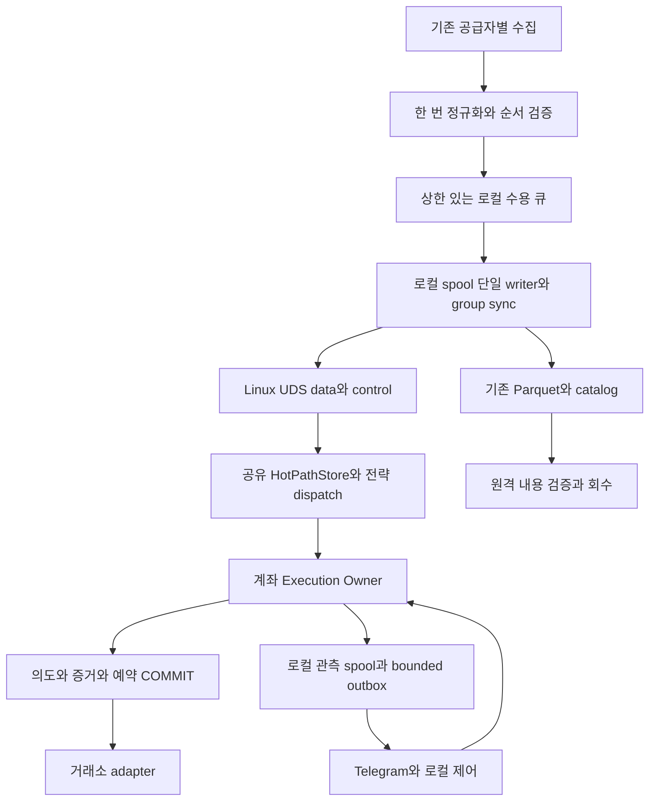

# VibeTrading 서버 리팩토링 실행 계획

작성일: 2026-10-18 KST · 갱신: 2026-10-19 · 버전: 1.2 · 상태: **서버 기준 구현·격리 검증, 운영 전환 전**

최신 사용자 결정: 최종 운영 구조는 **NATS를 사용하지 않는다**. 30분을 넘는 독립 실행도 필수다. 기존 NATS 코드 보존은 전환 호환성 목적이며 최종 아키텍처의 필수 의존성이 아니다.

실행 상태: [단계별 작업·역할 배정 보드](docs/refactoring/execution_board.md)와 [현재 gate 기록](docs/refactoring/runs/20261018-stage-assignment/gates.json)을 참조한다. 계획 본문과 실제 완료 증거를 구분한다.

2026-10-19 최신 지시로 아래 한국장 결손 hotfix는 **DEFERRED_BY_USER**다. 현재 작업은 P09 역할별 서버 릴리스와 P10/P11 점진 전환이다. P02 schema cache는 실제 storage/crypto-storage에 적용했고 두 서비스 healthy·소스 SHA·다른 컨테이너 불변을 확인했다. 나머지 통합 구현은 서버의 비활성 후보로 보존했다. 과거 아래 KR 표는 보류 범위를 기록하며 다음 실행 지시가 아니다.

| 순서 | 수정 파일·함수 | 달성 목표·판정 |
|---|---|---|
| KR1 | `etf_history_contract.py`: `session_coverage`, `prior_slot_readiness` | 09:01~15:20의 380 continuous 봉과 15:30 auction 구분. 14일 중 결손 슬롯을 명시. 13일로 조건 완화 금지 |
| KR2 | `etf_csv_sync.py`: `session_minute_rows`, `capture`, `sync_once`; `etf_csv_history.py`: `append_closed` | 실제 csv-sync 역할의 capture 잠금과 최근 수정 보존. 불완전 날짜를 완료 이력으로 append하지 않음 |
| KR3 | `etf_csv_history.py`: `repair_missing_minutes`, `recover_repair`; `NativeMinuteRepairEvidence.validated_rows` | 검증된 동일 native 자료로 누락만 원자적으로 추가. 기존 셀/원본/증거 보존, 반복 crash 복구. 실제 원문 부족이면 적용 차단 |
| KR4 | `etf_history.py`: `prepare`; `etf_trading.py`: `event`, `audit_missing_slots`; `etf_signal_diagnostics.py` | blocked_data·missing_event·evaluated를 별도 durable 기록. 기존 economic decision과 C3 경로 보존, 소급 주문 0 |
| KR5 | 역할별 overlay 이미지·배포/rollback manifest | ETF/csv-sync 두 서비스만 검증된 preimage에서 갱신. 기존 환경/계좌/다른 서비스 유지. 실서버 적용 여부는 배포 영수증으로 판정 |

현재 문제·측정값은 [refactoring_context.md](refactoring_context.md), 작업 배정·검수 방식은 [refactoring_ai.md](refactoring_ai.md)를 따른다. 첨부 master plan의 P00~P12 구분을 유지하되, `@LEDGER` 같은 별칭을 실제 파일과 함수에 연결했다. 파일별 실제 구현·통과 범위는 실행 보드와 테스트 source hash로 판정한다.

## 1. 리팩토링 목표와 범위

1. 저장용 publish ACK·Parquet·클라우드·Telegram 대기를 시장 판단과 주문 전송의 필수 경로에서 제거한다. 주문 의도·증거·예약의 확정은 유지한다.
2. 동일 feed의 호가 복원·기본 이력·공통 feature를 엔진 안에서 한 번 수행한다. 전략 수가 늘어도 같은 상태를 여러 번 정렬·복사하지 않는다.
3. 계좌 범위별 단일 실행 소유자, DB 파일별 write 직렬화, 멱등 intent/fill, UNKNOWN 대조, halt/resume 경계를 명시한다.
4. 기존 원문·정밀도·sequence·Parquet·원격 검증·ACK floor·회수 조건을 보존하며, 복구가 불가능한 구간을 숨기지 않는다.
5. 2 vCPU·3.823GiB 호스트에서 유한 큐·cache·outbox·임시 파일을 사용하고, 전체 앱 peak 3GiB라는 계획 목표를 실제 장중 부하로 검증한다.
6. C3·KP·KD, mock/mock2, 최근 KIS·ETF 복구 수정, `/trade` 거래 보고를 보존한다. 리팩토링을 이유로 신규 실거래 전략이나 수집 종목을 활성화하지 않는다.

신규 알파/FV 모델·파라미터 탐색·레버리지/자금 배분 변경·신규 거래소·전체 과거 데이터 변환은 범위 밖이다. PostgreSQL/Redis/DuckDB·범용 RPC·자체 트리·Cython/Rust 전환은 기본 작업이 아니다. 기존 SQLite·PyArrow·거래소 adapter를 재사용하고, 최종 통신은 local spool/UDS로 대체한다.

### 1.1. 이번 조사로 수정한 원안의 전제

| 항목 | 이 계획의 결정 |
|---|---|
| 현재 코드 | 로컬 HEAD만으로 부족. 미추적 최신 코드와 역할별 이미지 SHA를 P00 기준선에 함께 포함 |
| 현재 원장 | RuntimeStore와 별도 EtfJournal 등 복수 경로가 존재. SQLite 재사용, 주문 자료를 하나의 거대한 catalog로 합치지 않음 |
| 이미 구현된 개선 | universe 캐시·Kiwoom 오래된 행 제거·event run·confirmed ACK·remote verification은 보존/회귀 검증 대상으로 처리 |
| 기존 v2.4 스펙 | 전략 불변·market/mode 명시·인과성 원칙은 보존. PostgreSQL/QuestDB 고정·구형 subject·서비스마다 프로세스라는 전제는 실제 배포와 구분해 ADR에 기록 |
| 실제 상시 전략 | runtime 설정의 strategies는 비어 있고 ETF는 별도 프로세스. 일반 runner의 병목을 현재 모든 서비스의 병목으로 과장하지 않음 |
| 현재 큐 한도 | CRYPTO_DATA는 실측 128MiB. 과거 512MiB 또는 첨부의 예시 숫자를 기본값으로 덮어쓰지 않음 |
| Telegram | `/trade`는 조회 기능 유지. 신규 제어 명령은 P04의 gate가 준비된 후 추가 |
| 저장 구조 | bounded local spool → Linux UDS 공유 엔진, 별도 spool → Parquet worker. NATS는 전환 호환 코드로만 보존 |

## 2. 목표 구조와 필수 계약

그림의 각 상자는 논리 책임이며 새 컨테이너를 하나씩 만들라는 뜻이 아니다. 코인 공급자 3개 프로세스는 우선 유지한다. 일반 collectors의 공유 루프는 최근 개선을 보존하고 남은 blocking 근거가 있을 때만 추가 분리한다.

### 2.1. NATS 제거 필수 작업의 실제 파일·함수

| 단계 | 수정·추가 파일과 핵심 함수 | 달성 목표·검증 |
|---|---|---|
| P05-S1 | `market_spool.py`: `MarketSpool.append/flush/seal`, `SpoolReader.read_batch` | APPENDED/DURABLE 분리, 체크섬·incarnation·유한 디스크/record/segment, incremental 읽기. 부분 tail·fsync 실패·회전·재시작 |
| P05-S2 | `local_transport.py`: `LocalTransportServer`, `LocalTransportClient` | Linux UDS data/control, peer UID, 유한 byte/count/age, RECEIVED/APPLIED/DURABLE 분리, GAP·disconnect 즉시 invalid |
| P05-S3 | `local_pipeline.py`: `SpoolingMarketPublisher` | 콜백은 byte 수용만 수행. 단일 writer thread group sync 후 UDS 전달, 기존 prefix는 검증된 engine handoff 없이는 건너뛰지 않음 |
| P05-S4 | `local_engine.py`: `LocalMarketEngine.on_frame/apply_replay/handoff/event_source` | 공유 상태 한 번 적용, native sequence와 ingress cursor 구분, C/H replay에 주문 생성 없음, bounded ETF source |
| P05-S5 | `local_observation.py`: `LocalObservationBus` | signal/order/system 관측을 로컬에 유한 수용. NATS ACK와 주문 제출 독립 |
| P05-S6/P07-L | `local_storage.py`: 직접 spool 소비와 기존 `ParquetBatchWriter` | Parquet fsync·manifest COMMIT 뒤 local consumer 확인. 중복·GAP·관측 보존. source 삭제는 별도 증명 전 금지 |
| P09-L | `local_config.py`, `local_runtime.py`: `validate_runtime/run_collector/replay_startup/run_engine` | 최종 역할에 NATS 연결 없음. 생산 측정 identity/hash와 1800초 초과 남은 수용 예산·mount·초기화 순서 검증 |
| P08-L/P11-L | Telegram·dashboard·status 로컬 관측 소비, 전환 manifest/role 배포 | NATS 없이 보고·모니터링 유지, 구형 backlog 소비·이전 후 서비스 제거 |

추가 구현하던 spool→NATS bridge는 최종 요구에 불필요하여 신규 소스에서 제거했다. 기존 운영 NATS 경로는 전환·구형 backlog 확인 전까지 보존한다. 가상 1801초 테스트는 실제 장중 peak·30분 wall-clock·72시간 측정 및 전체 RSS·회복률 증명을 대신하지 않는다.

### C01. 시세 비동기 보관, 주문 사실은 제출 전 확정

기본 목표는 첨부의 **Policy A**다. 신규 주문 전에 `intent + DecisionEvidence + reservation + stable client_order_id + submit attempt`를 한 주문 원장 transaction으로 확정한다. 시세 전체를 주문마다 fsync하는 barrier를 추가하지 않는다. Policy B를 병행 구현하지 않는다.

이 선택은 마지막 확정 이전의 시세나 엔진 적용 trace가 crash 때 유실될 수 있음을 허용한다. 작은 DecisionEvidence는 주문의 판단 근거이며 전체 lookback의 무손실 재현을 보장하지 않는다. 기존에 별도 감사 의무가 확인되면 해당 전환 계약을 다시 검토한다.

### C02. 기존 이벤트를 확장하고 정밀도·순서를 보존

`models.py`의 `BaseMarketEvent`, `InstrumentId`, `OrderBookEvent`, `Bar1mEvent`를 기반으로 한다. 이미 있는 `collector_run_id`, `connection_id`, `receive_sequence`, `record_index`, `native_event_id`, `receive_monotonic_ns`, `sync_generation`, first/final/previous update ID를 우선 매핑한다. 이름만 다른 새 envelope를 전체 경로에 이중 생성하지 않는다.

추가 계약은 producer incarnation/connection epoch의 수명, boot/clock domain, engine incarnation/apply_seq, input version vector, bar의 available_at/revision, feed quality다. 기존 `connection_id`가 재접속 때 새로 생성되는지와 seq 초기화 위치를 adapter별로 확인한 뒤 의미를 고정한다. 필터로 제외된 이벤트가 local seq에 포함되는 경우 skip coverage 또는 전달 stream 단위를 명시한다.

가격·수량은 Decimal/정확 문자열을 기본으로 보존한다. 주문 tick/lot과 시세 정밀도는 별개다. 정수화는 손실 없는 scale·overflow 검사·원문 왕복이 입증된 경우만 한다. 현재 Arrow decimal128(38,18) 범위를 넘는 값은 조용히 반올림하지 않고 명시적으로 거절/격리한다. 호가 raw_payload 보존 범위를 모든 trade wire frame까지 저장하는 것으로 과장하지 않는다.

### C03. 공유 상태·이력과 인과성

엔진 이벤트 루프 하나가 mutable market state의 writer다. 호가 한 메시지의 모든 변경을 적용한 뒤 version을 올리고 전략에 immutable view를 전달한다. callback에는 DB/파일/HTTP/압축 await를 넣지 않는다. worker 결과는 사용한 input version을 돌려주고 stale 결과를 주문에 사용하지 않는다.

Top-K는 `(book_version,K)`, 공통 feature는 `(의존 feed versions, parameters/config version, window/clock version)`으로 공유한다. 시간이 흐르면 값이 달라지는 window는 무이벤트 타이머에서도 만료한다. 고정 N개 ring이 N초를 보장하지 않으며 부족하면 HISTORY_INCOMPLETE로 차단한다.

ETF는 09:01 end-label·closed 여부·실제 도착 시각·provider별 revision을 구분한다. KP/KD의 기준 ETF와 실행 ETF를 바꾸지 않는다. backfill은 과거 실주문을 재발생시키지 않으며 `etf_reference.py`의 계산식을 성능 최적화와 섞어 변경하지 않는다.

### C04. 주문 소유권·경쟁 조건·복구

소유 범위는 `(venue, account, subaccount/margin_scope)`다. 전략별 가상 장부와 실제 계좌의 공통 예약을 구분한다. 같은 SQLite 파일의 write는 한 connection 소유 스레드/기존 검증된 writer에서 직렬화한다. DB transaction 안에서 네트워크 await를 하지 않는다.

SQLite WAL/FULL을 유지하며 writer connection에서 실제 값을 확인한다. WAL/FULL의 COMMIT 내구성과 NORMAL의 전원 장애 차이를 속도 개선을 위해 바꾸지 않는다. [SQLite 공식 계약](https://www.sqlite.org/pragma.html#pragma_synchronous)

실행 순서는 `중복·mode·epoch·feed·expiry·risk 검사 → intent/evidence/reservation/attempt COMMIT → gate/expiry/risk 재확인 → 직렬화된 SUBMIT_HANDOFF → ACK/fill/reconciliation`이다. COMMIT 실패·결과 불명은 전송하지 않는다. handoff 이후 timeout은 UNKNOWN으로 두고 조회한다. 재시작 후 SEND_AUTHORIZED도 이미 외부에 제출됐을 가능성을 대조하며 무조건 재전송하지 않는다.

halt는 owner가 gate를 닫는 시점을 선형화 지점으로 삼는다. 먼저 gate를 닫고 epoch를 올리며 영속화 후에만 ACCEPTED로 응답한다. 이미 handoff된 주문은 취소·체결 대조를 계속한다. COMPLETED는 미해결 주문이 없다는 뜻이며 포지션 0을 뜻하지 않는다. global/account/strategy epoch를 모두 검사한다. DB 장애면 gate를 닫힌 상태로 유지한다.

상태는 제출·외부 주문·취소·대조의 축을 나눈다. ACK 전 fill, cancel 중/후 늦은 fill을 정상 처리한다. 공급자 실제 유일성 범위의 fill key로 원장 dedupe하고 position/fee/reservation을 같은 transaction에 반영한다. fill ID가 없는 KIS 같은 경로는 검증된 누적 체결량 대조를 사용하며 임의 timestamp 합성 ID를 유일성 근거로 만들지 않는다.

계좌 한도는 미체결·UNKNOWN이 체결될 최악 노출까지 반영한다. strategy가 `risk_reducing=true`라고 보냈다는 이유로 halt를 우회하지 않는다. 검증된 위험 축소 정책이 없으면 취소·조회만 허용한다. 두 거래소 주문은 원자적이지 않으며 한 leg 실패는 잔여 노출 대조와 새 group 차단으로 처리한다.

### C05. 유한 큐와 장애 전파

모든 queue/cache/executor 제출 목록에 bytes·records·max frame·oldest age·in-flight·overflow 상한을 둔다. `create_task` 수를 무제한 늘려 비차단을 구현하지 않는다. 기존 64MiB publisher·128 record·4 shard, live 8MiB/256 message는 현재 코드의 값이며 검증된 최종 예산이 아니다.

저장 수용 실패는 affected feed의 storage GAP을 latch하고 신규 위험을 차단한다. live overflow는 INVALID→재동기화다. delta/trade를 silent drop/coalesce하지 않는다. 제어 통지가 밀려도 health lease 만료가 주문을 차단해야 한다. 장애 전파 상한은 측정하며 분리 프로세스 사이의 즉시 동시 차단을 약속하지 않는다.

NATS/Core 자체가 transport로 남는 동안 NATS 전체 장애에 독립이라고 주장하지 않는다. **“NATS 30분 중단에도 hot path 독립” 목표를 필수로 채택하면 P01에서 별도 transport/spool 분기를 확정하고 G-NATS를 통과해야 한다.** 기존 transport를 재사용하는 첫 릴리스는 그 목표의 완료가 아니다. 목표 제외·변경은 ADR에 남기며 조용히 PASS 처리하지 않는다.

### C06. 복구와 저장 생명주기

정확 회귀는 초기 상태·config/spec·시세·timer·fill/control·외부 응답 fixture·seed·engine 적용 순서를 고정한다. 실제 live 복구는 연속 구간 확보와 새 snapshot/window 준비를 검증한다. producer cursor만으로 과거 교차거래소 판단 순서를 복원했다고 하지 않는다.

복구 상태는 WARMING→VALIDATING→LIVE, 장애 시 INVALID→CATCHING_UP 또는 WARMING이다. 마지막 적용 C와 handoff H를 고정하고 `(C,H]`를 REPLAY로 적용한 뒤 bounded ring의 H 이후를 중복 제거해 연결한다. 미확정 범위·incarnation 변경·overflow·누락 window는 재동기화로 돌린다. REPLAY/WARMING/INVALID의 외부 신규 주문 수는 0이어야 한다.

파일은 `tmp 작성/close/fsync → 동일 filesystem rename → directory fsync → manifest/catalog 확정 → 소비 ACK` 순서를 보존한다. final 파일만 생긴 crash는 검증 후 등록한다. catalog만 있고 파일이 없으면 대체본·remote proof와 대조한다. 원격 업로드는 실제 내용 hash/readback 검증을 유지한다. ETag·사용자가 설정한 hash metadata·길이만으로 검증하지 않는다.

현재 nested bids/asks schema, `logical_hash_rows`, `file_sha256`, exact event runs, confirmed ACK floor, delivery recovery, replacement chain/lease를 재사용한다. raw/원본 회수는 동등한 대체본·reader pin·retention을 모두 만족할 때, 마지막 local 사본은 remote proof까지 만족할 때만 허용한다. 데이터 부족 시 원본을 삭제해 정상화하지 않는다.

### C07. Telegram와 운영 보고

기존 조회 명령은 유지한다. 변경 명령은 `(bot_id,update_id)`를 durable inbox의 고유키로 접수하고 실행 결과를 재사용한다. batch 앞부분 전체가 영속 접수/거절된 뒤에만 offset을 올린다. 높은 offset 호출이 이전 update를 확인 처리한다는 API 의미를 따른다. [Telegram getUpdates](https://core.telegram.org/bots/api#getupdates)

명령 발송 시각에 따른 TTL, 숫자 user/chat allowlist, 이전 halt보다 오래된 resume 거절, bot당 단일 poller를 적용한다. TTL 60초는 후보이며 P01에서 확정한다. sender는 별도 bounded outbox를 처리하고 429 retry_after·backoff를 따른다. 알림 중복 가능성과 주문 중복 금지를 구분한다. Telegram 장애에서도 로컬 halt와 계좌 상태 조회가 가능해야 한다.

PnL은 기존 실체결/가정체결/복구 장부/테스트 제외를 구분하고 valuation 시각·통화·수수료·funding·외부 입출금·실계좌 대조 상태를 표시한다. 근거 없는 성과 통계나 stale 값을 확정 손익으로 만들지 않는다.

## 3. 단계 의존성과 공통 완료물

기본 순서는 `P00 → P01 → P02 → P03 → P04 → P05 → P06 → P07 → P08 → P09 → P10 → P11 → P12`다. P00 장기 계측은 오프라인 개발과 병행한다. P08은 G04 이후 독립 파일 범위에서 개발할 수 있다. 공유 schema·execution/control 파일의 동시 편집은 금지한다.

각 단계는 **수정 diff, 기준선/입력 hash, 실제 테스트 명령·exit code·결과, 보존 계약, gate 판정, rollback 단위**를 남긴다. 미완료 검증은 NOT_RUN/UNVERIFIED로 기록한다. 아래 테스트 명령은 **향후 구현 검증용**이며 이번 문서 작성에서 통과한 기록이 아니다. `pytest.ini`는 기본적으로 live_data를 제외하지만 추가로 네트워크·운영 자격 증명이 없는 환경에서 수행한다.

### P00. 운영 역할별 기준선과 재현 입력 확정

목표: 지금의 조사 결과를 실제 구현에 사용할 수 있는 코드·설정·fixture 기준선으로 완성한다. 제품 수정 없음.

| 대상 파일·함수 | 구체 작업 |
|---|---|
| `main.py`, `vibetrading/cli.py::build_parser`, `vibetrading/runtime.py::run_runtime`, `_load_config` | 역할별 entrypoint·호출 경로·배포 SHA·Python/라이브러리 버전 대조. 로컬/운영 차이를 파일별 분류 |
| `vibetrading/settings.py::RuntimeSettings.from_env`, `config/*.yaml`, 실제 runtime.yml/dashboard.yml | 비밀을 제외한 적용 설정·mount·구독·종목·모드·flag 값을 고정 |
| `vibetrading/sqlite_store.py::RuntimeStore.connection_pragmas`, `vibetrading/etf_journal.py::EtfJournal.__init__` | 운영 writer의 PRAGMA는 관측 인터페이스 또는 격리 실행에서 확인. 새 읽기 connection의 synchronous 값을 writer 값으로 오인하지 않음 |
| `scripts/measure_crypto_latency.py`, `scripts/measure_crypto_e2e.py`, `scripts/measure_pipeline_capacity.py` | 기존 도구의 side effect·주문 가능 여부를 먼저 감사. 운영에는 수동 관측만 사용하고 주문 benchmark는 fake 환경으로 분리 |
| E02~E04와 기존 tests/evidence | 일관된 백업의 오프라인 manifest 집계, 최소 정상/gap/reconnect/ETF/UNKNOWN fixture와 golden output 생성 |

생성 예정 산출물: `docs/refactoring/baseline_manifest.json`, `code_map.json`, `fixture_manifest.json`, `known_failures.md`. baseline에는 HEAD 외 파일 hash, 역할별 image/config digest, 적용할 최근 수정 목록을 포함한다. 최신 미추적 파일을 보존한 이후에만 구현 checkout/worktree를 구성한다.

검증 명령: `python -m pytest -q -m "not live_data"`를 격리 환경에서 한 번 기준선으로 수행하고 기존 실패를 기록한다. 수신·적용·원장·송신 단계의 수동 계측은 최소 72시간, 국내 개장/마감·미국 세션·코인 burst를 포함하도록 별도 확보한다.

**G00:** 역할별 기준선 식별, 핵심 심볼/현재 계좌 모드 매핑, 실행 가능한 최소 회귀 fixture, 기준선 테스트 결과가 있어야 관련 구현 티켓 READY다. 오늘의 일요일 20초 표본으로 성능 gate를 통과시키지 않는다. rollback은 수집한 문서/fixture만 철회하며 제품 변경은 없다.

### P01. 계약·파라미터·추가 모듈 경계 확정

의존: G00의 해당 매핑. 목표: C01~C07을 코드 필드·소유권·상한·실패 동작에 결합한다.

| 수정/설계 대상 | 함수·필드 수준 작업 |
|---|---|
| `vibetrading/models.py::BaseMarketEvent`, `OrderBookEvent`, `Bar1mEvent`, `OrderIntent` | 기존/추가 필드 대응, schema 호환, 정밀도 범위, EngineCursor/DecisionEvidence 계약 설계 |
| `vibetrading/settings.py::RuntimeSettings.from_env`, `NatsSettings`, `ParquetSettings`, `StorageGuardSettings` | 설정 validation 설계. 큐 bytes/records/age, intent TTL, feed lease, memory budget, disk reserve를 단위·출처와 함께 고정 |
| `vibetrading/execution.py::BrokerAdapter`, `vibetrading/kis_execution.py::KisCashBroker`, `vibetrading/extended_brokers.py` | adapter capability 표: client ID, 조회, cancel, fill 유일성/누적량, account scope, pagination, nonce, retry 정책 |
| `vibetrading/parquet_store.py`, `vibetrading/archive.py`, `vibetrading/bus.py` | 기존 경로 reuse 판정, 15분/24시간 장애 용량식, NATS 독립 목표의 필수 여부와 분기 확정 |

생성 예정: `docs/refactoring/contracts.md`, `parameters.json`, `adapter_capabilities.json`, `decisions.md`. production 미확인 값은 UNVERIFIED이며 활성화 validation을 실패시킨다. offline test profile 값은 명시적으로 분리한다.

**G01:** 모든 READY 티켓에 실제 파일/심볼·보존 계약·test oracle·명시적 수치 또는 관련 live 차단이 있다. 자체 spool/UDS/MessagePack을 선택하면 기존 경로로 충족하지 못하는 계약과 비교 실험을 먼저 기록한다. rollback은 계약 버전을 되돌리고 의존 티켓을 재검토한다.

### P02. 기존 형식을 유지한 반복 작업 제거

의존: G00 및 관련 G01. 목표: 저장/주문 의미를 바꾸지 않는 개선을 먼저 확보한다.

| 실제 수정 대상 | 구체 변경 |
|---|---|
| `vibetrading/bus.py::dumps`, `BufferedMarketEventBus.publish_market_event`, `_worker`, `NatsJetStreamBus.publish_market_event` | event·encoded bytes·길이를 연결해 중복 인코딩 제거. live의 raw_payload 제외 view는 별도 1회 생성. 예외/취소 시 bytes accounting 복구 |
| `vibetrading/runtime.py::_CollectorReadinessBus.publish_market_event` | 위 bytes/길이를 재사용하는 내부 호출 연결. 계측을 위해 모델을 다시 직렬화하지 않음 |
| `vibetrading/parquet_store.py::_schema`, `_normalize`, `ParquetBatchWriter._materialize` | schema와 field name 캐시. normalized row/논리 hash/decimal/bids·asks 배열 의미 유지 |
| `vibetrading/universe_config.py::_universe_snapshot`, `load_universe_config`, `configured_instrument` | **우선 검증·재사용**. 이미 있는 캐시를 또 만들지 않음. 추가 변경은 profile이 남은 병목을 입증할 때만 |

기존 검증: `python -m pytest -q tests/test_models.py tests/test_parquet_store.py tests/test_durable_pipeline_guards.py tests/test_universe.py tests/test_universe_hot_path.py`.

신규 예정 `tests/refactoring/test_encoding_equivalence.py`: 동일 입력의 저장 bytes/정규화/논리 hash와 live 필드 비교, mutable event 변경 방지, 큐 등록 취소/실패의 counter 복구. 기존 JSON key 순서 변화가 ID/hash를 바꾸면 codec 호환 검증을 먼저 한다.

**G02:** 이벤트 의미·ID·구독·시그널 동일, CPU/event 및 encode 횟수 근거 제출, 증가하는 cache/task 없음. rollback은 이 단계의 작은 최적화 단위이며 DB 포맷 변경이 없다.

### P03. 공유 MarketState·feature·이력과 전략 연결

의존: G01/G02. 목표: 공유 상태 1회 적용, 기존 전략 결정 보존. 초기 연결은 replay/shadow다.

| 실제 수정 대상 | 구체 변경 |
|---|---|
| `vibetrading/hot_path.py::HotPathStore.apply`, `_apply_crypto_book`, `latest_book`, `StrategyDataView.history` | single writer, versioned immutable view, 요청한 window별 저장량, 전체 delta 원자 적용, native gap invalidation. max_books=1 일괄 변경 금지 |
| `vibetrading/strategy_runner.py::LiveStrategyRunner.__init__`, `run`; `vibetrading/runtime.py::run_runtime` | 여러 전략에 한 HotPathStore/공유 reader 주입, 관심 구독자만 dispatch. 일반 signal publish를 bounded 관측 경로로 분리할 준비 |
| `vibetrading/models.py::BaseMarketEvent`, `Bar1mEvent`; `vibetrading/collection_timing.py::CollectionContext`, `receipt_clock` | cursor·clock domain·engine 순서·bar availability를 C02에 맞춰 확장 |
| `vibetrading/providers/crypto_perp.py::CryptoPerpCollector._common`, `_binance_message`, `_book`; `vibetrading/providers/extended_perp.py::ExtendedPerpCollector._arcus_message`, `_grvt_message` | 기존 snapshot bridge·native sequence와 payload 보존. 거래소별 규칙을 공통 `seq+1`로 대체하지 않음 |
| `vibetrading/etf_history.py::EtfHistory.intraday_features`, `prepare`; `vibetrading/etf_intraday_store.py::merge_session_rows`; `vibetrading/etf_csv_history.py::CsvStrategyHistory.minute`, `merge_minutes` | 이력 preload·증분/cache 후보. 늦은 revision/provider 충돌·09:01 end-label·missing bar 차단 보존 |
| `vibetrading/etf_trading.py::EtfTradingLoop.event`, `timer`, `evaluate_c3` | 공유 입력 adapter만 연결. `intraday_decision` 및 `etf_reference.py::make_features`, `weights`, `rolling_z1`은 golden oracle로 동결 |

공통 feature가 기존 파일에 과밀해질 경우에만 **신규 예정** `vibetrading/shared_features.py`의 `register_dependencies`, `update`, `expire`, `snapshot`으로 분리한다. `fv_mm/market.py::Markets`, `mm_state/features.py::Microstructure`는 입력·window 계약 비교 대상으로 읽되, 현재 사용 여부를 확인하기 전에 전면 교체하지 않는다.

기존 검증: `python -m pytest -q tests/test_crypto_perp_pipeline.py tests/test_binance_snapshot_bridge.py tests/test_exchange_expansion.py tests/test_etf_mock_trading.py tests/test_etf_outage_recovery.py tests/test_etf_csv_sync.py`.

신규 예정 `tests/refactoring/test_shared_state.py`, `test_history_causality.py`: 전략 수 1/5/10에서 book apply/같은 feature update 횟수 불변, 전체 레벨·trade window·경제적 intent 동일, 무이벤트 만료·revision·spec 변경·overflow 시험.

**G03:** 재구성 전체 상태와 전략 신호/side/price/qty/옵션 일치. UUID 등 운영 metadata는 별도 검증하며 이 차이로 경제적 결정 차이를 숨기지 않는다. rollback은 route flag+재동기화로 수행하며 서로 다른 상태 schema를 그대로 넘기지 않는다.

### P04. 주문 원장·단일 owner·halt/reconciliation

의존: G01, G03의 evidence 계약. 목표: 새 live 입력을 주문에 연결하기 전에 실행 안전성 확보.

| 실제 수정 또는 명시적 추가 대상 | 구체 변경 |
|---|---|
| `vibetrading/execution.py::ExecutionSafetyGate.validate`, `OrderIntentFactory.from_signal`; `vibetrading/real_runner.py::RealExecutionRunner._handle_signal`, `run` | 현 gate를 readiness/epoch/예약 계약에 연결. 관측용 publish 실패가 order ambiguity를 만들지 않도록 실제 handoff 상태와 분리. connect는 준비 단계로 이동 |
| `vibetrading/etf_journal.py::EtfJournal.stage`, `accepted`, `ambiguous`, `apply_status`, `transaction`; `vibetrading/etf_trading.py::EtfTradingLoop.place`, `reconcile`, `replace_with_market` | 기존 예약·가상장부·누적 체결·fallback·mock/mock2를 보존하며 evidence/attempt/control을 additive 확장 |
| `vibetrading/sqlite_store.py::RuntimeStore.record_order_intent`, `update_order_intent`, `set_kill_switch`, `is_killed` | generic runner의 기존 기록 호환. 대량 catalog write와 주문 확정을 분리할 필요를 평가하며 시세 원장 전체 이관 금지 |
| `vibetrading/kis_execution.py::KisCashBroker.submit_order`, `order_status`, `daily_fills`, `cancel_order`; `vibetrading/extended_brokers.py::ArcusBrokerAdapter.connect`, `GrvtBrokerAdapter.connect`, 양 adapter의 `submit_order`, `order_status` | account 준비·persistent session·정확 client ID 조회·UNKNOWN·취소/조회 여유. WS 주문 경로를 새 REST 연결로 오해하지 않음 |
| `vibetrading/brokers.py::broker_for_name`, `BinanceBrokerAdapter.connect`, `submit_order`, `order_status`; `vibetrading/fv_mm/runner.py::Runner.create`, `cancel`, `reconcile` | 직접 submit 경로와 공통 owner의 경계를 조사·연결. 비활성 연구/testnet runner는 별도 실행 모드를 보존하고 미검증 live 우회로가 되지 않도록 함 |
| **신규 예정** `vibetrading/execution_owner.py` | `accept_intent`, `authorize_dispatch`, `dispatch`, `handle_order_event`, `reconcile_account`: actor 소유권과 최종 gate. 처음부터 계좌당 컨테이너를 만들지 않음 |
| **조건부 신규 예정** `vibetrading/execution_ledger.py` | generic execution에 작은 전용 DB가 필요할 때 `record_intent_and_reservation`, `apply_fill_once`, `load_recovery_state`. ETF 원장을 이 DB로 강제 병합하지 않음 |
| **신규 예정** `vibetrading/runtime_control.py` | `close_gate`, `apply_command`, `resume_if_ready`, `snapshot`: global/account/strategy epoch와 local control. 기존 kill_switch와 호환 |

기존 검증: `python -m pytest -q tests/test_dual_mock_and_assumed.py tests/test_etf_execution_update.py tests/test_trade_exclusions.py tests/test_fv_mm.py tests/test_fv_pilot.py tests/test_liquidity_mm.py`.

신규 예정 `tests/refactoring/test_execution_owner.py`, `test_order_crashes.py`, `test_halt_races.py`, `test_ledger_compatibility.py`: fake exchange+복사 DB에서 COMMIT 전후·handoff 전후 crash, ACK 유실, fill 먼저/중복/늦게, cancel race, 동시 예약, 두 owner 시작, restart 후 halt, 외부 포지션 차이 시험.

**G04:** pre-COMMIT submit 0, UNKNOWN 무검증 재전송 0, 중복 fill 이중 반영 0, halt gate 이후 새 handoff 0, 예약 한도 초과 0. 실제 계좌·이전 비협조 프로세스 fencing은 P11까지 별도 확인. 거래소 기능 미지원이면 해당 live 분기 BLOCKED.

rollback은 최신 원장을 보존한 호환 binary/flag 복귀다. 과거 DB backup으로 현재 체결 사실을 덮지 않는다. additive schema도 구 binary의 읽기/쓰기 호환을 테스트하지 않았으면 복귀 가능으로 표시하지 않는다.

### P05. 실시간 fanout과 저장 대기 분리

의존: G03/G04. 목표: storage 지연이 hot path 완료 조건이 되지 않도록 하되 유한 자원·품질 gate 유지.

| 실제 수정 대상 | 구체 변경 |
|---|---|
| `vibetrading/bus.py::BufferedMarketEventBus.publish_market_event`, `_worker`, `close`; `NatsJetStreamBus.publish_market_event`, `subscribe_live` | live/storage의 대기 책임 분리. 단순 같은 queue에서 ACK/live 순서만 바꾸지 말고 수신 측 수용 실패와 drain을 분리. item+byte+in-flight 상한 유지 |
| `vibetrading/runtime.py::_collector_loop`, `_CollectorReadinessBus.confirm_recovered` | 수집 상태·저장 상태·live 적용 상태를 구분. ACK를 받기 전에 storage-complete로 표시하지 않음 |
| `vibetrading/market_policy.py::MarketDataPolicyBus.publish_market_event`, `_check_pressure`, `crypto_storage_blocker`; `vibetrading/storage_guard.py::StorageGuard.evaluate` | 저장 queue full/stall에 GAP latch와 신규 위험 차단 연결. 기존 disk/state guard·보호 정지 이유 보존 |
| `vibetrading/health.py::touch`, `check`; 신규 owner/control | queue age·pending bytes·durable lag·feed lease를 전달. 제어 lane은 데이터 backlog에 묶이지 않음 |

기본 후보는 기존 durable NATS publisher와 Core live를 재사용한다. 새 경로에서 APPENDED/RECEIVED/APPLIED/DURABLE을 구분하고 NATS publish ACK를 물리 매 메시지 fsync 증명으로 쓰지 않는다.

**조건부 분기 P05-S:** G01에서 NATS 장애 독립 또는 저장 중단 용량 때문에 필요하다고 결정한 경우만 **신규 예정** `vibetrading/market_spool.py`의 `try_append`, `flush_group`, `seal_segment`, `scan_recover`, `durable_cursor`; 신규 IPC가 꼭 필요하면 `vibetrading/local_transport.py`의 `encode_frame`, `read_frame`, `try_publish`, `request_resume`를 만든다. versioned length frame·max length·checksum·header 검증, partial read/write, producer incarnation별 연속 durable cursor, active tail/중간 손상 구분, sync→rename→directory sync를 시험한다. 기본 codec은 기존 JSON 재사용이다. segment 64MiB/60초·sync 10/50/100ms는 비교 후보일 뿐 확정값이 아니다.

기존 검증: `python -m pytest -q tests/test_durable_pipeline_guards.py tests/test_crypto_storage_readiness.py tests/test_collection_limits.py tests/test_publish_and_mock_notifications.py tests/test_storage_pipeline.py`.

신규 예정 `tests/refactoring/test_fanout_backpressure.py`, 조건부 `test_spool_recovery.py`: queue full·writer stall·oversize·ENOSPC/EIO·reader 지연·한 feed 폭주·task 누적·재접속·부분 frame 시험.

**G05:** hot callback의 storage/network drain/압축 대기 없음, 수용 실패와 유실 범위가 명시됨, 오류에도 메모리 상한 유지. 동일 logical event/raw 보존. 무한 큐나 delta 폐기로 낮춘 latency는 FAIL. rollback은 feed별 route를 하나만 활성화하고 신규 확정 파일을 보존한다.

### P06. replay/live 경계와 warmup

의존: G05. 목표: 과거 자료로 상태를 복구해도 과거 주문이 실행되지 않게 한다.

| 실제 수정 대상 | 구체 변경 |
|---|---|
| `vibetrading/parquet_store.py::ParquetHistoryReader.history`, `_available_path`; `vibetrading/hot_path.py::HotPathStore.apply` | cursor 범위/파일 pin·원격 검증·mode 정보를 갖는 recovery reader 연결 |
| **신규 예정** `vibetrading/feed_recovery.py` | `begin_recovery`, `replay_range`, `handoff_live`, `validate_ready`: C/H 경계, ring 상한, incarnation/generation 확인 |
| `vibetrading/strategy_runner.py::LiveStrategyRunner.run`; 신규 `execution_owner.py` | REPLAY/WARMING/INVALID intent의 submit 차단, 최신 lease/window/account 대조 이후 LIVE |
| `vibetrading/etf_recovery.py::replay`, `datasets`; `vibetrading/etf_trading.py::EtfTradingLoop.event`, `restore_today` | 기존 연구 replay와 운영 장부의 구분 보존. `apply_plan`/`ingest`를 회귀 테스트에서 운영 대상으로 호출하지 않음 |

기존 검증: `python -m pytest -q tests/test_crypto_replay_integrity.py tests/test_etf_outage_recovery.py tests/test_mm_state_revision.py`.

신규 예정 `tests/refactoring/test_replay_handoff.py`, `test_replay_no_submit.py`: C 직후/H 전후 중복·누락, producer restart, trace gap, live buffer overflow, trade window 미충족, virtual clock의 무이벤트 만료. 정확 replay의 경제적 출력 digest를 golden과 비교한다.

**G06:** 경계 apply 1회, 과거 network submit 0, 부족한 window/sequence를 READY로 승격 0. 복구 불가 구간은 UNRECOVERABLE/GAP. rollback은 INVALID에서 legacy snapshot+warmup으로 돌아가며 old intent를 재사용하지 않는다.

### P07. Parquet·보관·catalog·GC 정비

의존: G05/G06. 목표: 기존 정확성 계약을 보존하면서 저장·검증 처리량과 메모리 bound 확보.

| 실제 수정 대상 | 구체 변경 |
|---|---|
| `vibetrading/parquet_store.py::ParquetBatchWriter._materialize`, `_write_staged`, `_write`, `reconcile_startup` | flush 원인과 Arrow bytes/row count/RSS를 분리 계측. 기존 nested schema·논리 hash·파일/dir fsync 유지 |
| `vibetrading/storage_worker.py::StorageWorker.run`, `_flush`, `_rss_thresholds`, `_cgroup_nonreclaimable_bytes` | batch/ACK/heartbeat의 책임 분리, cgroup+in-flight 상한과 오래된 저빈도 partition의 flush 보장 |
| `vibetrading/sqlite_store.py::RuntimeStore.commit_files`, `archive_candidates`, `deletion_candidates`, `claim_local_deletions`, `record_confirmed_ack_floor`, `prune_delivery_history` | 이미 있는 partial index·lease·exact dedupe/confirmed floor 재사용. 근거 없는 TTL prune 금지 |
| `vibetrading/archive.py::ArchiveMaintenance._run_once_locked`, `_reclaim_verified`, `_upload`, `_backup_sqlite_if_due`; `vibetrading/storage_backend.py::NcloudStorageBackend.put_file`, `verify` | 업로드 실패가 검증된 reclaim까지 막지 않도록 기존 scheduler 계약 검증. readback 비용·bytes·backlog age와 동시 작업 상한 |
| `vibetrading/compactor.py::ParquetCompactor._compact`; `vibetrading/event_index_runs.py`, `vibetrading/delivery_recovery.py` | 기존 event run/recovery proof/replacement chain 유지. 코드 수정 전 해당 모듈의 실제 심볼을 티켓에 지정; 일괄 rewrite 금지 |

Arrow `row_group_size`는 행 수다. 8MiB 같은 입력 메모리 목표를 그대로 API 인수에 넣지 않는다. [PyArrow ParquetWriter](https://arrow.apache.org/docs/python/generated/pyarrow.parquet.ParquetWriter.html)

기존 검증: `python -m pytest -q tests/test_parquet_store.py tests/test_event_index_runs_storage.py tests/test_confirmed_ack_receipts.py tests/test_crypto_delivery_recovery.py tests/test_archive_scheduler_progress.py tests/test_archive_reclaim_scaling.py tests/test_maintenance_yield.py tests/test_maintenance_lock_retry.py tests/test_sqlite_io_budget.py`.

신규 예정 `tests/refactoring/test_archive_faults.py`: tmp/final/catalog/remote-proof/삭제 사이 crash, bad hash, pin 중 GC, 손상 파일 격리, local 유일본 보존. 실제 delete 시험은 복사 fixture에만 한다.

**G07:** count뿐 아니라 canonical event/raw/native sequence/전체 book 결과 동일, 잘못된 remote VERIFIED 0, 유일본 삭제 0, backlog 회복 근거. 기존 구현이 충족하면 새 catalog 없이 reuse 판정으로 종료한다. rollback은 신규 포맷 처리를 멈추고 reader 호환 파일만 기존 worker에 넘긴다.

### P08. Telegram 제어·알림·보고 분리

의존: G04. 목표: 기존 조회 호환, 명령 한 번 실행, gateway 장애의 실행 영향 제한.

| 실제 수정 대상 | 구체 변경 |
|---|---|
| `vibetrading/telegram.py::TelegramController._poll_loop`, `_handle`, `_api`, `_send` | inbox 접수와 sender 분리, offset durable prefix, 숫자 사용자/chat 권한, TTL, 단일 poller |
| 같은 파일의 `_pending_mock_notifications`, `_mark_mock_notification`, `_deliver_mock_notifications` | 기존 notifications 재사용, claim→lock 해제→HTTP→결과 기록, 429/backoff·상한·집계 |
| `vibetrading/etf_journal.py::EtfJournal.notify`; 신규 `runtime_control.py` | control state/결과/outbox transaction 연결. Telegram에 거래소 제출 권한을 두지 않음 |
| `vibetrading/telegram_trade.py::trade_report`, `summary`; `vibetrading/trade_reporting.py`; `vibetrading/etf_trading.py::EtfTradingLoop.account_report`, `persist_account_report` | `/trade` 의미와 제외·실체결/가정/복구 장부 보존, snapshot age·valuation·대조 차이 표시 |
| `vibetrading/cli.py::build_parser`, `_main_async` | **추가 예정** local `control status/halt/resume` 경로를 owner에 연결. 임의 shell/flatten 기능 추가 금지 |

기존 검증: `python -m pytest -q tests/test_telegram_commands.py tests/test_telegram_status.py tests/test_publish_and_mock_notifications.py tests/test_trade_exclusions.py tests/test_dual_mock_and_assumed.py tests/test_session_alerts.py`.

신규 예정 `tests/refactoring/test_control_inbox.py`, `test_outbox_isolation.py`: 중복 update·batch 중간 DB 실패·답장 유실·늦은 resume·429·1시간 gateway 단절·알림 1,000건. 실제 메시지를 보내지 않고 fake HTTP 사용.

**G08:** 기존 조회 결과 유지, command 중복 상태 전이 0, inbox 누락 offset 전진 0, stale resume 거절, Telegram 장애 중 owner/수집 계속. rollback 시 old UI를 써도 새 owner gate를 우회하지 않으며 poller는 하나다.

### P09. 배포·관측·전체 자원 예산

의존: G04~G08. 목표: 작은 호스트에서 재현 가능한 역할별 배포와 운영 상태 노출.

| 실제 수정 대상 | 구체 변경 |
|---|---|
| `docker-compose.yml`, `deploy/crypto-profile.yml`, `deploy/release1-overlay.yml`, `deploy/dashboard-compose.yml`, `deploy/nats.conf` | 실제 runtime.yml과 차이를 분류한 뒤 배포 source로 정리. image digest·mount·restart·health·stop grace를 고정. 현재 서비스 자동 전환 아님 |
| `vibetrading/settings.py::RuntimeSettings.ensure_dirs`; `vibetrading/runtime.py::run_runtime`; `vibetrading/storage_guard.py::StorageGuard.evaluate`; `scripts/os_disk_guard.py` | 데이터 mount 누락 시 root fallback 쓰기 차단, boot 경로 검증, root/tools/data 각 reserve와 recovery hysteresis 보존 |
| `vibetrading/runtime.py::_maintenance_loop`, `_with_maintenance_heartbeat`; `vibetrading/dashboard/bridge.py::run`; `vibetrading/dashboard/telemetry.py::heartbeat` | monitor·backup·compaction·upload CPU/메모리·동시 작업 수·상태 발행 주기 계측 및 제한 |
| `vibetrading/health.py::touch`, `check`; `scripts/build_release_images.py` | build/source/config hash와 역할 표시, live readiness/heartbeat 구분, 재현 가능한 릴리스 manifest |

기존 검증: `python -m pytest -q tests/test_settings.py tests/test_os_disk_guard.py tests/test_split_state_disk_guard.py tests/test_storage_heartbeat_contention.py tests/test_crypto_release.py tests/test_dashboard.py`.

신규 예정 `tests/refactoring/test_runtime_mounts.py`: missing mount, read-only filesystem, owner 중복, health stale, process restart. Compose 검증은 비밀 없는 test env로 렌더링하고 결과를 외부 로그에 노출하지 않는다.

**G09:** 실제 동시 기동 집합의 메모리 합·swap-in/out·CPU/IO 여유 검증, 신규 owner 1개, 운영 build/test 금지, root 증가 정책 존재. rollback 패키지는 실제 운영 Compose 기준으로 생성하며 오래된 로컬 default를 적용하지 않는다.

### P10. 통합 회귀·성능·장애·shadow

의존: G02~G09. 목표: 정확성·안전·용량·지연을 동시에 입증한다.

| 파일·함수 범위 | 작업 |
|---|---|
| 기존 `scripts/measure_crypto_latency.py`, `measure_pipeline_capacity.py`와 관련 실제 entrypoint | P00에서 감사한 read-only 계측 부분만 재사용. 계측기 전체 JSON fsync·테스트 주문 비용을 제품 개선으로 계산하지 않음 |
| **신규 예정** `scripts/refactoring/benchmark_replay.py`의 `run_case`, `compare_runs` | 동일 hash trace를 동일 2CPU/메모리·전략 수·저장 동작에서 3회 이상 교차 A/B 실행 |
| **신규 예정** `scripts/refactoring/fault_matrix.py`의 `run_fault`, `assert_invariants` | fake adapter·복사 DB·격리 Linux에서 아래 장애 매트릭스 실행 |
| `tests/refactoring/` 및 기존 tests | 전체 offline 회귀와 단계별 검증 재사용. 실패 시 필요한 수정은 원 단계 티켓으로 돌림 |

명령: `python -m pytest -q -m "not live_data"`; 신규 script 실행 명령은 구현한 CLI를 확인해 티켓에 확정한다. 존재하지 않는 인자를 미리 운영 명령으로 제시하지 않는다.

**G10:** §4의 hard gate 전부 통과, 목표 성능/용량 결과와 불확실성 공개, 미해결 안전 이슈 0. 충분한 자원이 없는 운영 서버에 전체 구/신 stack을 동시에 올리지 않는다. 제한된 public tap 또는 별도 환경 replay를 쓴다. rollback은 shadow/새 route 종료이며 production 주문자가 바뀌지 않는다.

### P11. 역할·feed·계좌별 운영 전환

의존: G10 및 해당 운영 변경에 대한 실제 사용자 권한. 목표: 최신 주문 사실을 보존한 단일 소유권 전환.

| 변경 대상 | 작업 |
|---|---|
| P09가 고정한 실제 runtime.yml/dashboard.yml의 역할별 image/config | immutable release package, 정확 서비스 목록, before/after 설정 diff, 비밀 제외 hash, rollback digest 작성 |
| 신규 owner/control의 `close_gate`, `reconcile_account`, `resume_if_ready`; 기존 broker 조회 | 아래 순서로 전환. 신규 실계좌나 비활성 전략의 자동 activation 금지 |
| **신규 예정** `docs/refactoring/cutover.md`, `rollback.md`, `release_manifest.json` | 실제 명령·계좌 범위·검증·중단 조건을 채운 review 가능한 실행 패키지 |

전환 순서: 신규 위험 halt → in-flight/UNKNOWN/예약·실계좌 대조 → 일관 백업과 복원 검증 → legacy 주문 프로세스 정지 및 자동재시작 차단 → 실제 단일 owner 확인 → candidate를 blocked로 시작 → 원장/계좌 대조 → feed snapshot/window 준비 → 허용된 범위에서 resume → 관측. 내부 epoch는 이를 모르는 legacy나 다른 호스트를 차단하지 못하므로 프로세스·계좌 범위를 따로 확인한다.

**G11:** 동일 계좌 동시 주문 소유자 0, unresolved UNKNOWN 임의 폐기 0, old epoch intent 실행 0, 계좌 대조·구독·데이터 무결성 유지. 운영 변경 권한이 아직 없으면 검증된 전환 패키지까지만 완료한다. 그 사실을 구현 실패로 숨기거나 배포 완료로 표시하지 않는다.

rollback: candidate 신규 위험 차단 → 가능한 전송/체결 대조 → candidate 정지·restart 차단 → **현재 원장을 읽을 수 있는** 이전 binary로 blocked 시작 → 최신 계좌/시장 상태 재대조 → 허용 범위 resume. live DB를 과거 backup으로 덮어쓰거나 NATS stream/consumer를 reset하지 않는다.

### P12. 검증된 legacy 정리와 인수인계

의존: G11 안정화 관측 및 삭제 대상별 보존 계약. 목표: 중복 경로와 운영 부채를 근거 있는 범위에서 제거한다.

| 대상 | 작업 |
|---|---|
| `vibetrading/bus.py`, `runtime.py`, `deploy/*.yml`, `requirements.txt`, `README.md`, `docs/trading_spec.md`, `docs/observability_interfaces.md` | 실제 참조·runtime·rollback 의존이 없어진 adapter/flag/config만 삭제. dependency는 import/배포 검증 뒤 정리. 구형 DB·subject·서비스 설명은 최종 구현에 맞게 갱신하고 과거 스펙 버전을 남김 |
| `services/`, `shared/`, 연구 runner·과거 scripts | 자동 삭제 대상 아님. caller/운영 사용/연구 재현/보존 기간을 먼저 확인하고 별도 retire 티켓으로 처리 |
| `archive.py`, `sqlite_store.py`의 GC 경로 | 기존 정책의 검증과 신규 삭제 migration을 구분. 원본·원격 객체·계좌 장부 삭제를 문서 작성 권한으로 수행하지 않음 |
| 인수 문서·검증 manifest | 최종 호출 경로·설정·SLO·누락 구간·DB 복구·최근 gate·남은 조건부 분기 기록 |

**G12:** 삭제 대상 참조 0, 필요 rollback 자료 보존, 운영자 runbook 재현, 최종 offline 회귀 통과. NATS를 제거하려면 storage뿐 아니라 OPERATIONS·Telegram·dashboard·signal/order 등 모든 의존을 이행하고 G-NATS를 통과해야 한다. 잔존 의존이 있으면 유지 사유를 남긴다.

## 4. 검증 목표와 합격 기준

### 4.1. 절대로 완화하지 않는 gate

| 자극 | assertion | 단계 |
|---|---|---|
| 동일 cursor 동일/다른 내용 | 적용 1회 / 무결성 위반 격리 | P03/P06 |
| snapshot/delta gap·역순·재접속 | 전체 book 동일 또는 INVALID, BBO만 맞으면 PASS 금지 | P03 |
| ETF revision/backfill/미완성 분봉 | 미래 정보 사용 0, 과거 신규 주문 0, C3/KP/KD 경제적 출력 보존 | P03/P06 |
| storage stall/queue full/EIO/ENOSPC | bounded memory, GAP·신규 위험 차단, 숨긴 유실 0 | P05 |
| COMMIT/handoff/ACK 경계 crash | pre-commit submit 0, UNKNOWN 무검증 resend 0 | P04 |
| duplicate/late fill·cancel race·계좌 동시 예약 | 수량/비용 1회 반영, 예약/노출 정합 | P04 |
| halt/restart/지연 resume/두 owner | halt 이후 새 handoff 0, epoch·소유권 검증 | P04/P08/P11 |
| 파일/catalog/remote 검증 경계 crash·reader pin | local 유일본 삭제 0, false VERIFIED 0 | P07 |
| Telegram duplicate/429/단절 | 명령 1회 실행, outbox 상한, 로컬 제어 가능 | P08 |
| mount 누락 | OS 볼륨 fallback 쓰기 0 | P09 |

### 4.2. 성능·메모리·회복 목표

| 지표 | 계획 목표와 판정 |
|---|---|
| CPU/event | 동일 입력 hot path에서 20% 절감 목표. CPU 측정은 wall-clock latency와 분리 |
| tail 회귀 | 동일 시나리오 p99/p99.9가 baseline보다 10% 이상 악화하면 FAIL. 표본 부족은 미판정 |
| 절대 latency | 전략 TTL·feed freshness를 기준으로 G01에서 확정. receive→apply/decision, intent→COMMIT, handoff, ACK/fill을 각각 기록. 전체 1ms 약속 금지 |
| 전체 CPU | 대표 정상 구간 평균 2 vCPU의 70% 이하를 여유 목표로 설정; 현재 관측은 그 달성 증거가 아님 |
| 앱 메모리 | 동시에 실행하는 구/신 경로·NATS·Arrow·cache·monitor·Telegram 포함 peak ≤3GiB 목표. cgroup aggregate/PSS로 확인하고 swap 증가로 가리지 않음 |
| 저장 처리율 | Parquet μ≥1.8λ, 원격 검증까지 μ≥2.4λ는 설계 후보; 실제 변동 입력의 backlog 회복으로 최종 판정 |
| 장애 흡수 | Parquet 15분 중단 후 30분 내, cloud 24시간 중단 후 24시간 내 회복 목표. 충분한 디스크 큐가 없는 경로는 FAIL/설계 재검토 |
| NATS 독립 | 필수 G-NATS-FREE: broker 없는 상태로 30분을 초과해 hot/execution·대체 저장·제어가 계약 충족. 가상 1801초 테스트와 실제 지속 실행 증거를 구분 |
| 데이터 완전성 | expected logical set/hash·native 필드·book 재생·명시 GAP 비교. 파일/행 수만으로 완료 판정 금지 |

p99들을 더해 전체 p99를 만들지 않는다. E06의 전체 E2E 10% 개선 기준은 실제 동일 조건의 E2E를 측정할 때만 적용한다. 기능 안전성 개선이나 미래 전략 확장 비용 절감을 E2E 10% 실적으로 대신 보고하지 않는다. 성능 목표 변경은 근거와 ADR을 남기고 hard gate와 교환하지 않는다.

### 4.3. 자원 예산 산정

`앱 메모리 = collectors + 공유 상태/전략 + execution/DB + storage/archive + NATS + 운영 UI/Telegram + 동시 전환 여유`로 계산한다. 큐가 이미 프로세스/cgroup 값에 포함되면 중복 합산하지 않는다. 현재 limit 합 7.1875GiB를 호스트가 감당할 수 있다고 보지 않는다.

추가 디스크 필요량은 `raw backlog + 미보관 Parquet + 동시 변환 tmp + WAL/백업/로그 증가 + reserve`이며 해당 볼륨의 available과 비교한다. 300GB 볼륨 여유가 OS/NATS 볼륨 여유를 대신하지 않는다. cloud와 Parquet 장애가 겹친 상황도 계산한다. 실측 bytes/s 없는 예산은 전환 gate를 통과하지 못한다.

## 5. 전체 완료의 정의

- 필수로 채택한 계약과 G00~G12, G-NATS-FREE가 증거로 충족되고 NATS 의존 이행과 구형 backlog 보존이 확인돼 있다.
- 기존 전략·계좌 모드·수집 범위·최근 수정·조회 명령을 보존했다. 의도적인 안전 동작 차이는 별도 expected-diff로 리뷰했다.
- 원장·계좌·데이터 정합성, bounded 자원, 성능 및 장애 회복이 함께 통과했다.
- 운영 전환이 요청 범위에 포함된 실행에서는 실제 단일 owner와 rollback까지 검증했다. 개발 검증만 마친 경우 상태는 READY_FOR_CUTOVER다.
- 실제 실행하지 않은 테스트·모의 주문·장기 계측을 완료로 적지 않았고, 운영 자료 삭제나 실거래 활성화를 코드 수정 성공에서 추론하지 않았다.

이번에 생성한 세 문서는 이 실행을 위한 기준 문서이며, 위 구현 gate의 PASS 보고서가 아니다.
